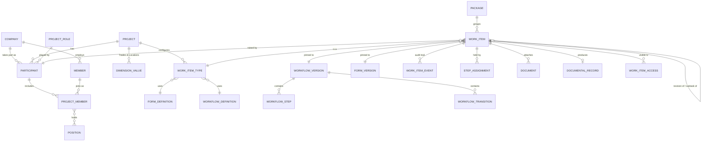

# Rabaed data model (Project Module, v1 draft)

The logical data model for the platform and the Project Module, in PostgreSQL terms. Names follow [GLOSSARY.md](../GLOSSARY.md). Schedule, Tendering and Financial are out of scope. Each Instance (standard / KSA) runs this same schema independently.

## Contents

Don't read this doc whole: find your heading with `grep -n '^#' docs/data-model.md`, then Read from that line with offset and limit; for one table, grep its name (`grep -n '\*\*work_item\*\*' docs/data-model.md`). `scripts/doc-index.test.ts` keeps this list in step with the headings.

- **Conventions**: read when you add any table or column: random ids, bilingual `i18n` values, the Library levels, no hard deletes, finding an `app.*` function's current body.
- **Core relationships**: read when you need the diagram of how the main tables relate.
- **1. Platform and tenancy**: read when you touch Companies, Members, or the row-level security every table has.
- **2. Projects and participation**: read when you work on Projects, Participants or Project Members.
- **3. Visibility, Trades, Locations, Scopes**: read when you work on Visibility Dimensions and what a Member's Visibility covers.
- **4. Engines: Forms, Workflows, Work Item Types**: read when you touch the tables behind Modules, Stages, Forms, Workflows and Work Item Types.
- **5. Work Items**: read when you touch the `work_item` table or what hangs off it.
  - **Creating a Draft**: read when you build something that creates a Draft: the code and `app.*` functions each path goes through.
- **6. Documents, signing, Documental Records**: read when you work on stored files, Signatures, Stamps or Documental Records.
- **7. Drawings, Markups, Pins**: read when you work on Drawings and what is drawn on them.
- **8. Files, Approved Suppliers, reports**: read when you work on the Files Module, the Approved Supplier List or reports.
- **9. Audit trail, notifications, admin**: read when you touch `work_item_event`, notifications or `admin_action`.
- **10. Access rules that cut across tables**: read when you need the full rule for seeing a Work Item, a file or an event, or write a row policy or a read of many items.
- **Settled points**: read when you hit a settled edge case: oversight, Snags assigned to a Contractor, and others.

## Conventions

- **IDs** are random UUIDv4 in every table: safe to expose, because they carry no time, and nothing to enumerate. Not UUIDv7, whose creation time would reveal when a Draft was started ([ADR 0015](adr/0015-random-ids-not-uuidv7.md)).
  Being random, an id never orders rows; it only breaks ties. Un-numbered Drafts (and items not yet Submitted) order by Subject, then id; Links by `created_at`, the linked item's Document Number, then id; Documents in upload order (`app.document_times`' `seq`: `confirmed_at`, file name, then id).
- **Bilingual content** entered by customers (names, labels) is stored as `i18n jsonb` (`{"en": "...", "ar": "..."}`), so further languages can be added without schema changes. UI strings are *not* in the database; they are translation keys (Lokalise).
- **Library pattern.** Forms, Workflows, Work Item Types, Positions, Trades and Scopes exist at three levels: `owner_kind ∈ {rabaed, company, project}` + `owner_id`. Using one always **copies** it down a level (`copied_from_id` keeps provenance). Nothing is linked live.
- **Nothing is hard-deleted.** Rows are deactivated, withdrawn, cancelled or closed.
- **Every table carries** `created_at`, `created_by`, `updated_at`. Change history for regulated tables goes to the audit log (§9).
- `→` means foreign key.
- **Finding a function's current body.** The `app.*` functions are redefined across many migrations (the newest by file name wins). `pnpm db:fn <name>` prints the newest definition and the migration and line it is in; `--list` shows every redefinition in order.

## Core relationships

---

## 1. Platform and tenancy

Tenancy is per Project (ADR 0007): every Project-owned table has `project_id` and a row-level-security policy that allows rows only for Projects the current Member participates in. Company-owned tables have `company_id` and a policy limited to the Member's own Company.

**company**
`id`, `legal_name i18n`, `cr_number` (unique), `vat_number` (unique), `status {active, suspended}`, `authorized_person_id → member` (exactly one; nullable only while onboarding), `onboarded_by → rabaed_engineer`, `logo_file_id → stored_file` (nullable: without one, records print the name), `stamp_file_id → stored_file` (nullable, but while it is null no Member of the Company can take a Transition; ADR 0023).
The Authorized Person uploads the logo and the Stamp in the Company profile. Like Signatures they are versioned through `stored_file` (a new upload is a new file), and each record's Record Data keeps the ones in force when the item closed.
As built (RP-617, `20270729000000_company_stamp.sql`): both columns are read like the rest of the row, by the Company's own Members only (`member_reads_own_company`), and the policy `member_reads_own_company_files` on `stored_file` lets them read the files in force, never one replaced, never another Company's. Only the Company's Authorized Person writes them, through `app.set_company_image(company, kind, storage_key, sha256, size, mime, now)` (`kind` is `logo` or `stamp`, PNG or JPEG): it locks the row, adds the `stored_file` row and points the column at it → `set` / `forbidden` (another Member of the Company) / `not_found` (another Company's Member, a made-up id, no acting Member). The api checks the image (its bytes are the type named, at most 1 MB; else `invalid_company_image`, 422, with nothing stored) before storing it under `companies/<company>/<logo|stamp>/<id>.<png|jpg>` (`PUT /v1/companies/:id/logo`, `/stamp`; read with `GET /v1/me/company`); the function refuses (22023, nothing written) a key outside `companies/<company>/<kind>/` or one with `..` (RP-632 review, `20270730000000_review_fixes.sql`), after `not_found` and `forbidden`. `app.member_company_has_stamp(member)` is `take_transition`'s Stamp check (workflow-engine.md §5.1 check 6), and the api's: granted to the app role since `20270730000000_review_fixes.sql`, as an invoker function it reads through row security, so it answers only for the acting Member's own Company (false for anyone else's). In the test database every Company gets a Stamp by default (`packages/db/test-support/test-defaults.ts`; `withoutStamp` opts out).

**member**
`id`, `company_id → company`, `email` (unique per Instance), `full_name i18n`, `phone`, `locale`, `status {invited, active, locked, deactivated}`, `can_create_projects bool` (= Project Creator).
A Member never moves between Companies. Changing employer means a new Member.

**credential**
`member_id` or `engineer_id` (exactly one), `password_hash` (argon2id, PHC string). Authentication is in-house (email + password); Members' MFA factors and lockout counters get their own table and columns later (Rabaed Engineers have them, below). The app role never reads it directly.

**session**
`token_hash` (SHA-256 of the random cookie token), `member_id`, `expires_at`, `revoked_at`. Server-side: signing out revokes the row. Members only: the customer api neither creates nor resolves a session for an Engineer (its `engineer_id` column is left from before ADR 0010).

**invitation**
`member_id`, `token_hash`, `invited_by_engineer_id` or `invited_by_member_id`, `expires_at`, `used_at`. One-time and expiring; accepting it sets the password and activates the Member.

**password_reset** (RP-1058, `20271021000000_password_reset.sql`)
`member_id`, `requested_at`, `token_hash` and `expires_at` (set together when the email is sent), `used_at`, `voided_at`. A forgotten password's emailed link: one-time, valid 30 minutes (`PASSWORD_RESET` in `@rabaed/domain`). No raw token is ever stored, not even in the outbox: `app.request_password_reset` writes the row with no token and an outbox row (kind `password_reset`, the row's id only), and the worker's handler (`@rabaed/db` password-reset.ts) mints the token as it sends the email, storing only its SHA-256 through `app.issue_password_reset`, in the handler's transaction (a failed send rolls it back; the retry mints a fresh one). The request answers `requested` for any email (the api pads every answer to the same time), and `too_many_attempts` past the per-email and per-visitor limits, which count every request alike (`password_reset_attempt`: SHA-256s of the normalised email and of the visitor's address, kept for the window only). Only an active Member of an active Company gets an email; a new request voids their unused links. `app.reset_password` spends the link, voids the Member's other links, sets the password, revokes every session of the Member and records the reset in **member_security_event** (`member_id`, `kind {password_reset}`, `at`; append-only, no token, no password). None of the three tables is granted to the app role or to `rabaed_admin`. Rabaed Engineers are out of scope (ADR 0010). The api: `POST /v1/password-resets` (202, or 429 `too_many_attempts`) and `POST /v1/password-resets/complete` (204 signed in, or 400 `invalid_reset_link` for an unknown, used, voided or expired link).

Identity tables record who created a row through `company.onboarded_by`, `invitation.invited_by_*` and `admin_action` instead of a generic `created_by`.

**member_signature**
`id`, `member_id`, `file_id → stored_file` (unique), `method {drawn, typed, uploaded}`, `active_from`, `active_to` (null while in force; at most one such row per Member, `member_signature_one_active`).
This table is versioned: every signing event points at the exact signature row that was in force, so replacing a signature never changes old records. Signing is blocked while a Member has no active row. Profile → Add Signature draws it (pen styles and colours), types it in a handwriting style, or uploads an image; each is stored as an image. As built (RP-85, `20270727000000_member_signature.sql`): the api checks the image (PNG or JPEG by its first bytes, at most 512 KB), stores it at `members/<member>/signatures/<id>.png|jpg` and calls `app.set_member_signature(storage_key, sha256, size, mime, method, now)`, which ends the row in force and adds the new one with its `stored_file`, under a lock on the Member's row. Read only by its own Member through the app role (row security; the policy `member_reads_own_signature_files` lets them read its `stored_file` rows too); the record job reads others' as the owner. The app role writes neither table. A row changes once, when replaced (`active_to` set), and is never removed (trigger `member_signature_versioned`). `GET /v1/me/signature` gives the Member's own with a short-lived link to the image; `PUT /v1/me/signature` saves a new one (`invalid_signature_image`, 422, for bytes that aren't the image named or are too large). `app.set_member_signature` refuses (22023, nothing written) a key outside `members/<member>/signatures/` or one with `..` (RP-632 review, `20270730000000_review_fixes.sql`). `app.active_signature_id(member)`, `take_transition`'s Signature check, is the api's too: granted to the app role since that migration, as an invoker function it reads through row security, so it gives only the acting Member's own (null for anyone else's). The demo seed gives every demo Member one.

**authorized_person_transfer**
`company_id`, `from_member_id`, `to_member_id`, `by_engineer_id`, `reason`, `at`.

## 2. Projects and participation

**project**
`id` (random UUIDv4, internal and used in URLs), `host_company_id → company` (whose subscription it counts against), `project_number` (per Host Company: 1, 2, 3…, unique `(host_company_id, project_number)`), `code` (short, editable, used in Document Numbers), `name i18n`, `status {active, closed}`, `closed_at`, `show_inspections_in_submittals bool` (default false; RP-652), `planned_completion` (date, nullable; shown as plain text, never counted down or flagged), `creator_member_id`, `record_language {ar, en, bilingual}` (default `bilingual`) and `record_hijri_dates bool` (default false), both set by a Project Admin and applying to records made afterwards (RP-151; below), `working_copy_watermark i18n` (default "Not Final / غير نهائي", never empty; the Project Admin sets it), `origin {direct, tender}`, `tender_ref` (nullable, future).
- `show_inspections_in_submittals` (RP-652): the Project's setting "Show Inspections in Submittals". On, the Project's Module tabs leave out Inspections and the Submittals tab's List, Kanban, Export and Submittals count also read the Inspections Module's Work Items (the work item query's `alsoModules`); a WIR sits in the same Stage group as a submittal of the same Stage key (the Inspections use the Submittals' Stage keys, ADR 0025; RP-674), the group named by the Submittals' Stage. The Module, its Document Numbers, Function Permissions, Workflows, Stages and item URLs are unchanged, and nothing reaches anyone it did not before: the merged read is the same RLS and `app.step_as_seen`. Every Participant reads the column with the Project row; the app role cannot write it. Written only through `app.set_show_inspections_in_submittals(project, show)` → `set` (also when the value is the same) / `not_found` (anyone but the Project's Project Admins, a made-up Project, a null value) / `project_closed`. A change is audited in `setup_event` (kind `project_setting`, type `show_inspections_in_submittals_changed`, payload `from` and `to`; RP-664), only when the value changes: the same value again and a refusal write nothing.
- `record_language` (`bilingual` default, `ar`, `en`) and `record_hijri_dates` (off by default) (RP-151): the language Documental Records are printed in and whether they show the Hijri date beside the Gregorian one. Every Participant reads both with the Project row; the app role cannot write them. Written only through `app.set_project_record_settings(project, language, hijri)` → `set` / `not_found` (anyone but the Project's Project Admins, a made-up Project, a language that is none of the three) / `project_closed`. The record job reads them when it makes the record, so a change applies to records made afterwards. The Working Copy's watermark text is RP-621's: `working_copy_watermark` (bilingual, each 1–60 characters after trimming), written only through `app.set_project_working_copy_watermark(project, text)` → `set` / `not_found` (anyone but the Project's Project Admins, a made-up Project, an empty or too long text) / `project_closed`, read by every Participant with the Project row.

**company_project_counter**
`company_id`, `last_project_number`. Incremented in the same transaction that creates the Project.

**project_admin**
`project_id`, `member_id`, `appointed_by` (member or engineer).

**project_role**
`id`, `owner_kind {rabaed, project}` + `project_id` (null for Rabaed defaults; the library pattern's `owner_id`, named for RLS), `base_role {contractor, consultant, owner, owner_representative}`, `name i18n`, `code`.
A custom role (Subcontractor, PMC…) must name a `base_role`. Permission checks cap at what the base role allows.

**participant**
`id`, `project_id`, `company_id`, `project_role_id`, `ordinal` (1, 2, 3… on the Project, set when it becomes Active; the Company segment of Document Numbers until numbering patterns), `code` (the Participant Code: 2–6 letters or digits, unique in the Project, null until set, when the ordinal stands in; stored in capitals, at least one letter so it never equals an ordinal; fixed once a number uses it or a starting number is set for a counter whose key holds it, recorded in `code_locked_at`, which may be set while the code is null: the position was fixed, so no code can be set (RP-311 review for a starting number; RP-508 for an issued number: a number whose pattern has the Participant segment sets it whether or not the code is null, and `20270120000000_order_fixes_code.sql` backfilled the Participants whose order earlier numbers printed); read with the Participant row, so only its own Company and the Project Admins see it, V15), `code_locked_at`, `status {invited, declined, invitation_withdrawn, active, withdrawn}`, `invited_by_member_id`, `invited_at`, `responded_at`, `withdrawn_at`, `withdrawn_by_member_id`.
Unique `(project_id, company_id)`. A Project Admin's Participant Invitation creates it Invited; the Company's Authorized Person accepts (Active) or declines it (ADR 0009). Invited and Declined rows are seen by nobody but the invited Authorized Person (their own pending invitations) and, as a CR number only, the Project Admins, to whom a Declined one still looks pending. A Project Admin may withdraw an Invited or Declined row (`invitation_withdrawn`, kept for audit and shown to nobody), exactly as they withdraw a lead (scenario 38); inviting the CR number again reopens the same row. Withdrawal of an Active Participant cancels the participant's in-progress Work Items in one transaction (§5).

**onboarding_lead**
`id`, `cr_number`, `project_id`, `project_role_id`, `requested_by_member_id`, `created_at`, `updated_at`, `converted_at`, `participant_id → participant`, `withdrawn_at`, `withdrawn_by_member_id`, `closed_at`. Unique `(project_id, cr_number)`.
A CR number a Project Admin invited that isn't on Rabaed. The Project Admin gets the same answer as for a Company that is, and sees it among their pending invitations by CR number; its details are read only through Rabaed Admin (V9).
When Rabaed onboards a Company with that CR number, each open lead becomes an Invited Participant on its Project, in the offered role, in the onboarding's transaction and `admin_action`. The Participant takes the lead's id and time, so the Project Admin's pending row doesn't change (scenario 31). The lead is then marked converted (`converted_at`, `participant_id`) and kept for audit. Inviting a CR number and onboarding its Company take the same lock on the CR number, so no lead is written after the conversion looked.
A Project Admin may withdraw a lead exactly as they withdraw an invitation to a Company on Rabaed (scenario 38): it leaves their list and Rabaed Admin's, and is never converted. Rabaed Admin may close a lead (`closed_at`, the reason in `admin_action`), which takes it off Rabaed's list only: the Project Admin's row doesn't change, and the lead is still converted if Rabaed onboards the Company after all. Inviting the CR number again reopens a withdrawn or closed lead; if Rabaed onboarded its Company in the meantime, the new invitation takes the withdrawn lead's id, so the row's id never shows that the CR number is now on Rabaed.

**project_member**
`id`, `project_id` (denormalised for RLS; must match the Participant's), `participant_id`, `member_id`, `status {active, removed}`, `removed_at`.
Removal never deletes access to what the Member signed (§10).
`app.member_project_counts()` (RP-413, the Members page): how many active Projects each Member of the caller's own Company is on, counting only active rows of an active Participant of that Company on an active Project. Only the count, never which Projects, and nothing of another Company (V15); no rows for a caller who isn't an active Member.

**position** / **position_permission** / **project_member_position**
- `position`: `id`, `owner_kind/owner_id`, `base_role`, `key` (stable, e.g. `project_manager`), `name i18n`, `sort`, `copied_from_id`. The walking skeleton has Rabaed Defaults only (no `owner_id`, no `copied_from_id` yet).
- `position_permission`: `position_id`, `permission {view, create, submit, review, approve, assign, close, attach}`, `module_key`, `work_item_type_id` (null = whole Module).
- `project_member_position`: `project_id`, `project_member_id`, `position_id` (many-to-many). Set by the Participant's Authorized Person; seen only by that Participant's Company (V14).
- The walking skeleton seeds Rabaed Default Positions only (e.g. Contractor Engineer, Contractor Project Manager) with Module-wide permissions (no `work_item_type_id` yet). The Owner and the Owner Representative each also have a **Project Manager** (`project_manager`: View, Review and Approve in the Submittals), the PM who confirms a Recommended Code in the Owner's review (ADR 0022; RP-593, `20270409000000_owner_review.sql`).

## 3. Visibility, Trades, Locations, Scopes

Trades, Locations and any future dimension share one generic structure, so adding a Visibility Dimension is data, not code.

**visibility_dimension**
`id`, `project_id`, `kind {trade, location, custom}`, `name i18n`, `required_on_work_items bool`.
Every Project gets `trade` (required) and `location` at creation, and the Trade "General" (code `GEN`, RP-627): `app.create_project_dimensions` adds it, as there is no Rabaed default Trade list table yet, and `20270914000000_site_observation_type_and_general_trade.sql` added it to the Projects that existed. A Form's `trade` field may carry `defaultCode` (the code of the Trade a new item starts on; the Site Observation Form names GEN): a starting choice the filler can change.

**dimension_value**
`id`, `dimension_id`, `parent_id` (Location tree: Zone → Building → Floor, three levels; flat for Trades), `depth`, `level_name i18n` (e.g. "Floor"), `code` (2–6 chars, used in numbering), `name i18n`, `copied_from_id` (Rabaed default Trade list), `sort`.

**location_shape**
`dimension_value_id`, `map_file_id → stored_file` (site map or plan image), `polygon jsonb`. Drives the Zone/Plan View.

**location_plan**
`dimension_value_id`, `drawing_id → drawing`. The plan Drawings of a Location, used for Pins.

**scope**
`id`, `project_id`, `trade_value_id → dimension_value` (a Trade of the Project), `parent_id` (null = Scope; set = Sub-scope, in its Scope's Trade), `name i18n`, `status {active, deactivated}`, `sort`. Two levels.
Only Project Admins add, rename and deactivate them; a deactivated one stays on the Work Items that use it. They are not a Visibility Dimension and never grant or restrict access. Built in RP-263; still to come: `code`, Rabaed defaults and the Company lists they are copied from (`owner_kind/owner_id`, `copied_from_id`, "pull updates").

**visibility_grant** / **visibility_grant_value**
- `visibility_grant`: `id`, `project_id`, `subject_kind {participant, project_member}`, `participant_id`, `project_member_id` (set for a Member's grant; `participant_id` is then their Participant), `dimension_id`, `is_all bool`. One per subject and dimension.
- `visibility_grant_value`: `grant_id`, `dimension_value_id`. Granting a Location includes its whole subtree, including Locations added under it later.
- No grant in a dimension covers nothing. A Member's `is_all` means all of their Participant's.

The rule "a Member's grant ⊆ their Participant's grant" is enforced on write: a wider Member grant is rejected, and narrowing a Participant stores each of its Members' grants as the intersection. A Member's effective Visibility (`app.my_visibility`) is also computed as that intersection. A **Visibility Gap** is a query: any dimension value (per role) that no active Participant covers.

## 4. Engines: Forms, Workflows, Work Item Types

**module**: fixed in code: `submittals, inspections, snag_list, site_reports, drawings`.

**stage**
`id`, `project_id`, `module_key`, `key` (stable, e.g. `pending_approval`), `name i18n`, `category {draft, in_progress, closed_positive, closed_negative, cancelled}`, `sort`.
This is the shared set per Module. Workflows reference Stages by `key`, so library Workflows work in any Project.
As built (RP-428, WF-5): `owner_kind {rabaed, project}`. Every Project has its own set per Module, copied from the Rabaed Defaults when it is created (trigger `project_stages`; existing Projects backfilled). An edit of the Rabaed Default Stages (Rabaed Admin, RP-443), a Stage added included, reaches only the Projects created afterwards (decided 2026-10-11, RP-528 review; `20270207000000_default_sets_reach_new_projects.sql` dropped the trigger `stage_rabaed_default_copied` that copied an added one into every Project); a migration that must give existing Projects a new Rabaed Default Stage calls `app.copy_rabaed_stages(project)` for each. A Stage's key moves only by migration, with `app.move_stage_key(module, from, to, name)` (RP-673, the migrator's alone): the Rabaed Default Stage and every Project's copy (a name a Project gave it is kept; where the set already has the new key, the old Stage is dropped), the Steps of every Workflow Version made for a Type of the Module, published ones included, and the items in it. Since ADR 0025 the Inspections Module's set is the Submittals keys (`pending_approval`, `approved`, `revise_resubmit`, `rejected`, moved from `pending_inspection`, `passed`, `failed`). A Rabaed Default Version with a Step in a Stage that an Active Project running that Rabaed Default lacks is refused at publish (`projects_lack_entries`, RP-566; as for outcomes, `outcome` below), and a Project Admin's binding that would put the Project, or one raising Participant, back on a Rabaed Default whose latest Version uses a Stage the Project lacks is refused `default_lacks_entries` (`app.bind_workflow`, `app.unbind_workflow`). Unique `(project_id, module_key, key)`. Every Member of the Project reads them (`member_reads_stages`: they are the Kanban columns everyone sees); the app role writes none. A Project Admin changes them only through `app.rename_stage`, `app.add_stage` (last in the order), `app.reorder_stages` (every key once) and `app.delete_stage`, each under a per-Project-and-Module advisory lock and audited in `setup_event`; outcomes `renamed` / `added` / `reordered` / `removed`, refusals `not_found` (not a Project Admin of it, an unknown Module or key: names nothing), `project_closed`, `invalid_name`, `invalid_stage`, `stage_exists`, `invalid_order`, `stage_in_use`. A Stage keeps its key and its category. A key is snake_case, at most 63 (`app.is_stage_key`, the same cases as `stage.ts` `stageKey`: `stage-key-cases.json`); the Modules are `app.module_keys()` (checked against `module.ts` by seam 2), which the Stage commands and the `module_key` checks of `stage`, `work_item_type` and `position_permission` read. `app.stage_in_use(project, module, key)`: a Step of a Version of one of the Project's own Workflows, or of the Workflow of a Work Item Type of that Module the Project can use, or of a Workflow the Project binds, or ever bound, a Type of that Module to (`workflow_binding_history`, RP-426; so a binding taken away still keeps the Stages of the items raised under it), has that `stage_key`; read from definitions only (which every Participant reads, ADR 0016), never from items. The List, the Kanban, the item page, the Dashboard, Need My Action and the weekly Step Age report read an item's Stage, its name, order and category from its Project's set; whether a Step is a Draft start (`app.is_draft_step`) from the set its Workflow is published against (the Project's for a Project's own Workflow, the Rabaed Defaults' otherwise). The api: `GET|POST /v1/projects/:projectId/modules/:module/stages`, `PUT …/stages/order`, `PATCH|DELETE …/stages/:key` (`ProjectStages`, with `canEdit` and each Stage's `inUse`). The Rabaed Defaults of Submittals: Draft (named "Drafts" until 2026-10-10), Internal Review, Pending Approval, Approved, Revise & Resubmit and (RP-433) Cancelled (`cancelled`, category `cancelled`), where a Cancel closes an item. The Rabaed Defaults of the Snag List (RP-434): Draft (`draft`), Open (`open`, in progress), Resolved (`resolved`, in progress) and Closed (`closed`, closed positive).

**form_definition** / **form_version**
- `form_definition`: `id`, `owner_kind/owner_id`, `name i18n`, `copied_from_id`. As built (RP-262), like `workflow_definition`: `owner_kind {rabaed, project}` with `project_id`; `copied_from_id` arrives with the library copy-down. RP-517: `owner_kind` also `company` (with `company_id`, a Form in a Company's Library, read by its Company only), and `work_item_type_id`, the Type a Form is made for (set on the Project's copy of a Company default). RP-554: a new item of a Type on a Project is pinned to the latest published Version of the Project's own Form for that Type, else of the Type's Rabaed Default Form (`app.new_item_form_version(project, type)`; form-engine.md §7 "Which Form a new item gets"). A published `form_version` never changes (a trigger refuses it to every role).
- `form_version`: `id`, `form_definition_id`, `version_no`, `status {draft, published}`, `schema jsonb`, `published_at`.
- `schema` holds the fields (type, `label i18n`, validation, options) and sections. It includes the field types `checklist`, `photo`, `boq_quantities` (future), `pick_list` (sources: Approved Supplier List, dimension values…) and `aggregate` (e.g. Weekly pulling totals from issued Dailies).
- Published versions are immutable.

**checklist_template**
`id`, `owner_kind/owner_id`, `name i18n`, `items jsonb`, `copied_from_id`. Copied into Forms, never linked (see form-engine.md §3).

**PDF layout** (no table): there is one Rabaed layout, shipped with the code (ADR 0023, form-engine.md §6), so `pdf_template` and `pdf_template_version` are dropped. `documental_record.layout_version` records which release of it printed a record. A Form Version's `pdf` block carries its `disclaimer {en, ar}` and `show_review_duration`. As built (RP-650): `formPdf` in `@rabaed/domain` (`form.ts`), optional in `formSchema`; it checks the two keys it reads and keeps the block's other keys (`header_fields`, print options) as they are; the Disclaimer is both languages or none, each 1 to 2,000 characters (`DISCLAIMER_MAX_LENGTH`); `show_review_duration` a boolean, off when left out. It lives in `form_version.schema` with the sections, so a published Version's never changes. Every Rabaed Default Form (`apps/admin/forms`: MAR, SAR, DAR, WIR, CMT, QST, SNG) carries a placeholder Disclaimer, "‹Disclaimer: the owner's text to come›", until the owner's text replaces it, with the review duration off; `pnpm defaults:publish` publishes them as their next Versions.

**workflow_definition** / **workflow_version**
- `workflow_definition`: `id`, `owner_kind/owner_id`, `name i18n`. As built (RP-426, ADR 0016): `owner_kind {rabaed, project, company}` with `project_id` or `company_id` (a Company's Library); no `copied_from_id`, since a copy is independent of its original. Read by every Member for a Rabaed Default, by the Project's Members for a Project's, by its own Company for a Library's (visibility.md V18, V20). `work_item_type_id` (RP-427): the Work Item Type it is made for, whose outcome set, Module Stages and Form its publish checks use; copied with it, and a binding names a Workflow of the bound Type. `default_key` (RP-596): names a Rabaed Default within its Type ("2-2", "1-1-owner"), unique per Type, null elsewhere; a Type has one Rabaed Default it runs (`work_item_type.workflow_definition_id`) and may have others, as the eight submittal Workflows (workflow-engine.md "The eight submittal Workflows"). Changed only through the authoring commands (workflow-engine.md §1 "Authoring").
- `setup_event` (RP-450): the one append-only record of setup changes, replacing `workflow_event` and `project_event`. `id`, `kind {workflow, form, screen, stage, outcome_set, company_default, checklist_template, project_setting}`, `type` (workflow: `duplicated`, `draft_saved`, `published`, `bound`, `unbound`; screen: `screen_created`, `screen_draft_saved`, `screen_published`; stage: `stage_added`, `stage_renamed`, `stages_reordered`, `stage_removed`; outcome_set: `outcome_added`, `outcome_changed`, `outcomes_reordered`; company_default: `default_set`, `default_cleared`, `defaults_applied`; checklist_template (RP-651): `checklist_template_created`, `checklist_template_edited`, `checklist_template_retired`; project_setting (RP-664): `show_inspections_in_submittals_changed`, `required_field_changed` (RP-1082 item 5); `form` has no type yet), `workflow_definition_id` (null when none, e.g. an unbinding), exactly one of `project_id` and `company_id` (a change to a Project's own Workflow names the Project), `actor_member_id`, `payload`, `created_at`. Every setup change writes exactly one row (a command that changes nothing, such as a retired template retired again or a setting set to the value it has, writes none), through `app.write_setup_event` (`app.write_workflow_event` and `app.write_project_event` are its older names). A trigger refuses UPDATE, DELETE and TRUNCATE to every role; the app role can't read or write it (it stays out of the **Activity Feed** until its audience rules are settled). A Rabaed Engineer's changes also keep their `admin_action` with a reason.
- `workflow_binding` (RP-426): `id`, `project_id`, `work_item_type_id`, `raising_participant_id` (null: the Type's Workflow on the Project; else an exception for items that Participant raises), `workflow_definition_id`. Unique per (Project, Type) and per (Project, Type, raising Participant). Names the Project's own Workflow or a Rabaed Default with a published Version (trigger `workflow_binding_checked`). Read by the Project's Members; an exception only by its Participant's Members and the Project Admins (V15). See workflow-engine.md §1 "Ownership and binding". Every Workflow a Project ever bound a Type to is kept in `workflow_binding_history` (`project_id`, `work_item_type_id`, `workflow_definition_id`, `first_bound_at`; written by trigger `workflow_binding_recorded` for every writer, never removed, read by `app.stage_in_use` only: the app role reads none of it).
- `workflow_change_note` (RP-555): `workflow_version_id` (primary key), `change_note text` (1 to 1000 characters), `created_at`. The Change Note written when the Version was published (`app.publish_workflow_with_change_note`; Rabaed Admin's `app.mark_workflow_published_with_change_note`), shown in the Versions history. Append-only; a table of its own because a published Version never changes, and read by the Workflow's authors only (`app.can_author_workflow`), never by every Member who reads the Version (visibility.md RP-555-1).
- `workflow_version`: `id`, `workflow_definition_id`, `version_no`, `status {draft, published}`, `layout jsonb` (React Flow node positions only), `published_at`. Published versions are immutable. `draft_name i18n` (RP-427): a draft's new name for the Workflow, given to `workflow_definition.name` when it is published and then cleared, so nobody but the draft's authors reads it before (V20). A definition with no published Version is read by its authors only.

**workflow_step**
`id`, `workflow_version_id`, `key`, `name i18n`, `stage_key`, `actor_rule jsonb` (its old `is_signing` dropped by RP-85: every Transition is signed, ADR 0017), `outcome_mode {none, recommend_code, issue_code, inspection_result, confirm_code}` (`confirm_code`: the Owner's review, which issues the Code Recommended to it, ADR 0022, RP-593), `edits_form bool` (nullable), `drafts_visible_to {company, author}` (nullable), `after_send_back {comment, edit_form}` (nullable).
- `edits_form` (RP-514, ADR 0019): whether the raiser's Form is edited at the Step, by the Member holding it, before the first Submit (or at a Step a Send Back leads to). Null is the default, `app.step_edits_form`: a Step of the Draft Step's role held with the Draft Step's Function Permission (form-engine.md §4).
- `drafts_visible_to` (RP-514, ADR 0019): on the Draft Step only; null is `company`. `author`: a Draft is seen by the Member holding it alone (visibility.md V1).
- `after_send_back` (as built, RP-580; ADR 0021): on a raiser's Step a `send_back` leads to, what the raiser may change after a Send Back to it, until the next Submit: `comment` (nothing of the Form) or `edit_form`. Every Version saved or published since RP-580 sets it there (`comment` when left out; `app.publish_workflow_draft` fills it on every publish); null, only on Versions published before, is `edit_form` (form-engine.md §4).
- `actor_rule` says who can hold the Step: base role or project role (`base_role`), or the raiser whatever its role (`{"raiser": true, …}`, RP-622, workflow-engine.md §3.1), required permission (e.g. `approve`), and optional default assignee resolution. The Participant is resolved at runtime from the item's Visibility values; that is how "Electrical goes to Consultant A" works.
- `issue_code` marks the final review Step.

**workflow_transition**
`id`, `workflow_version_id`, `key` (stable within the version, e.g. `send_for_review`), `from_step_id`, `to_step_id`, `label i18n`, `kind {send, submit, return, close, cancel}`, `outcome` (nullable: a closing outcome code of the Work Item Type's set, **outcome**; required when `to_step` is terminal; RP-429), `permission`, `offers_assign_to bool`, `condition jsonb`, `action_form jsonb`, `notifications jsonb`.
- `kind = submit` marks a hand-over between Participants.
- `condition`: routing on Form field values, e.g. `cost_impact > 500000`. As built (RP-430, WF-7): there is no `condition` column; the routing condition is a Restrict rule in `rules`.
- `rules` (RP-430, WF-7): `{ "restrict": [...], "validate": [...] }` as the definition format has them (`transitionRules`, `workflow-definition.ts`); null when the Transition has none. Read at run time by `app.transition_rules` (workflow-engine.md §4, §5.1). Every Member reads it with the Workflow (ADR 0016).
- `action_form`: the pop-up form schema, e.g. pick a Review Code, comments, files.
- `offers_assign_to`: as built (RP-431, WF-8), there is no such column; "Assign to" is an action in `actions`.
- `actions` (`jsonb` array, null for none; RP-431, WF-8): what taking the Transition does besides moving the item, as the definition format has them (`transitionAction`, `workflow-definition.ts`): `{"type": "offer_assign_to"}`, `{"type": "set_field", "field": "<key>", "value": <text, number, yes/no> | {"now": true}}`, `{"type": "copy_field", "from": "<key>", "to": "<key>"}`. Applied at run time by `take_transition` (`app.assignees_offered`, `app.transition_actions`; workflow-engine.md §3.3, §5.1). Every Member reads it with the Workflow (ADR 0016).
- `notifications` (`jsonb` array, null for none; RP-432): whom the Transition notifies besides the next holder or Step Pool, in-app always and email by each Member's own settings: `{"to": "holder"}`, `{"to": "raiser"}`, `{"to": "watchers"}`, `{"to": "position", "position": "<key>"}` (a Position of the acting Participant). Never a person, a group or an email address. Delivered by the watched-item path (`app.transition_notice_members`) for every move the Transition makes, whatever its event's type (`transition`, or `issue_code` for a Code issued); each recipient is checked again at send time.
- `notifications`: who gets what, on which channel.
- `screen_key`, `screen_version_id` (RP-516, ADR 0019): the Screen the Transition shows, by key (null: its own `action_form`), and the Screen Version publishing pinned (`app.workflow_screens`: the owner's Screen with that key, else the Rabaed Default's), whose schema is copied into `action_form` and frozen with the Version (workflow-engine.md §5.7).

**screen** / **screen_version** (RP-516, ADR 0019)
- `screen`: a named, reusable Action Form. `id`, `owner_kind {rabaed, project, company}` with `project_id` or `company_id` (the library pattern, like `workflow_definition`, ADR 0016), `key` (snake_case, unique per owner: what a Transition names), `name i18n`, `created_at`, `updated_at`. A Project's Screens are edited by its Project Admins; a Company keeps them in its Library.
- `screen_version`: `id`, `screen_id`, `version_no`, `status {draft, published}` (at most one draft), `schema jsonb` (an Action Form schema, checked as `action_form` is), `internal_fields text[]` (the keys of the answer fields internal to the acting Participant; every other field is shared), `published_at`. A published Version never changes (`screen_version_published_frozen`).
- Read like the Workflows that use them (visibility.md V20, V18): published only, a Screen with none by its authors only. The app role writes neither table; the commands are `app.create_screen`, `app.save_screen_draft`, `app.publish_screen`, audited in `setup_event`.
- `company_default` (RP-517): `id`, `company_id`, `work_item_type_id`, `kind {form, workflow, screen}`, exactly one of `form_definition_id` / `workflow_definition_id` / `screen_id` (the one of its kind), `created_at`, `updated_at`; unique `(company_id, work_item_type_id, kind)`. Read by the Company's own Members; the app role writes it only through `app.set_company_default` and `app.clear_company_default` (the Authorized Person), audited in `setup_event`. `app.create_project` copies a Company's defaults into each Project it creates (workflow-engine.md "Company defaults").
- A reply's internal answers are a `work_item_event` of type `internal_answers` (payload `{"answers": {...}}`), internal to the acting Participant and carrying the Transition's id; its shared answers stay in the Transition event's payload (V5).

**work_item_type**
`id`, `project_id`, `module_key`, `code` (MAR, SAR, DAR…), `name i18n`, `form_definition_id`, `workflow_definition_id`, `outcome_kind {review_code, inspection_result, approval, none}`, `expected_frequency {none, daily, weekly, monthly}`, `allows_subtasks bool`, `copied_from_id`.
New items use the latest *published* versions of the Form and Workflow at creation time. `workflow_definition_id` is the Type's Rabaed Default; a Project's `workflow_binding` overrides it for that Project's new items (RP-426). As built (RP-429): `outcome_kind` only names the Rabaed Default outcome set a new Type starts with; its outcomes are then its own (**outcome**). The Rabaed Default Types: the Submittals Module's three, MAR Material Approval Request, SAR Supplier Approval Request and DAR Document Approval Request (`review_code`; RP-590 renamed the SAR and DAR, which began as "Shop Drawing Submittal" and "Document Submittal", codes unchanged, as Shop Drawings belong to the Drawings Module); WIR, the Work Inspection Request (Inspections, `review_code` since ADR 0025: RP-673 added Codes A–D before its Passed, Passed with Comments and Failed, kept for the WIRs on Workflow Versions 1 and 2); and (RP-434) CMT, the Comment (Snag List, `none`), whose items Code B's rows make (workflow-engine.md §6; RP-668: `raised_from_item_only bool`, true for CMT, marks a Type created only from another item: `GET …/raisable-types` and the new-item Form leave it out, and `app.create_work_item` refuses it `type_not_found`, while Code B's follow-up path inserts its items itself); and (RP-90) SNG, the Snag (Snag List, `none`), raised by the Consultant on the Contractor covering it (workflow-engine.md §6, "The Snag Type as built"). New item's Type picker lists the Submittals Types the viewer's Participant may raise (`GET /v1/projects/:projectId/raisable-types`): each has a published Workflow bound for that Participant (`app.new_item_workflow_version`) whose Draft Step their base role holds, the MAR first; the Type is in the URL (`?type=`). `position_permission` gives the Rabaed Positions their Snag List permissions: the Contractor's `view`, `submit` and (RP-90) `create`, `close`, `attach`; the Consultant's `view`, `create`, `close` and (RP-90) `attach`; the Owner's and Owner Representative's `view`. The Snag List's Rabaed Default Stages (**stage**): Draft, Open, In Progress, On Hold (RP-90, `in_progress`), Resolved, Closed.

**outcome** (RP-429, WF-6; glossary Outcome)
A Work Item Type's outcome set: `id` (random), `owner_kind {rabaed, project}`, `project_id` (null for a Rabaed Default), `work_item_type_id`, `code` (a letter, then letters, digits or `_`, ≤ 32; never `cancelled`, `pending` or `in_preparation`: `app.is_outcome_code`; its follow-up actions `app.is_outcome_actions`; both run over `outcome-cases.json` with `outcome.ts`), `name i18n`, `closing bool`, `polarity {positive, negative}`, `actions jsonb` (follow-up actions, each kind once: `{kind: create_items, type: <Type code>}`, `{kind: offer_revision}`, `{kind: offer_replacement}`; `app.is_outcome_actions`), `sort`, `created_at`, `updated_at`. Unique `(work_item_type_id, code)` for a Rabaed Default, `(project_id, work_item_type_id, code)` for a Project's. `@rabaed/domain`'s `outcome.ts` is the TypeScript side (`outcomeSchema`, `defaultOutcomeSets`).
- **Rabaed Default sets** (`app.default_outcomes(kind)`, seam-2 `outcome-sets.test.ts` checks it equals `defaultOutcomeSets`): `review_code` A Approved (+), B Approved with Comments (+, create items of `CMT`, WF-11), C Revise and Resubmit (−, offer a Revision), D Rejected (−, offer a replacement, WF-12); `inspection_result` Passed (+), Passed with Comments (+; creating Comments, as Code B does, is to come), Failed (−); `approval` Approved (+), Rejected (−); `none` Closed (+). All closing.
- **Seeding**: a new Type gets the set of its `outcome_kind`, owned as the Type is (trigger `work_item_type_outcomes`); a new Rabaed Default Type's set is also copied into every Project then, so a Project can run the Type at once. A new Project copies them all (trigger `project_outcomes`), so every Project runs its own copy of each Rabaed Default Type's set, as it runs its own Stages. Backfilled for existing Types and Projects. An edit of a Rabaed Default set (Rabaed Admin, RP-443: an outcome added, a name or follow-up action changed, the order) reaches only the Projects created afterwards; no existing Project's copy changes (decided 2026-10-11, RP-528 review; the trigger `outcome_rabaed_default_copied` that copied an added outcome into every Project is dropped). So a Rabaed Default Version whose Transition sets an outcome that an Active Project running that Rabaed Default has no closing outcome of in its copy is refused at publish, `projects_lack_entries` with how many Projects and which outcomes, never which Projects, and logged in `admin_action` as `refuse_workflow_publish` (RP-566, `projectsLackingOutcomesAndStages`; workflow-engine.md "Rabaed Admin -> Workflows"); its Project Admin adds the outcome first. Likewise a Project Admin's binding that would put the Project, or one raising Participant, back on such a Rabaed Default is refused `default_lacks_entries`, naming the Project's own missing outcomes and Stages (`app.binding_lacks_entries`, to its Project Admins only).
- **Visibility**: read like the Type (`member_reads_outcomes`, the rule of `member_reads_work_item_types`): a Rabaed Default set by every Member, a Project's copy by its Project Members only. The app role writes none.
- **Commands** (Project Admin, the Project's copy only; a Rabaed Default set changes only in Rabaed Admin, as Seeding says, reaching only the Projects created afterwards): `app.add_outcome(project, type code, code, name, closing, polarity, actions)` (last in the order), `app.change_outcome(project, type code, code, name, actions, new code, closing, polarity)` (the last three null: kept; decided 2026-10-09: code, closing and polarity change only while the outcome is unused, `app.outcome_in_use`: no closing Transition of a published Version the Project's items can run names it, i.e. the Project's own Workflows, the Rabaed Defaults for the Type, the Type's default Workflow and every Workflow the Project ever bound the Type to; read from definitions only, never from items, since whether a hidden item closed with it would leak to a Project Admin not on its Documental Record, and an item's outcome only ever comes from such a Transition, so an unused outcome closed no item; refused `outcome_in_use`, the api 409 with an English and Arabic message; a change of them is audited with `code`, `closing` and `polarity` in the event's `from` and `to`), `app.reorder_outcomes(project, type code, codes)` (every code once). The Type is the Project's own of that code, else the Rabaed Default (`app.project_type_id`). Each under a per-Project-and-Type advisory lock and audited in `setup_event`; outcomes `added` / `changed` / `reordered`, refusals `not_found` (not a Project Admin of it, a Type the Project doesn't use, a code the set lacks: names nothing), `project_closed`, `invalid_outcome`, `outcome_exists`, `invalid_order`, `outcome_in_use`. Nothing deletes an outcome.
- **Reads of follow-up actions**: `app.outcome_offers(project, type, code, action kind)` (invoker), `app.work_item_outcome_actions(item)` (the actions of the outcome a closed item ended with, for a caller who sees it; `[]` otherwise), `app.can_create_revision` (an outcome offering a Revision, Code C).
- The api: `GET|POST /v1/projects/:projectId/work-item-types/:type/outcomes` (`TypeOutcomes`, with `canEdit`), `PUT …/outcomes/order`, `PATCH …/outcomes/:code`; `invalid_outcome` 422, `outcome_exists` 409, `invalid_order` 422, anyone else the plain 404.

**step_default_holder**
`project_id`, `participant_id`, `work_item_type_id`, `step_key`, `member_id`. Set by each Participant for its own Steps.

**project_required_field** (Required links; as built, RP-82; form-engine.md §2.13)
`project_id`, `work_item_type_id`, `field_key`, `set_by_member_id`, `set_at`; primary key `(project_id, work_item_type_id, field_key)`. One row while a Project makes a link question (`work_item_ref`) of one of its Types required on its items, such as the WIR's Approved submittals; turning it off deletes the row. Every Project Member of every Participant reads the Project, Type and key (V20); the app role reads no one who set it, nor when. Written only through `app.set_project_required_field(project, type code, key, required, now)` → `set` (also when it already was so) / `not_found` (anyone but the Project's Project Admins, a null value) / `project_closed` / `type_not_found` (the Type is `app.project_type_id`'s). A change is audited in `setup_event` (kind `project_setting`, type `required_field_changed`, payload `work_item_type_id`, `field_key`, `from`, `to`; RP-1082 item 5), only when a row is added or deleted: the same value again and a refusal write nothing. The API checks the key is a link question of the Form a new item of the Type gets there (`field_not_found`, 422), and reads the Form of the Project's items of the Type with it required (`requiredByProject`). API: `GET|PUT /v1/projects/:id/required-fields`.

**checklist_template** / **checklist_template_version** / **work_item_checklist** (Checklist Templates; as built, RP-651; form-engine.md §3.2)
- `checklist_template`: `id`, `project_id`, `version_no` (its latest Version, the one a new pick copies), `status {active, retired}`, `created_by_member_id`, `created_at`, `retired_by_member_id`, `retired_at`. `checklist_template_version`: `id`, `checklist_template_id`, `project_id`, `version_no` (unique per template), `name i18n`, `trade_value_id` (a Trade of the Project), `items jsonb` (1 to 100 check items: `checklistTemplateItems`, the RP-285 item shape plus `on_negative {none, create_snag}`, `create_snag` by default), `created_by_member_id`, `created_at`; never changed or deleted (a trigger refuses it to every role). Every Project Member of every Participant reads the content columns of both (V20); the app role reads no one who wrote or retired one, nor when.
- Written only through `app.create_checklist_template(project, name, trade, items, now)` → `created` (with the id) / `not_found` (anyone but the Project's Project Admins) / `project_closed` / `trade_not_found`; `app.edit_checklist_template(template, name, trade, items, now)` → `edited` (its next Version) / `not_found` / `project_closed` / `template_retired` / `trade_not_found`; `app.retire_checklist_template(template, now)` → `retired` (also when it already was) / `not_found` / `project_closed`. Each audited in `setup_event` (kind `checklist_template`). The API checks the items' shape. API: `GET|POST /v1/projects/:id/checklist-templates` (`ChecklistTemplates`, each template's latest Version, with `canEdit`), `PUT /v1/checklist-templates/:id`, `POST /v1/checklist-templates/:id/retire`; `trade_not_found` 422, `template_retired` 409, anyone else the plain 404.
- `work_item_checklist`: `work_item_id`, `field_key` (the `checklist_template` field), `checklist_template_version_id`, `name i18n` and `items jsonb` copied from that Version, `copied_at` (audit only, not granted); primary key `(work_item_id, field_key)`. Read by whoever sees the item (`app.sees_work_item(work_item_id)`, §10 rule 7). Written only by `app.sync_work_item_checklists(item, now)`, which the API calls in the same transaction as every create and Save draft of an item whose Form has such a field: for the Member who may save the item's answers now (`app.can_save_answers`, else `not_editable`), a copy follows its answer (kept while it names the same Version, replaced by a new pick, deleted with the answer); after the item's first Submit replacing or deleting a copy is `checklist_fixed`, while a missing one is filled in (no change of the pick); a new copy takes only the latest Version of an active template of the Project for the item's Trade, read under a share lock on the template (RP-651 review, `20270716000000_checklist_templates_review_fixes.sql`), or, on a Revision, the Version the item it revises holds; anything else is `template_not_found`. The api also calls it when a Revision is created and before a forward Transition by a Member who may save. The item read carries it as `checklistCopies`.

**reply_checklist** (a reply Screen's checklist answers until its Transition; as built, RP-86; form-engine.md §3.3, workflow-engine.md §5.7)
`id`, `project_id`, `work_item_id`, `field_key` (the Screen's `copied_checklist` field), `answers jsonb` (by check item, as the api checked them; an item that raises a Snag keeps `"snag": false` when its "Raise a Snag" tick was taken off, RP-577), `participant_id` (the holding Participant that fills it), `updated_by_member_id` and `updated_at` (audit only, not granted), `reply_event_id` (the Transition's event that took it; deferred foreign key). One row waiting per item and field (`reply_checklist_waiting_key`, where `reply_event_id` is null); each Transition taken keeps its own. The app role reads `work_item_id`, `field_key` and `answers` of the rows waiting, and only as a Member of the Participant holding the item (`app.holds_work_item`, V19); once taken, the Transition's event shares the answers. Written only by `app.save_reply_checklist` (and the triggers that take or discard it, workflow-engine.md §5.7). `document.reply` rows may now name an `item_key` (a check item's photo; `document_reply_has_field`).

**outbox**
`id`, `kind` (`notification`, `email`, `digest`, `step_age_report`, `documental_record` (RP-620, §6), `record_ready` and `documental_record_reproduce` (RP-155, §6), `working_copy` (RP-621: a Working Copy a Member asked for, payload `{working_copy_id}`, §6) as built; package_recompute… to come), `project_id` (null for a row that spans Projects, such as a Member's daily digest), `payload jsonb` (ids only, never customer text), `created_at`, `available_at` (next due), `processed_at`, `last_failed_at` (when an attempt last failed, set with `last_error` by `app.outbox_failed`; RP-670), `attempts` (failed attempts: counted when a row is taken, in its own committed step, and given back when the attempt succeeds, so a worker that dies in the handler still spends one; RP-958. While a handler runs, or after its worker died, it includes the attempt in flight, as the Job Monitor shows it, RP-670), `last_error`, `dead_at` (dead-lettered after the last attempt). Written in the same transaction as the command that caused it, or by a scheduled job; the worker takes one due row at a time (`FOR UPDATE SKIP LOCKED`), pushing its `available_at` back by the attempt's backoff, then runs it in a second transaction holding the row's lock (workflow-engine.md §5).

**scheduled_job_run** (RP-358)
`job` (primary key, e.g. `daily_digest`), `run_at` (the latest run time it ran for), `ran_at`. The worker's only: no grant to the app role. The worker works out a job's due run time from its schedule (`dueRun` in `@rabaed/domain`) and claims it with `app.claim_scheduled_run(job, run_at)` in the transaction the job runs in, so a run time runs once however many workers poll, and a failed job runs again.

**numbering_pattern**
`id`, `project_id`, `work_item_type_id` (null = Project default), `segments jsonb` (≤ 6 of: project code, type code, trade, participant code, location level, custom literal), `separator` (`-` or `/`), `seq_digits (3–7)`, `seq_scope jsonb` (the positions, from 0, of the segments the counter counts separately for), `shared_counter_accepted_at` (required when `seq_scope` leaves out the participant code; the setter is the one who accepts), `set_by_member_id` or `admin_action_id`, `effective_from`, `follows_project` (a Work Item Type's row saying the Type uses the Project pattern again from then; its pattern columns are null). Project Members read their Project's patterns; a Project Admin saves one through `app.set_numbering_pattern`, in effect from then. Rows are never changed or deleted: each is a version, read with who saved it through `app.numbering_pattern_versions` (RP-412 rebuild; the saver's Company per V15, the person within the reader's own Company only, V14). The Numbering page calls a Type's pattern its **Custom pattern**.
A pattern change creates a new row, and old numbers stay as issued. No row means the Rabaed Default: project code, type code, participant code, sequence of 4, counted by all three (settled 2026-10-05). The number is built by `app.document_numbering`, the database's copy of `documentNumbering` in `@rabaed/domain` (the web's live example); the two must agree.

**numbering_counter**
`project_id`, `counter_key` (resolved prefix), `last_value`, `starting_value` (set when created ahead; it has issued nothing while `last_value = starting_value - 1`).
Incremented with `INSERT … ON CONFLICT DO UPDATE … RETURNING` (the first number creates the row) in the same transaction as the first Send or Submit, so there are no gaps and no reuse.
The key is the values of the pattern's counted segments joined by `-`, whatever the separator; under the Rabaed Default `<project code>-<type code>-<Participant Code or ordinal>`, so each Participant counts on its own (e.g. `TWR-MAR-01-0001`). A new pattern counting by the same values continues the same counter. A counter can be created ahead with a starting `last_value` by a Project Admin or Rabaed Engineer, only while it has issued nothing; doing so fixes the Participant Code its key holds. A value whose number the Project already used (another counter built it, after a pattern change) is skipped at issue, never issued (RP-311 review). Only Project Admins and Rabaed Engineers read counters.
A number names the Trade and Location it was issued with, so those never change afterwards (RP-581, ADR 0021): `app.number_fixed_fields(work_item_id)` reads the pattern in effect at the item's `numbered_at` and returns `trade` and/or `location` when its segments hold a Trade or a Location level; `app.check_work_item_built_ins` then refuses a changed value as `number_part_fixed`.

**command_idempotency**
`member_id`, `key`, `project_id`, `work_item_id`, `command`, `created_at`. Primary key `(member_id, key)`. Written in the same transaction as the command; the same key again applies nothing. No read policy: the app role reads it only through `app.command_keys_used(keys)` (RP-646, `20270817000000_bulk_transitions.sql`), how many of `keys` the caller has already applied a command under, never which item or command.

## 5. Work Items

**work_item**

| column | notes |
|---|---|
| `id`, `project_id`, `work_item_type_id` | |
| `raised_by_participant_id`, `created_by_member_id` | |
| `title`, `data jsonb` | Form answers, validated against `form_version.schema`. Read only through `app.work_item_answers` (§10) |
| `form_version_id`, `workflow_version_id` | pinned forever |
| `created_at` | when the Draft was started: kept for audit, shown to nobody, also for a cancelled or discarded Draft. A Work Item is never deleted. As built (RP-334): not granted to the app role, nor is the item's `created` event (same time) readable through it |
| `document_number`, `numbered_at` | null while Draft; set at first leaving Draft. `numbered_at` is the **Creation Date**, shown only to the raiser's Participant: not granted to the app role, read through `app.work_item_creation_date` (RP-334) |
| `submitted_at` | the **Submission Date**: the first Submit out of the raiser's Participant; never changes, also after a Send Back. Link search and Linked from offer only items that have it (`app.work_item_submitted`, `app.work_item_linked_from`; RP-309), also while Sent Back to the raiser, and Link search lists the latest first. An item that has it stays visible at its raiser's Steps after a Send Back (`app.sees_work_item`, V1). Granted to the app role: everyone who sees the item reads it (RP-334) |
| `arrivals` | how many times the item has arrived at a Participant or closed: the trigger that clears `data_as_arrived` adds one. A Document or Link added during the current arrival is the holding Participant's until the item leaves (`app.item_row_seen`, V19). Never granted to the app role (RP-309) |
| `built_ins_as_arrived jsonb` | as built (RP-582; ADR 0021, visibility.md V19): `{"dimensions": {<dimension_id>: <value_id>}, "scopes": [<scope_id>]}`, the item's Trade, Location and Scopes as they were when it arrived at its holder, taken by `app.set_work_item_built_ins` before the first change of a Submitted item (only the raiser, after a Send Back to an "Edit the Form" Step) and cleared with `data_as_arrived` when it leaves. While set, everyone but the holder's Participant reads these values: `app.sees_work_item` (layer 4), the views `work_item_dimension_value_seen` and `work_item_scope_seen`, the search index; the policies on `work_item_dimension_value` and `work_item_scope` show the rows as they are now to the holder's Participant only. Granted to the app role: it holds only what everyone who sees the item saw at the Send Back |
| `revision_no` (0 = original), `revision_of_id`, `root_id` | Revision chain; display `MS-003 Rev 1`. `root_id` is an original's own id; unique `(root_id, revision_no)` among rows not discarded. The app role reads `revision_no` only (RP-316); the chain through `app.revision_chain` (RP-318), and the List's one row per chain through `app.latest_visible_revision(item)`: whether it is the latest Revision of its chain the caller sees (RP-345) |
| `discarded_at` | a discarded Draft: closed `cancelled`, its access rows removed, seen by nobody. A Draft Revision (RP-316, `app.discard_revision`) or, from RP-409, any Draft that never left Draft (the List's Delete, `app.discard_draft`, below); check `work_item_discarded_closed`: a discarded row is closed |
| `duplicated_from_id`, `duplicate_member_id`, `duplicate_key` | the List's Duplicate (RP-409): the item a Draft was duplicated from, and the duplicating Member and their request key. Not granted to the app role. One live Draft per (`duplicate_member_id`, `duplicate_key`) (unique index `work_item_duplicate_key`, where not discarded), so a repeated request answers with the same Draft; a discarded one frees its key. No time: it never tells when the Draft was started (scenario 61) |
| `parent_id` | Subtask; check: parent's `parent_id` is null |
| `package_id` | nullable: its Package, at most one (RP-636). Never granted to the app role: another Company sees the owner's Submitted items, and their `package_id` would tell of a Package it may not see. Read through `app.work_item_package`, written only by the Package functions (below) and two triggers (RP-642): a Revision takes its `revision_of_id` item's before insert (`app.revision_joins_package`), and a replacement the replaced item's when its `replaces` link is written (`app.replacement_joins_package`, after insert on `work_item_link`) |
| `import_id` | the Submittal Register Import that created the Draft (RP-637, §8 `submittal_register_import`); null otherwise. Never granted to the app role |
| `paper_ref` | the **Paper ref** (as built, RP-639, spec RP-631 story 27): the old paper number of a submittal still under review on paper, brought in by a register import or typed by the raiser; never a Document Number. Trimmed, at most 100 characters, null when none. One per Participant on a Project among items not discarded, whatever the case (unique index `work_item_paper_ref_key`). Granted to the app role: everyone who sees the item reads it, as the Subject. Written only by `app.confirm_register_import` and `app.set_work_item_paper_ref(item, paper ref, now)` → `saved` / `not_found` (an item the caller doesn't see) / `project_closed` / `not_editable` (numbered, past its Draft Step, or the caller may not edit it now, `app.can_save_answers`) / `paper_ref_too_long` / `paper_ref_taken`, so it never changes once Submitted. API: `PUT /v1/work-items/:id/paper-ref`; the List's search finds it |
| `current_step_id`, `current_stage_key`, `step_entered_at` | `step_entered_at` feeds **Step Age** inside the holding Participant |
| `participant_entered_at`, `participant_entered_step_id` | when, and at which Step, the item reached the holding Participant (or closed): what every other Company sees (V14) |
| `outcome` | a closing outcome of its Type's set on its Project (**outcome**), or `cancelled`; null while open. Trigger `work_item_outcome_in_set` refuses any other, whoever writes it (RP-429) |
| `recommended_code` | not a column (RP-433): every Participant that sees the item reads its row, so the Recommended Code lives only in its `recommend_code` event, internal to the recommender's Participant (V5); the latest such event is the current Recommended Code |
| `closed_at` | set with `outcome`. The Kanban's closed columns hold the items closed in the last 30 days (RP-349) |

**The List's row commands** (as built, RP-409, `20270117000400_list_row_commands.sql`; workflow-engine.md §5.7; visibility.md Exports row, scenarios RP-409-1 to RP-409-3), all security definer, each checking `app.sees_work_item` first:
- Delete: `app.can_discard_draft(item)` (never numbered, still at its Draft Step, on an active Project, and the caller may edit it now, `app.can_save_answers`) and `app.discard_draft(item, now)` (`discarded`, `not_found`, `project_closed`, `not_discardable`): a `cancelled` event internal to the raiser's Participant (`payload.draft_discarded`), the assignment done, `outcome = cancelled`, `closed_at` and `discarded_at` set, and its `work_item_access` rows deleted. The row stays for audit.
- Duplicate: `app.duplicate_of_key(key)` (the caller's live Draft for that request), `app.record_duplicate(draft, source, key)` (`recorded` or `not_found`; only on a Draft of the caller's own Participant with no source yet), `app.own_written_fields(item)` (the keys of the fields whose last writer is of the caller's own Participant, from the never-granted `work_item.field_times`; nothing else of the times or writers), `app.copy_duplicate_documents(draft, source, field_keys, now)` (copies the Documents and photos the caller's own Participant uploaded, as the caller reads them, as new rows uploaded now by the caller, and returns the storage keys for the api to copy the files) and `app.work_item_duplicated_from(item)` (the source's Document Number and Subject, to the raiser's Participant only, no time).
- Download, the item as shared, the same for every viewer: `app.work_item_shared_answers(item)` (the answers as they last arrived, never a `member` answer, a `participant` answer only for a Company everyone who sees the item reads, `app.shared_company`, a link question by number and Subject only, leaving out an unshared item of its own chain, `app.chain_item_unshared`), `app.work_item_shared_named_answers(item)` (the Companies those answers name), `app.work_item_shared_stage(item)` (the Stage every Company but the holder reads), `app.work_item_shared_documents(item)` and `app.work_item_shared_links(item)` (as of the last arrival). Each answers nothing before the first Submit.

**work_item_dimension_value**
`work_item_id`, `dimension_id`, `dimension_value_id`. Exactly one value per dimension, and Trade is required.

**work_item_field_value** (reporting projection)
`work_item_id`, `field_key`, `value_text`, `value_num`, `value_date`. Written on save for `reportable` fields only, and under the same RLS as `work_item`.

**work_item_scope**
`work_item_id`, `scope_id`. Many allowed; all must sit under the item's Trade.

**step_assignment**
`id`, `work_item_id`, `step_id`, `participant_id`, `assignee_member_id` (null = in the Step Pool), `status {pooled, picked_up, done, vacant, reassigned}`, `picked_up_at`, `done_at`. `picked_up` means held by an assignee, whether picked up, given by "Assign to" or a Return, or held on arrival by a pool of one (`picked_up_at` = `created_at`; RP-513, workflow-engine.md §3.3 rule 4, which also writes an internal `assigned` event, `payload.reason` `only_member`, its actor the holder).
A Member never leaves a row `vacant`: before they are deactivated, removed from the Project, or leave its Step Pool through a Position or Visibility change, each row they hold is handed over to a new holder from its pool in the same transaction (`app.hand_over_step`, RP-108, workflow-engine.md §9): the same row, `assignee_member_id` the new holder, `picked_up_at` the Handover's time, with an internal `assigned` event, `payload.handover` `{from_member_id, to_member_id, because}`, its actor the Authorized Person. `vacant` stays for the Participant-level Vacancy (a Participant withdrawn).
The app role reads only its own Participant's rows, so never another Company's internal Steps or who holds them (V5, V14), and never `picked_up_at`, `created_at` or `updated_at` (the Draft Step's are when the Draft was started, RP-334). Who holds an item now comes from `app.work_item_holder`: the Participant, and the Member only for that Participant's own Members (RP-309).
Need My Action reads these rows through `app.need_my_action(item)` (RP-346): `waiting` when the caller holds the open Step (`picked_up` by them) or is in the Step Pool (`app.step_pool`) of a `pooled` one, `own_draft` for a Draft they raised (listed, never counted), and null otherwise, for an item they don't see, a closed item, or anything on a closed Project. The List's `needMyAction` filter and the Projects page's count both use it, and both keep one row per Revision chain (`app.latest_visible_revision`), so the count is the toggle's rows minus the Member's own Drafts.

**work_item_access** (materialized, maintained by the engine)
`work_item_id`, `participant_id`, `since`, `reason {raised, handling, oversight, informed}`.
- A Participant gets a row when it raises the item, when a Step is first assigned to it, (Owner / Owner Representative) on first Submit if the item is within their Visibility, or (`informed`, RP-625) when a Submit naming its role to inform is taken and its Visibility covers the item (workflow-engine.md §5.1 "Informed Participants", `app.inform_participants`).
- `since` is never granted to the app role: the raiser's is when the Draft was started (RP-334).
- Row-level security joins this table with the Member's own Visibility grant. This keeps "Contractor B never sees Contractor A's submittals" a cheap, indexable check instead of a runtime rule walk.

**work_item_link**
`id`, `project_id`, `from_id`, `to_id`, `kind {related, raised_from, relies_on, replaces}` (`replaces`: from a replacement to the rejected item it replaces, made at creation, RP-435; `raised_from`: from a Comment to the item whose Code B row made it, made at creation, RP-434, or from a Snag to the Inspection whose failed check item made it, RP-577; neither is a free Link, so Links can't remove it), `field_key` (nullable; set for `relies_on`, the `work_item_ref` field that made it), `checklist_key` and `item_key` (nullable, together, a `raised_from` Link only: the check item a Snag was raised from, its copy's `checklist_template` field and its key, RP-577; not granted to the app role, read through `app.raised_from_check_item`), `created_by_member_id`, `created_at`. One row per (from, to, field key); never from an item to itself.
- Read under the _from_ item's row-level security, keyed by Project. The app role can't read `to_id` (nor `created_by_member_id`): the targets come through `app.work_item_links`, with the id only for a target the reader sees (as built, RP-291).
- `created_at` is not granted to the app role: a Link added during the Draft keeps its real time. `app.work_item_links` returns it no earlier than the item's Creation Date once numbered; while it is a Draft, real times (RP-399, scenario 61).
- Both items are in the same Project, and the target has been Submitted (`submitted_at` set).
- A viewer without access to the target sees only its Document Number and Subject (E1), and from Form engine part 4 may open its latest Documental Record. A viewer of the target sees every item with a `submitted_at` linking to it (with its Links as they were at a Send Back, while it is Sent Back), with number and Subject only for those they can't see (E3), through `app.work_item_linked_from` (as built, RP-292). Neither shows an item of the reader's item's own Revision chain that the reader can't see, not even by number (`app.chain_item_hidden`, RP-311 review; form-engine.md §2.8a).
- Written only through `app.*` functions, with the answers; frozen at Submit.
- `arrival` (the from item's `arrivals` when it was added, set by a trigger; a `raised_from` Link is 0, as it comes with its follow-up item before the item's first arrival, so everyone who sees the item reads it: RP-1031) and `removed_at` (removed by the item's holder during the current arrival): while the item is held, its holder reads the Links as they are now and everyone else as they were when it arrived (`app.item_row_seen`, in the RLS policy and the read functions). When the item leaves, the removed rows are deleted. A Link added and removed in one arrival is deleted at once. Neither column is granted to the app role (RP-309).

**chat_message** (as built, RP-1062, `20271023000000_work_item_chat.sql`; spec RP-1054 decision C1; visibility.md V6 and the Chat row, scenarios RP-1062-1 to RP-1062-5)
`id` (random), `seq` (an identity that orders messages sharing a time; read only in `app.work_item_chat`'s order), `work_item_id`, `project_id` (together referencing `work_item`), `participant_id` (the author's Participant when they posted), `author_member_id`, `body` (text with no leading or trailing white space, `app.chat_body_trimmed`; 1 to 4000 characters, counted as code points; the check is the one definition of a valid body), `created_at` (never before the item's `submitted_at`, as posting stores it). Insert-only: triggers refuse every update, delete and truncate. `file_ids` is not built: files in Chat are a follow-up, with the File downloads row.
- Not granted to the app role at all (row-level security on, no policy): a row policy on item visibility would give everyone who sees the item each author's Member id.
- Read through `app.work_item_chat(item)` (security definer): nothing unless `app.sees_work_item`, checked on every read, so a Member who loses access stops reading at once. Oldest first: `id`, `author_kind` (`own` when the author's Company is the reader's, else `other`), `member_name` (the author's name, `own` only; null for another Company), `company_name`, `role_base` and `role_name` (the author's Participant's Project Role), `mine` (the reader wrote it), `body`, `at`.
- Written through `app.post_chat_message(item, body, now)` (security definer) as the acting Project Member, holding the Project's row (`for share`) so a close waits for the post: `posted` with the message's id; `not_found` for an item the Member doesn't see, alike with a made-up id; `project_closed`; `not_submitted` before the item's Submission Date (only the raiser sees it then, V1); `invalid_body` for a body empty once trimmed or over 4000 characters. A refusal writes nothing.
- The api: `GET /v1/work-items/:id/chat` (`workItemChat`: the messages and their `count`) and `POST /v1/work-items/:id/chat` (`{ body }`, any string: the database decides; 201 with the id; `not_submitted` is 409, `invalid_body` 422, `project_closed` 409). `CHAT_MESSAGE_MAX_LENGTH` in `@rabaed/domain` mirrors the 4000 for the composer. Chat notifications are a follow-up, with their own leak-channel row.

**package** (as built, RP-636, `20270812000000_open_package.sql`; spec RP-616; visibility.md "Packages", scenarios RP-588-1 to RP-588-3, RP-647-1)

| column | notes |
|---|---|
| `id`, `project_id` | |
| `participant_id` | the owning Participant (usually the Contractor); `(participant_id, project_id)` references `participant` |
| `seq` | per Project **and owning Participant**, shown `PKG-` and three digits (`packageNumber` in `@rabaed/domain`), left-to-right; unique `(project_id, participant_id, seq)`, never reused (a discarded Package keeps its row). Not one count per Project: its gaps would tell each Company how many Packages the others hold, Open ones included (RP-588-1, as Document Numbers count by Participant Code) |
| `name` | i18n, English and Arabic (`app.is_bilingual`) |
| `status` | `open`, `in_progress`, `done`; stored, recomputed in the same transaction as the change by `app.recompute_package_status` (RP-638, `20270813000000_submit_package.sql`): `in_progress` once any item has `submitted_at` (a trigger on `work_item` after an update of `submitted_at` or `package_id`: an item Submitted, alone or by Submit Package, or an already-Submitted item added), never back to `open`. `done` (RP-642, `20270815000000_package_done.sql`): leaving out cancelled and discarded items, at least one item, and the latest Revision of each of its chains (`app.latest_revisions` over every item of the chains of its items, wherever each is: over the whole chain, never per viewer; RP-976, `20271009000000_package_one_definition.sql`) closed at an outcome that offers no Revision (`app.outcome_offers` … `offer_revision`: Code A, B or D in the Rabaed Defaults; a Code C waits for its Revision); else `in_progress`, so an open item joining a Done Package (a replacement, an item added) puts it back. The trigger now fires on an update of `submitted_at`, `package_id`, `outcome`, `closed_at` or `discarded_at` (an item closing through `app.take_transition`, cancelled, discarded) and on an insert with a `package_id` (a Revision); the recompute locks the Package row first, so two items closing at once count one after the other |
| `created_by_member_id`, `created_at` | not granted to the app role |
| `discarded_at` | an Open Package deleted (the Package's Delete, discarded as a Draft is, `app.discard_draft`): nobody sees it again; check: only an `open` one. Not granted to the app role |

The app role reads `id`, `project_id`, `participant_id`, `seq`, `name`, `status`, under the policy `app.sees_package(id)`, and writes nothing. Reads:
- `app.owns_package(package)` (RP-641, `20270814000000_package_viewers.sql`): a Member of the owning Participant, while it is not discarded. Only they change it.
- `app.sees_package(package)`: its owner (`app.owns_package`), or, once it is no longer `open`, a Member who sees (`app.sees_work_item`) at least one of its items (RP-641).
- `app.package_items(package)`: the ids of its items the caller sees (`app.sees_work_item`); nothing when they don't see the Package. Every list or count of a Package comes from these.
- `app.package_latest_items(package)` → (`work_item_id`, `counted`) (RP-616 review fix 18, `20270819010000_package_latest_revisions.sql`; spec story 30): `app.latest_revisions` of the items the caller sees (`app.package_items`). `app.latest_revisions(items)` (RP-976, not for the app role) is the rule, once, for this and the Package's Done: of the given items, not discarded, the latest Revision of each chain (`root_id`, highest `revision_no`), a cancelled one left out so a cancelled R1 gives the Code C back; a chain of only cancelled ones gives its latest, `counted` false. Per viewer, so a Revision they don't see never counts for them. The Package page lists these.
- `app.package_summary(package)` → (`total`, `open`, `codes`) (RP-641; story 30 since review fix 18): of the `counted` ones of `app.package_latest_items` (a Code C and its open R1: open 1, total 1), how many, how many still open, and the closed ones by outcome (the Review Code) as `{"A": 2, "C": 1}`; no row when they don't see the Package. The board's and the Package page's counts.
- `app.package_owner_name(package)` (RP-641): the owning Participant's Company name (V14), for every Member who sees the Package; else null.
- `app.work_item_package(item)`: the item's Package (`package_id`, `seq`, `name`) where the caller sees both the item and the Package; else no row. The work item query gives it on each row (`package`), and the item's page too, each with its owning Company's name from `app.package_owner_name` (`companyName`, V14; RP-974: the chip shows it next to the number, since two Participants' Packages can both be PKG-001).
- `app.package_comments(package)` → (`work_item_id`, `raised_from_id`) (RP-647, `20270818000000_package_comments.sql`): the Comments (Type `CMT`, raised by Code B, RP-434) whose `raised_from` link names one of the items the caller sees (`app.package_items`), each one the caller sees (`app.sees_work_item`, as `app.work_item_comment_counts` counts them), never a discarded one; nothing when they don't see the Package. A Comment has no `package_id`: it is never one of the Package's items, nor in its counts or status.

The work item query's `packageId` filter (RP-647) keeps the rows in `app.package_items(package)`: a Package the caller doesn't see filters to nothing, the same answer as a made-up id. `GET /v1/packages/:id/comments` gives `PackageComments` (`forInformation: true`, each Comment as the Snag List's row gives it, with the submittal it was raised from), or the plain 404.

The api's board (`GET /v1/projects/:id/packages`) and Package page (`GET /v1/packages/:id`) give each Package as `PackageSummary` (with `counts`), the page its items as `PackageDetailItem`: each item's own row of the work item query (`workItemRowsById`), so "With" follows V14 as in the List, the latest Revision of each chain the viewer sees (`app.package_latest_items`, story 30), with `bulkTransitions`, `toSubmit` (still to Submit by Submit Package's own rule, for the owner only) and `notReady` (RP-974: why it stops Submit Package before any attempt, `pick_up_first` or `cannot_submit` as the 409 names them, null when nothing of it does and always for a viewer outside the owning Participant); the page also gets `owned`, `othersNotReady` (an item still to Submit the owner doesn't see stops it, `app.package_hides_unsubmitted`, never which; false for any other viewer) and the table's `filters` (the Types' outcomes on the Project, its Trades and Locations, `outcomeAndDimensionChoices`), so the web reads the items once and works out no rule of its own (review fixes 9, 10). A viewer outside the owning Participant is offered no action. Each `PackageSummary` also carries its `trades` (RP-953): the Trades of the items its page lists to the viewer (`app.package_latest_items`), each as the viewer may know it (`work_item_dimension_value_seen`, V19), in the Project's order of Trades. The Packages view's search (the PKG number, the name in either language) and its Trade and owning Company filters work on those Packages in the web (`filterPackages`, `packageFilterChoices` in `@rabaed/domain`; each Trade carries its `sort`, so the Filter panel lists them in the Project's order too, product owner 2026-10-20), kept in the URL (`q`, `trade`, `company` beside `view=packages`), so every choice comes from what the board API gave the viewer.

Writes (security definer, each re-checking the caller; a Package the caller doesn't own is `not_found`, whether or not they see it, a Project not active `project_closed`):
- `app.create_package(project, name, now)` → (`outcome`, `package_id`, `seq`): any Member of a Participant on the Project, for their Participant; `created`, `not_found`, `project_closed`, `invalid_name`. The next `seq` under an advisory lock per Project and Participant.
- `app.rename_package(package, name, now)`: `renamed`, `not_found`, `project_closed`, `invalid_name`.
- `app.add_package_item(package, item, now)`: only a submittal (a Type of the Submittals Module) the owning Participant raised, that the caller sees and that isn't discarded, else `item_not_offered` (one answer whatever the reason); `in_another_package` when it is in another; `not_editable` for a Draft (no Document Number) the caller may not edit (`app.can_save_answers`); `added`, also when it already is in this one.
- `app.remove_package_item(package, item, now)`: while `open`; `removed`, `package_not_open`, `item_not_in_package` (not in it, or not seen).
- `app.discard_package(package, now)` (the Package's Delete): while `open`; its items keep everything but their Package; `discarded`, `package_not_open`.
- Helpers, not for the app role: `app.package_for_write(package)` (the row locked, if the caller owns it: `app.owns_package` since RP-641), `app.write_package_event` and `app.recompute_package_status(package)`.

**Submit Package** (RP-638) is a command of the api (`submitPackage` in `apps/api/src/packages/packages.ts`), not of the database: for each item of the Package the caller sees still to Submit (`app.package_items_to_submit`), their Submit Transition (kind `submit`, from `app.work_item_actions`) taken through `takeTransitionIn`, the single Submit's path and its `app.take_transition`, all in one transaction; any refusal rolls back all of them. Each item's key is derived from the request's key and the item. The database gives it:
- `app.begin_package_submit(package, key)` → (`outcome`, `work_item_ids`): the Package locked; `ready`, `replayed` with the items the caller's same key Submitted before, `not_found`, `project_closed`.
- `app.record_package_submit(package, items, key, now)`: the `submitted` event of the trail, once each item is in the Package and Submitted; `recorded`, `not_found`, `item_not_submitted`.
- `app.package_unsubmitted(package)` (RP-976, not for the app role): the rule "still to Submit", once: every item in the Package without `submitted_at`, not closed, not discarded. `app.package_items_to_submit(package)`: those the caller sees (`app.package_items`), what the api's Submit Package and its readiness read.
- `app.package_hides_unsubmitted(package)`: whether an item still to Submit (`app.package_unsubmitted`) is one the caller doesn't see; such an item stops their Submit Package, which says so without naming it. False for anyone but the owner (`app.owns_package`, RP-641), so a viewer of another Company never learns an item is still to Submit.

`POST /v1/packages/:id/submit` answers 200 with the items Submitted (`submitted`), or refuses with the api's own codes besides `not_found`, `project_closed` and `not_confirmed`:
- `package_not_ready` (409): nothing was Submitted; `notReady` lists each item the caller sees that stops it, with why (`PackageNotReadyReason`: `pick_up_first`, `cannot_submit`, `form_incomplete`, `invalid_action_form`, `validation_failed`, `no_signature`, `no_stamp`, `refused`), and `othersNotReady` says whether an item they don't see stops it too (`app.package_hides_unsubmitted`), never which.
- `nothing_to_submit` (409): every item the caller sees is Submitted already (or closed), and none they don't see is still to Submit.

**Bulk Transitions** (RP-646) are a command of the api (`takeBulkTransition` in `apps/api/src/work-items/bulk-transitions.ts`, `POST /v1/work-items/bulk-transitions`), not tied to Packages and not of the database: a list of item ids, one Transition key, one set of Action Form answers, one Internal Note and one optional "Assign to" pick. Accepted only when every item is one the caller sees (else the plain 404), waits on them (`app.need_my_action` = `waiting`), and offers them that Transition (`app.work_item_actions`) with the same Action Form: its `workflow_transition.screen_version_id`, or for an inline one its `action_form`. Then each item's Transition is taken through `takeTransitionIn` and `app.take_transition`, with a key derived from the request's and the item, all in one transaction; the first refusal rolls back all of them, and the 409 `bulk_refused` names that item (as the caller reads it) and why (`BulkStop`). The same request again replays (every derived key used, `app.command_keys_used`); a key used for other items is `idempotency_key_reused`. There is no signing check of its own: since ADR 0017 every Transition is signed and no Step or Transition is marked as signing (`workflow_step.is_signing` is read by nothing; RP-85 drops it). The Package page gives each item's `bulkTransitions` (`bulkOffers`): the Transitions the viewer may take on it now with their Action Form (`form`), none when it doesn't wait on them; a selection shares one when every item offers the same key and `form`.

**package_event** (RP-636)
`id`, `project_id`, `package_id`, `type {created, renamed, item_added, item_removed, submitted, discarded}`, `work_item_id` (set exactly for `item_added` and `item_removed`), `actor_member_id`, `actor_participant_id` (the owning Participant), `payload` (`created`: the name; `renamed`: `from` and `to`; `submitted`: `work_item_ids` and the request's `idempotency_key`, RP-638), `created_at`. The Package's own trail, internal to the owning Participant. Append-only (trigger), and not readable through the app role until a reader is built.

Status is recomputed on Submit, when a submittal, Revision or replacement joins it, and on every member item's closure, cancel or discard, in the same transaction (as built, RP-642). The Package is Done when every *latest revision* in it closed at A, B or D; cancelled and discarded items are left out.

**Lock order** (RP-616 review fix 5, `20270819000000_lock_order.sql`). A single Transition locks its item (`app.take_transition`'s update), then its Package (the status trigger, `app.recompute_package_status`, `for update`). A command over several items, Submit Package and a bulk Transition, locks all its items first, in order of id (`app.lock_work_items(ids)`: the ones the caller sees, `for update`, until the transaction ends), then the Package, so it and a single Transition never wait on each other the other way round. Both go through `apps/api/src/work-items/several-transitions.ts` (`lockWorkItems`, then `takeEach`). Submit Package locks the items still to Submit before `app.begin_package_submit` locks the Package; an item added between that read and the Package's lock is locked when it is taken. An Open Package's own writes take the same order (RP-973, `20271003000000_package_write_lock_order.sql`): `app.add_package_item` and `app.remove_package_item` lock their item through `app.lock_work_items` (an item the Member doesn't see is not locked, and they return before writing it), and `app.discard_package`, for an owner of the Package only, locks every item in it by id, the ones the Member doesn't see too, since it takes them all out (`20271004000000_discard_package_locks_unseen_items.sql`); then `app.package_for_write` locks the Package. Before, they locked the Package first, so removing an item or deleting the Package while that item was being Submitted could deadlock. An item added between the delete's read and its Package lock is still locked after the Package, so only a Submit of that same item in that instant could still wait on it the other way round. Seam 1 checks the order of each command (`test/support/lock-order.ts`).

### Creating a Draft

Pointers only (RP-1024); the code holds the rules. Find each `app.*` function's newest body with `pnpm db:fn <name>`.

- **"+ New"**: `POST /v1/projects/:projectId/work-items` (`apps/api/src/routes/work-items.ts`) → `createWorkItem` / `createWorkItemIn` (`apps/api/src/work-items/work-items.ts`) → `app.create_work_item`, then `app.save_work_item_answers` and `app.sync_work_item_checklists` (`syncChecklists`).
- **Inside `app.create_work_item`**, in order: the caller's active Participant; the Form, `app.new_item_form_version`; the Workflow, `app.new_item_workflow_version`; its Draft Step, `app.is_draft_step`; the raise rule (next line); `app.check_work_item_built_ins`, `app.set_work_item_built_ins`; the `work_item_access` row (`raised`), the `step_assignment` (`picked_up`) and the `created` event.
- **The raise rule** (may this Member raise this Type: the Draft Step's role, or for a Step held by the raiser its Function Permission, `app.project_member_has_permission`, RP-622) is not one definition: `app.create_work_item` (the one that refuses) and `app.register_import_type_raisable` (the import's preview and confirm) each check it whole; `getRaisableTypes` (`work-items.ts`, what "+ New" offers) checks the role only and offers a raiser-held Draft Step to anyone. Change them together.
- **Duplicate**: `POST /v1/work-items/:workItemId/duplicate` → `duplicateWorkItem` (`work-items.ts`), through `createWorkItemIn`, then `app.record_duplicate`, `app.copy_duplicate_documents`; `app.duplicate_of_key` answers a repeat.
- **Revision and replacement**: `POST /v1/work-items/:workItemId/revisions` and `/replacements` → `createRevision`, `createReplacement` (`apps/api/src/work-items/revisions.ts`) → `app.create_revision`, `app.create_replacement`; their Documents copied by `app.revision_document_copies`. Neither goes through `app.create_work_item` nor checks the raise rule: each inserts its own row (`app.revision_draft_step`, or for a replacement `app.new_item_workflow_version` and `app.is_draft_step`).
- **Submittal Register Import**: `POST /v1/register-imports/:importId/confirm` (`apps/api/src/routes/register-imports.ts`) → `confirmRegisterImport` (`apps/api/src/register-import/register-import.ts`; Rabaed Admin's for an Engineer: `confirmRegisterImportFor`, `apps/admin/src/register-import.ts`) → `app.confirm_register_import_by_engineer` / `app.confirm_register_import` → `app.register_import_confirm`, one `app.create_work_item` per row (§8 `submittal_register_import`).
- **Not Drafts**: `app.raise_follow_up_item` (a Code B's Comment, a failed check item's Snag, from `app.transition_follow_up_items` and `app.raise_checklist_snags`) makes items already Raised, never at a Draft Step.
- **Documents of a Draft**: `POST /v1/work-items/:workItemId/documents`, then `…/:documentId/confirm` (`apps/api/src/routes/documents.ts`) → `startUpload`, `confirmUpload` (`apps/api/src/documents/documents.ts`) → `app.start_document_upload`, `app.pending_document_upload`, `app.confirm_document_upload`; the web side is `apps/web/src/components/use-documents.ts`.
- **UI**: the page `apps/web/src/app/[locale]/projects/[projectId]/work-items/new/page.tsx` renders `CreateWorkItemForm` (`apps/web/src/components/create-work-item-form.tsx`), built on `@rabaed/ui`'s `FormRenderer`, `Field`, `Input` and `Button`; the import's `RegisterImportWizard` and `ImportRows` are in `packages/ui/src/components/register-import/`.

## 6. Documents, signing, Documental Records

**stored_file**
`id`, `storage_key` (object storage, unique), `sha256` (`bytea`, the stored bytes' 32-byte SHA-256), `size` (bytes), `mime`, `uploaded_by_member_id → member` (null when Rabaed made the file, such as the record job's PDF), `created_at`.
One row per file Rabaed keeps outside Documents: a Member's Signature image (RP-85), a Company's logo and Stamp, a Documental Record's PDF and Record Data. A new upload is a new row, so whatever pointed at the old one keeps it. As built (RP-85, `20270708000000_stored_file.sql`): immutable, since triggers refuse update, delete and truncate for every role. Row security is on with no policy of its own: each table that points at a file adds the policy that lets its readers read that file's row (`member_signature`: the Member's own Signature files; `company`, RP-617: its own Members read its logo and Stamp in force). The app role is granted `id`, `storage_key`, `size`, `mime` and `created_at` only, never `sha256` or `uploaded_by_member_id`, and writes nothing; rows are written by `app.*` functions and the record job. `rabaed_admin` may not insert, update, delete or truncate.

**document**
`id`, `project_id`, `work_item_id`, `file_name`, `size_bytes`, `content_type`, `storage_key` (`projects/<project>/work-items/<item>/documents/<id>`, ADR 0007), `uploaded_by_member_id`, `uploaded_by_participant_id`, `created_at`, `confirmed_at`, `removed_at`, `removed_by_member_id`, `frozen_at`, `field_key` (nullable), `item_key` (nullable, only with a `field_key`), `taken_at`, `taken_latitude`, `taken_longitude` (nullable).
A file attached to a Work Item: in the Attachments System Field (RP-269), or, with a `field_key`, in one of the Form's `attachments` or `photos` fields (RP-281, RP-284), whose content types and maximum the upload functions check, or, with a `field_key` and an `item_key`, as the photo evidence of one item of a `checklist` field (RP-285: images only, at most 10 an item, only for an item that takes photos). An image keeps when and where it was taken (`taken_*`), which the api reads from the stored file's EXIF when it confirms the upload, never from the browser; null when the file records none. Read under the item's own RLS; written only through `app.*` functions. Upload is three steps: a pending row and a signed PUT URL for exactly the declared size and type, the browser's upload, then a confirm once the api finds the file in storage (`confirmed_at`). Until confirmed, and once removed, nobody sees the row. The raiser's Participant, with the Attach permission, adds and removes Documents while the item is in Draft; removal marks the row and keeps the file.
Frozen at the first Submit (ADR 0020; RP-515: the trigger `work_item_freezes_documents_at_submit` when the item, once Submitted, crosses to another Participant, or closes, a Cancel without a Submit included (kept, product owner 2026-10-11); before, when it left Draft). After that the row can't change, even for its owner, and a change needs a Revision. Until then the holder of a raiser's Step that edits the Form adds and removes them (the Contractor Engineer Step after a Return too); one added after a Send Back is frozen at the next Submit.
`arrival` (RP-309): the item's `arrivals` when the row was added, set by a trigger. A Document added while the item is held (the raiser's Draft after a Send Back) is seen only by the holding Participant until the item leaves it; everyone else reads the Documents it had when it arrived (`app.item_row_seen`, in the RLS policy, so lists and downloads agree). A Document others have seen is frozen, so never removed.
A Revision's Documents are copied as new rows with their own storage keys; **document_copy** (`document_id`, `copied_from_id`) records each one's source so the api copies the file, and is never granted to the app role (RP-316). A copy keeps its source's `created_at` and `confirmed_at` (its `uploadedAt`), never the Revision's start, so it carries no Draft-started time (RP-393, scenario 75).
`reply` and `reply_event_id` (RP-623, ADR 0024): `reply` marks a file of a reply Screen's `photos` or `attachments` field (its key in `field_key`, never one of the item's Form, no `item_key`), added by the Participant holding the item; `reply_event_id` names the Transition event that took it (it freezes then; a deferred foreign key to `work_item_event`), null while it waits. One waiting when the item leaves that Participant any other way is removed. Selectable by the app role; workflow-engine.md §5.7 "Documents in a reply".

`annotated_from_id` (RP-656): set on an **annotated copy**, the image drawn on a photo in the shared photo tool (`packages/ui` `PhotoTool`), naming the original photo it was drawn on. The original is never written again: its row and its stored bytes stay as they were, and it stays the evidence. The copy is a Document of its own (its own storage key) on the same item (a foreign key on `(annotated_from_id, work_item_id)`), with the original's `field_key` and `item_key`, and its time and place (the drawn image has no EXIF; a trigger copies them on confirm). It is read under the same RLS, so exactly where the original is (visibility.md RP-656-1). Started by `app.start_annotated_copy_upload(item, original, file name, size, content type, now)` → `started` / `not_found` (item or original unseen, or the original itself a copy) / `project_closed` / `forbidden` / `not_editable` / `document_frozen` (a frozen original takes no new copy) / `content_type_not_allowed` (the original isn't a photo, or the copy isn't JPEG, PNG or WebP) / `field_not_found` (a reply photo whose field takes nothing at the item's current Step, RP-981); the api's `POST /v1/work-items/:id/documents` with `annotatedFromId` calls it, and the usual confirm finishes it. One live copy an original (a partial unique index): confirming a new one removes the previous one, and removing the original removes its copy (triggers). Copies count toward no field's maximum or checklist item's 10 photos, and a field's file types apply to the original only (`app.field_document_refusal`); nor do they count in a field's files for leaving Draft. A reply Screen's photo (RP-981) is annotated by the Members who may add to its field now (`app.reply_documents_refusal` and `app.reply_field_refusal`, not `app.can_change_documents`), and its copy is a reply Document (`reply = true`): the Transition that takes the original takes it too, and leaving the Participant any other way removes it (visibility.md RP-981-1). Confirming such a copy is `not_editable` once a Transition took its original. A trigger (`document_annotated_copy_where_original_is`) refuses a copy whose `reply`, `field_key` or `item_key` differ from its original's. A Revision's copy of a copy is linked to its copy of the original (a trigger on `document_copy`). `DocumentSummary.annotatedFromId` carries it; `withAnnotatedCopies` (domain) pairs each original with its copy, and `isAnnotatedCopy` keeps copies out of the views that list files.
`created_at` and `confirmed_at` are not granted to the app role: a Document added during the Draft keeps its real time, for audit. `app.document_times` gives each visible Document its upload time (the api's `uploadedAt`), no earlier than the Creation Date of the item it was first uploaded on once that item is numbered, so a copy follows the original's Creation Date and a Revision's own Documents its own; while that item is a Draft, real times. It also gives the order they were uploaded in (`seq`) (RP-399, scenarios 61 and 75).
`stored_file` (with its `sha256`) comes with the Files Module and the Documental Record; until then the file's details live on the Document. A Document has `file_sha256` (as built, RP-618): its bytes' fingerprint, which the api works out from the stored file, streamed, when it confirms the upload, and passes to `app.confirm_document_upload` (a confirmation without one is refused, `upload_mismatch`). A Revision's or a replacement's copy takes its source's as its `document_copy` row is written (a trigger), a Duplicate's in `app.copy_duplicate_documents`. It is not granted to the app role, like the content hash it joins (workflow-engine.md §7). Null only on Documents confirmed before RP-618 (dev and UAT data). The Documental Record prints it beside each file of its appendix, read by the worker through `app.documental_record_facts` (RP-147).

**documental_record**
`id`, `work_item_id` (unique: one record per item), `pdf_file_id → stored_file`, `record_data_file_id → stored_file` (the Record Data XML, also attached inside the PDF), `layout_version`, `language`, `outcome`, `pdf_sha256`, `sealed_at`, `verification_token_hash` (the QR's long link), `verification_code` (the short printed code, unique with the Document Number), `status {preparing, published, failed_checks}`.
Produced on every closure from its Record Data (ADR 0023). The PDF names everyone who took a Transition on the item's path to its outcome, whichever Company (name, Position, Company, date, Signature, Stamp), but no Returns, Internal Notes, Recommended Codes, Chat or in-progress answers (visibility.md V7, ADR 0017). It is PDF/A-3, sealed with PAdES B-LT and a timestamp. Its location, name and URL never change.
As built (RP-620, `20270709000000_documental_record.sql`): also `project_id` and `created_at`; `verification_token_hash` and `verification_code` are each unique on their own (the code is `XXXX-XXXX` in Crockford's base 32); `status` is written `preparing` and moved by the checks (RP-155, below): the trigger lets it move only from `preparing`, to `published` or `failed_checks`; a record whose checks failed is published again only by a Re-produce. Both files are `stored_file` rows with no uploader (Rabaed made them), at `projects/<project>/work-items/<item>/documental-record/record.pdf` and `…/record-data.xml`. The row is written once (trigger `documental_record_written_once`): the only change allowed is `status` moving forward, `preparing` to `published` or `failed_checks` and `failed_checks` to `published`, for RP-155's checks; Re-produce gets its own function (RP-155, below).
**RP-151** (`20270720000000_record_page_one.sql`): `app.documental_record_facts` is rebuilt to also give the worker what page 1 and the Form print (the Submission Date, the Revision's source and its outcome, the Companies on the item with their Project Roles, the Project's Trades with the item's marked, Location and Scopes, the Type's closing outcomes, the issued Code's Remarks from its shared `issue_code` event, the number of Review Comments, the Form Version's sections with `app.record_form_answers`, the Option Lists, Approved Suppliers and Company names those answers use, the Documents, the Project's record settings; each Transition also gives its Company's Project Role, its kind, the Step's outcome mode and, for a Code's own shared event, its Remarks: the reply printed is the one on the path's Code that is the outcome, so a Code the Owner sent back, and any Cancel's, never print). Still never read: Returns' reasons, Internal Notes, Recommended Codes, Chat, in-progress answers, the Draft-started time. `app.shared_answers_of(item)` is the body `app.work_item_shared_answers` had, without a calling Member (not granted to the app role): `app.work_item_shared_answers` (redefined by this migration, same result) checks `app.sees_work_item` and calls it, and the facts function calls it once. `pdf_template` and `pdf_template_version` were never built.
**work_item_event_signer** (RP-620): `event_id` (primary key, → `work_item_event`), `project_id`, `member_name`, `positions` (jsonb array of bilingual names), `company_name`: who took a `transition` or `issue_code` event, as they were then, written by trigger `work_item_event_records_signer` in the event's transaction, so the record names a signer's Position at the time even after it changes. Not granted to the app role; read only by `app.documental_record_facts` (an event written before it falls back to the Member as they are now). Not granted to the app role at all: `app.documental_record_file(item)` gives a Member who sees the item its PDF's storage key and file name (the Document Number, `.pdf`), and nothing otherwise; the worker reads `app.documental_record_facts(outbox_id)` and writes through `app.save_documental_record(…)`, both refusing a Member's session (`app.require_worker`). The job is an `outbox` row of kind `documental_record`, payload `{closed_work_item_id}`, written by trigger `work_item_queues_documental_record` when `closed_at` is first set (never for a discarded Draft). Seam 1: `documental-record.test.ts`; seam 2: `documental-record-rls.test.ts`.

As built (RP-650, `20270925000000_record_signatures.sql`): `app.documental_record_facts` also reads each path Transition's Signature through `work_item_event.signature_id` → `member_signature.file_id` → `stored_file` (the one the event recorded, never the Member's current one), its pinned Action Form and, for a shared event only, its payload's shared answers; each Company's logo and Stamp in force when the item closed, from `app.company_image_at(company, kind, at)`: the company row keeps only the one in force now, and every upload is its own `stored_file` row under `app.company_image_prefix(company, kind)` (`companies/<id>/<logo|stamp>/`, refusing any other kind; the api's `companyImagePrefix` is the same), so it is the last of those created at or before the close, found by a byte-wise range on the new index `stored_file_storage_key_prefix` (`text_pattern_ops`): a later upload never reaches a record; owner read only, not granted; the Comments the issued Code raised (`raised_from`, created at the close, with the Raise event's `work_item_event_signer` row); the raiser's Participant; the Form Version's `pdf` block; and, for Rabaed's cancel when a Company leaves the Project, the `cancelled` event with no Member whose payload names `left_participant_id` (workflow-engine.md §9; that command is not built yet). The images are printed and only flagged in the Record Data: no storage key, fingerprint or image bytes are in it.
As built (RP-147, `20270926000000_record_appendix.sql`): `app.documental_record_facts` gives each Document's `file_sha256` (hex; the column stays ungranted to the app role, the worker reads it only through this owner-run function), and its Documents are only those the other Participants saw, from `app.documents_shared_before_close(item)` (the record's own rule, owner-run, not granted to the app role): on a closed, Submitted item, confirmed, not removed, and with `arrival < arrivals - 1` (the close adds one to `arrivals` in `app.share_answers_on_leaving`, so these are the Documents added before the arrival the close follows; one the holding Participant added while it held the item at the close is never read, though `app.item_row_as_arrived` gives a closed item's Documents to everyone who sees it). A Document others have seen is frozen and never removed, so `removed_at` only ever drops one nobody else saw. A Revision's copies count as its own Documents once it is Submitted. The record's appendix and its Record Data's `<appendix>` name each by `file_name` and `file_sha256` only; no storage key or size.
As built (RP-982, `20271015000000_record_reply_checklist.sql`): `app.documents_shared_before_close` also gives a reply Document (`document.reply`) whose `reply_event_id` names a shared event of the item: the code's event shares a reply Screen's checklist photos and files with everyone who sees the item, though they were added in the arrival the close follows. One no Transition took is removed when the item leaves its holder; one only an internal event took stays out. `app.documental_record_facts` adds `checklistCopies` (each `work_item_checklist` row of the item: `field_key`, `checklist_template_version_id`, `name`, `items`), which a reply checklist on the record answers.

**documental_record_reproduction**
`id`, `documental_record_id`, `admin_action_id` (unique: the Engineer, the reason and the time are its), `previous_status` (`published` or `failed_checks`), `replaced_storage_key` (where the replaced PDF is kept, `…/documental-record/replaced/<sha256>.pdf`), `replaced_sha256`, `replaced_size`, `replaced_sealed_at`, `new_sha256`, `new_size`, `new_sealed_at`, `created_at`. A Re-produce in Rabaed Admin (workflow-engine.md §7): the replaced PDF kept for Rabaed Engineers only; its fingerprint still opens the verification page, which says it was replaced. As built (RP-155, `20270805000000_record_checks.sql`): not granted to the app role, never changed; written only by `app.reproduce_documental_record` (the worker). `stored_file` stays immutable. `documental_record.pdf_sha256` is the current PDF's fingerprint (with `sealed_at`, which only a Re-produce changes: the trigger allows it under the session flag `app.documental_record_reproduce`, set by that function; the app role has no UPDATE on the table, so it cannot set it around a write of its own), and `documental_record_reproduction.replaced_sha256` holds the replaced ones. RP-157 reads those columns, never `stored_file.sha256`, which keeps the first PDF's fingerprint and size. The verification token and code are not changed.
**working_copy** (RP-621)
`id`, `work_item_id`, `project_id`, `content_sha256` (of what it prints, `app.working_copy_content`), `app_version` (the release whose layout prints it), `outbox_id` (its `working_copy` job), `storage_key` and `made_at` (once printed), `stale_at` (the content changed before the job ran), `created_at`; unique `(work_item_id, content_sha256, app_version)`. One row for each content a Working Copy was printed from, so every viewer of that content gets the same file. Not granted to the app role; written and read only through `app.request_working_copy` (a Member who sees the item), `app.working_copy_job` and `app.save_working_copy` (the worker). Nothing names who asked.

**RP-157** (`20270910000000_documental_record_verification.sql`): the public verification page reads a record only through `app.verify_documental_record_by_token(token hash)` and `app.verify_documental_record_by_code(code, Document Number, visitor hash, now, limit, window)`, security definer, granted to `rabaed_app` only, answering a `published` record with a face and nothing else; their helper `app.documental_record_verification(record)` is not granted. They read `documental_record_face` (below) and, of `documental_record`, only `pdf_sha256`, `sealed_at`, `status`, `verification_token_hash` and `verification_code`, with the replaced fingerprints in `documental_record_reproduction` (`previous_status = 'published'`); never a `work_item`, `project` or `outcome` row, so renaming the Project or an outcome after sealing changes nothing on the page. Nothing new is granted on any table (workflow-engine.md §7, "As built (RP-157)").

**documental_record_face** (RP-157)
`documental_record_id` (primary key, → `documental_record`), `language` (`bilingual`, `ar`, `en`: what the record printed), `document_number` (null only for an item Cancelled before it was numbered), `subject`, `project`, `outcome` (`{code, name}`: `code` the short code the record prints, A to D, else null), `signers` (jsonb array, in the order of the record's path to its outcome: each `{name, positions, company}`), `written_at`. The record's printed face, taken by the worker from the Record Data it had just written (`apps/worker/src/record/face.ts`; every text only in the language(s) the record printed), at the record job and again at a Re-produce that passes (same Record Data, so the same face), through `app.save_documental_record_face(outbox id, face)` (the worker only; `app.save_documental_record` is unchanged). Row security on, no grant to the app role; `rabaed_admin` may not write it. **No backfill** (spec RP-632, Out of Scope: records made before it are dev and UAT data only): a record made before RP-157 has no face and answers as a record that doesn't exist, until a Re-produce writes one.

**verification_attempt** (RP-157)
`visitor_sha256` (the SHA-256 of a visitor's address, never the address), `attempted_at`. One row for each typed Verification Code, kept for the rate limit's window (15 minutes) and pruned by `app.verify_documental_record_by_code`, which writes it; not granted to the app role or `rabaed_admin`.

**documental_record_check** (RP-155)
`id`, `documental_record_id`, `run_kind` (`closure`, the record job's, or `reproduce`), `passed`, `problems` (jsonb array of what failed, in words for a Rabaed Engineer; empty exactly when passed), `ran_at`. One row for each run of the checks (workflow-engine.md §7), not granted to the app role, never changed, written by `app.finish_documental_record` and `app.reproduce_documental_record`. A record whose latest check failed, and a record job that ran out of attempts, are Rabaed Admin's alerts (`app.documental_record_alerts`). `documental_record.status`: `preparing` until the job's checks have run, then `published` or `failed_checks`; an item with no published record shows none (`app.documental_record_state`). `notification.kind` also holds `record_ready` (the bell, and email under the "Items I watch" setting, RP-950).

**record_job_retry** (RP-670, `20271006000000_record_job_monitor.sql`)
`id`, `dead_outbox_id` (unique, → `outbox`: the dead record job), `outbox_id` (unique, → `outbox`: the fresh job that replaced it), `admin_action_id` (unique: the Engineer, the reason and the time are its; deferred, since the caller writes the `admin_action` after the function returns), `created_at`. Admin-only like `documental_record_reproduction`: no grant to the app role, read-only for `rabaed_admin`, written by `app.retry_record_job`, never changed. The dead `outbox` row is never reset or changed (its `attempts`, `dead_at` and `last_error` stay as audit); a dead record job has at most one row here. Read by `app.record_jobs` and `app.documental_record_alerts`, which leave a retried dead job out. Rabaed Admin's reads, all admin-only (`rabaed_admin`, never the app role) and each an `admin_action` with a reason: `app.record_jobs()` (the failing and dead jobs of kind `documental_record` and `documental_record_reproduce`, with their item, Project, error, attempts and `last_failed_at`/`dead_at`), `app.documental_record_history(item)` (the item's Re-produce requests: Engineer, reason and outcome `replaced`, `waiting`, `job_failed` or `checks_failed`) and `app.documental_record_check_runs(item)` (each run of the checks). `app.record_job_item(kind, payload)` (not granted) is the one place that says which payload key names a record job's item.

**snag_report** (RP-677)
`id`, `project_id`, `member_id` (who asked), `language` (`en`, `ar`), `content` (jsonb: the Snag List items the Member read when they asked, with each item's first photo's storage key where they may see it), `outbox_id` (the worker's job, kind `snag_report`, ids only), `file_id` (→ `stored_file`, the plain PDF once made) and `made_at`, `created_at`. A plain PDF of the Snag List, not a Documental Record: unsealed, not PDF/A-3, kept under `projects/<project>/snag-reports/<id>/` with no expiry. Row-level security: its asker's own rows, while they are still on the Project; the app role has no grant on the table and reaches it through `app.request_snag_report` (accepts a photo only when its storage key is a Document the asking Member reads, as `member_reads_documents` lets them: RP-1003), `app.snag_report_state(project, report)` (its asker only, under the report's own Project) and, for the worker, `app.snag_report_job` and `app.save_snag_report`.

## 7. Drawings, Markups, Pins

**drawing**
`id`, `project_id`, `participant_id`, `number`, `title i18n`, trade + location dimension values, `current_revision_id`.

**drawing_revision**
`id`, `drawing_id`, `rev_label`, `stored_file_id`, `review_work_item_id` (the drawing-submittal that carries it), `status {under_review, current, superseded, rejected}`.
Overlay compare works on any two revisions of the same Drawing.

**markup**
`id`, `drawing_revision_id`, `review_work_item_id`, `author_member_id`, `participant_id`, `geometry jsonb`, `body`, `status {open, answered, closed}`, `carried_from_id` (Markup on the previous revision), `became_comment_id → work_item` (on Code B).

**markup_reply**
`id`, `markup_id`, `author_member_id`, `kind {fixed, reply}`, `body`, `created_at`.
The resubmit transition is blocked while any carried Markup has no reply.

**pin**
`work_item_id` (unique), `drawing_revision_id`, `x`, `y` (normalised 0–1). Pins survive new revisions by staying on their original sheet.

## 8. Files, Approved Suppliers, reports

**folder**
`id`, `project_id`, `owner_participant_id`, `parent_id`, `name`, `kind {work_item, free}`, `work_item_id`.
A `work_item` folder is virtual: its contents and permissions come from the Work Item, so it can never show more than the item itself.

**folder_permission**
`folder_id`, `participant_id` or `project_member_id`, `level {view, edit}`.

**free_file** / **file_version**
- `free_file`: `id`, `folder_id`, `name`, `current_version_id`.
- `file_version`: `id`, `free_file_id`, `version_no`, `stored_file_id`, `uploaded_by`.

**approved_supplier** (the Approved Supplier List; as built, RP-592)
`id`, `project_id`, `name i18n`, `trade_value_id` (a Trade of the Project), `scope_id` (optional: a Scope or Sub-scope of that Trade), `source {preloaded, submittal}`, `source_work_item_id` (the SAR, for `submittal` only), `status {approved, withdrawn}`, `added_by_member_id` (for `preloaded` only), `added_at`, `withdrawn_by_member_id`, `withdrawn_at`.
- Never deleted. A withdrawn supplier stays on the items that already chose it and can't be chosen again (RP-595); adding it again by hand makes a new row. A Trade lists one approved supplier per name (English or Arabic, ignoring case and outer spaces).
- Every Project Member reads it through row-level security on `project_id` (V10). The app role is granted only `id`, `project_id`, `name`, `trade_value_id`, `scope_id` and `status`: never `source`, `source_work_item_id`, nor who added or withdrew it and when.
- Written only through `app.add_approved_supplier(project, trade, scope, name, now)` → `added` (with the id) / `not_found` / `project_closed` / `trade_not_found` / `scope_not_found` / `supplier_exists`, and `app.withdraw_approved_supplier(supplier, now)` → `withdrawn` (also when it already was) / `not_found` / `project_closed`. Both answer anyone but the Project's Project Admins `not_found`. `app.approved_supplier_listed(trade, name)`, the duplicate check, is not granted to the app role. A SAR closed at Code A or B adds its supplier (`source` `submittal`, `source_work_item_id` the SAR) through `app.sar_adds_supplier`, called by `app.take_transition`, for a Work Item Type with `work_item_type.adds_approved_supplier` (RP-594; workflow-engine.md §6). API: `GET /v1/projects/:id/approved-suppliers?tradeId=&status=`, `POST /v1/projects/:id/approved-suppliers`, `POST /v1/approved-suppliers/:id/withdraw`; refusals `scope_not_found` (422) and `supplier_exists` (409).

**report_gap_decision**
`work_item_type_id`, `participant_id`, `period_date`, `decision {added_late, ignored}`, `by`, `at`. Gaps themselves are computed from `expected_frequency`.

**submittal_register_import** (the Submittal Register Import; as built, RP-637, spec RP-631, `20270628000000_register_import.sql`)
`id`, `project_id`, `participant_id` (the importing Participant), `run_by_member_id` (null for a Rabaed Engineer's import), `run_by_engineer_id` (RP-645: the Rabaed Engineer who ran it in Rabaed Admin; never granted to the app role), `default_member_id` (RP-645, an Engineer's import only: the Member of the Participant who raises every row nobody else is assigned; exactly one of `run_by_member_id` and `run_by_engineer_id`), `file_name`, `sheet`, `header_row`, `headers jsonb` (the header row's cells), `mapping jsonb` (`@rabaed/domain` `registerImportMapping`: the Subject's column, the Type's and the Trade's column or one value for every row; from RP-639 the optional Scopes, Location and Paper ref columns, the Form fields' columns with their labels as the Form names them, and `values`, the values matched by hand once by the cell's `registerMatchKey`; from RP-640 the optional `assignTo` column, each row's assignee by email, and `assign`, the default assignee and the group rules by Trade or Type, each a Member's id; from RP-961 `suggested`, the keys of `values` still matched by a suggestion the importer hasn't confirmed), `status {previewed, created}`, `rows_total`, `rows_rejected`, `rows_created` (on confirm), `created_at`, `confirmed_at`, `confirm_txid` (set only while its confirm runs).
- The api reads the register (`apps/api/src/register-import/spreadsheet.ts`, RP-635: an .xlsx or .csv of at most 10 MB and 2,000 data rows, cells as stored) from the chosen sheet and header row, takes each row's Subject, Type and Trade from the mapping, and `app.preview_register_import(project, file name, sheet, header row, headers, mapping, rows, fixed type, fixed trade, now)` → `previewed` (with the id) / `not_found` / `project_closed` / `forbidden` (the caller may raise no Submittals Type there: no Form, or no Workflow bound for their Participant whose Draft Step their base role holds, or held by the raiser with a Function Permission they hold; `app.register_import_raisable_types`, the one rule the preview, the confirm (again, row by row) and the api use, as `app.create_work_item` decides) / `type_not_found` (a fixed Type they may not raise) / `trade_not_found` (a fixed Trade not the Project's). It checks every row and keeps it with every reason it is bad. Nothing exists in the Project yet.
- Matching (as built, RP-639, `20270916000000_register_import_values.sql`): the api matches each row (`apps/api/src/register-import/matching.ts`, with `@rabaed/domain` `register-import-match`): the Type (any Submittals Type), Trade, Location (also by its path, "Building A / Floor 1") and each Scope of the Scopes cell (split at commas, semicolons and line breaks; a Sub-scope brings its Scope) by code or English or Arabic name, ignoring case and spaces, or by the mapping's `values`; a text naming two values matches none. The simple Form fields (text, number, date, single and multiple choice, Option List, a Member by email or name, a Participant by name, each only when unambiguous) of the row's Type's Form for new items, in a section editable at the Draft, are checked with the Form's own validator (`validateAnswers`, draft mode); a mapped field the Type's Form lacks is left out. It hands the preview what each row matched (`type_code`, `trade_id`, `location_id`, `scope_ids`, `scope_reason`, `invalid_fields`, `answers` with their `form_version_id`, `paper_ref`), and the function checks every id again: a Type outside the Submittals is unknown, a Trade or Location not the Project's unknown, Scopes not under the row's Trade (`app.check_work_item_built_ins`), a Trade or Location outside the importer's Visibility, a Paper ref repeated in the register or held by a Work Item of the Participant on the Project not discarded (whatever the case), or over 100 characters. `GET /v1/projects/:id/register-imports/fields` lists what a register may fill; `POST /v1/projects/:id/register-imports/values` each mapped value column's values once, with what each matches (`exact`, `manual`, or `suggested` with a score); `read` suggests a field for each column from its heading. Refusal `field_not_found` (422): a mapped Form field no Type the Member may raise has.
- Suggested matches (as built, RP-961; owner decision on spec RP-631): Map values pre-chooses the suggestion for a value with no exact match and sends it in `values`, listing its key in the mapping's `suggested` until the importer confirms it or picks another value (one confirmation covers every row with that value). `values` answers such a value `suggested`, with its score, while its match is still the suggestion, and `manual` once it isn't. The preview imports it as matched (nothing changes for confirm); the API's import has `rowsSuggested`, its good rows holding a value among `suggested` (`@rabaed/domain` `rowUsesSuggestion`: the Type, Trade or Location cell, a Scope, or a Form field's value, by `registerMatchKey`), which Validate shows ("12 rows use suggested matches"), never as a warning. Nothing is stored for it but the mapping.
- `app.confirm_register_import(import, now)` → `created` (with how many; again, unchanged, once created) / `not_found` (not the caller's own preview, or one older than 7 days) / `project_closed` / `nothing_to_import` / `preview_outdated`. One transaction: for each good row, `app.create_work_item` as the importer (the Type's Form for new items, the row's checked answers, Trade, Location and Scopes), then `app.record_field_times`, as a single Draft is made; it sets `work_item.import_id`, `work_item.paper_ref` and the row's `work_item_id`. A row that no longer passes (the Project or the importer's Visibility changed, its Type's Form has a newer Version than its answers were checked against, or its Paper ref was taken since) undoes every Draft and answers `preview_outdated`.
- Assign to (as built, RP-640, `20270917000000_register_import_assignees.sql`): a row's raiser is its assignee: the email in the mapping's `assignTo` column (matched ignoring case among the active Members of the importer's own Participant on the Project; `GET .../register-imports/fields` lists them as `members`, and `values` lists the column's emails with the Member each names, never suggested), else the first `assign.rules` entry naming its Trade or Type, else `assign.default`, else the importer. The preview checks the assignee as `app.create_work_item` checks a raiser (`app.register_import_assignee`, not granted: an active Member of the same Participant on the Project, Member and Participant active): anyone else is `assignee_unknown`, one who may not raise the row's Type `assignee_cannot_create` (`app.register_import_type_raisable`), one whose Visibility doesn't cover its Trade or Location `assignee_outside_visibility`; the importer's own checks stay. The confirm creates an assigned row's Draft as its assignee: `app.member_id` is the assignee while `app.create_work_item` and `app.record_field_times` run (it checks their Type again first), then the importer again; so the Draft is theirs (`created_by_member_id`, its Draft Step picked up by them), and an assignee who no longer passes refuses the whole confirm (`preview_outdated`). The `created` event's actor is the importer: `app.add_register_import_to_created_event` finds the confirm by `confirm_txid` and the event's Participant and sets `actor_member_id` to `run_by_member_id`. An import notifies nobody: no notification, outbox row, email or digest entry, for an assignee or anyone else (owner, 2026-10-19: its time would be the Drafts' start, scenario 61).
- A Rabaed Engineer's import (as built, RP-645, `20270918000000_register_import_by_engineer.sql`; visibility.md RP-589-3): in Rabaed Admin the Engineer picks a Project, a Participant and its default Member (`app.register_import_raisers(project)`, rabaed_admin only: each active Member of each active Participant and whether they may import there), gives a reason, and Rabaed Admin runs the api's own import code (`@rabaed/api/register-import`) on its connection with `app.member_id` set to the default Member, who stands where a Member's importer stands (their checks, their Participant; they raise every row nobody else is assigned). The preview, confirm and results have one body each (`app.register_import_preview`, `app.register_import_confirm`, `app.register_import_row_results`, not granted) behind the Member's functions (rabaed_app) and `app.preview_register_import_by_engineer(engineer, participant, …)` (`not_found` for a default Member not of that Participant), `app.confirm_register_import_by_engineer(engineer, import, now)` and `app.register_import_results_by_engineer(engineer, import)` (rabaed_admin only; only the Engineer's own import, read as its default Member). The import records the Engineer, never as `run_by_member_id`: the Company reads "Rabaed" as who imported (the API's `runBy` is null; `defaultRaiser` names the Member who raises unassigned rows), and the Drafts' `created` event's actor is the Engineer (`actor_engineer_id`). Every step is an `admin_action` with the reason (`read_register_import`, `preview_register_import`, `confirm_register_import`; `after` holds whom it was for and the outcome, never a time). rabaed_admin may run the definer helpers the api's import code reads the Project through as a Member (`app.register_import_raisable_types`, `app.current_participant_ids`, `app.new_item_form_version`, `app.new_item_workflow_version`, `app.form_participant_choices`, `app.actor_holder`). As built (RP-960): rabaed_admin is a member of rabaed_app without inheritance (`grant rabaed_app to rabaed_admin with inherit false`, given by the bootstrap on every setup and deploy, since a migration's role may not give role membership): unswitched it has none of the app role's privileges, and after `set local role rabaed_app` none of its own, `bypassrls` included. Rabaed Admin runs each import step (read, fields, values, preview, get, confirm) under that switch, so the api's code is held to row-level security as the default Member; it switches back (`set local role none`) only for the default Member check, the `_by_engineer` functions, the Engineer's own import's header and rows (which no Member reads: `run_by_engineer_id` is not granted), and the `admin_action` (`apps/admin/src/register-import.ts`, `ImportingEngineer.own` in the api's import module). `app.register_import_type_raisable` counts a Type's Workflow only when it is a Rabaed Default or the Project's own (`20270921000000_register_import_type_raisable_workflow.sql`), as "+ New" offers Types.
- Packages from an import (as built, RP-644, `20270920000000_register_import_packages_downloads.sql`; spec RP-631 stories 16, 28–31): the mapping's `packages` puts every row in one Package (`{new: name}`, a new one; `{existing: id}`, a Package of the importer's own Participant), or its `package` column puts each row in the Package its value names: the choice made by hand on the Assign & packages step (`values.package`, by `registerMatchKey`: an existing Package's id, or `new`), else a Package of the importer's own Participant it matches by English or Arabic name or number, ignoring case and spaces (an Open one first, then the earliest), else a new one named as the value first reads in the register. The api matches among `app.register_import_packages(project)` (the acting Member's own Participant's Packages, not discarded, with number and status; rabaed_app and rabaed_admin, said for the acting Member, never by RLS; `GET .../register-imports/fields` lists them as `packages`, and `values` gives the Package column's names with the Package each matches, never suggested) and hands each row `package_id` or `package_name`. The preview checks every id again: one not of the importing Participant on the Project, discarded or made up refuses the whole preview `package_not_found` (422), the same answer for a Member's import and a Rabaed Engineer's (visibility.md RP-589-1, RP-589-3); one In Progress or Done makes its rows bad (`package_not_open`), and a new name over 200 characters (`package_name_too_long`). New Packages are created only on confirm, once per name (whatever its case), through `app.create_package` as the importer (the default Member for an Engineer's import), so the Package numbering and rules apply; each Draft goes in through `app.add_package_item` as its raiser (an assignee's own Draft, which only they may edit), as if added by hand. A Package no longer Open (or no longer the Participant's) at confirm refuses the whole confirm (`preview_outdated`), creating no Package. The API's import has each row's `package` (`text`, `match` with number, name and status, `new`) and `packages`: what it creates and adds to (a preview's good rows, a confirmed import's created rows, each new Package with its number once created).
- The original register (RP-644, story 34): the api keeps a Member's previewed register in the file store under the Project's prefix (ADR 0007) at `app.register_import_file_key(project, import, file)` = `projects/<project>/register-imports/<import>/<file>`, and records it with `app.store_register_import_file(import, file)` (rabaed_app; their own preview only, once) in `source_file_id`. `GET /v1/register-imports/:id/original` gives it to whoever reads the import (its importer while a preview, every Member of the importing Participant once created) through the api, with its own name and type and no time in any header (never a signed link, whose store answer would carry its upload time). An Engineer's import keeps one too (RP-959). Rabaed Admin has no file store and no way to the api (ADR 0010), so its preview hands the file over in its own transaction: `app.hand_over_register_import_original_by_engineer(engineer, import, bytes)` (rabaed_admin only; the Engineer's own `previewed` import that keeps none yet, once) sets `source_file_id` and leaves the bytes in `register_import_original_hand_over` (`import_id`, `bytes`, no time, no grant to either role, deleted with its import). At the first download by a Member who reads the import, the api takes them off with `app.take_register_import_original_hand_over(import)` (rabaed_app; a confirmed import of one of their Participants and Projects only; refused on Rabaed Admin's connection, which runs the import as the app role but stores no file) and stores them under the import's key in the same transaction. In Rabaed Admin `original` is false (it downloads nothing). A preview's file goes with the preview: `app.clean_previewed_register_imports` leaves its key in `register_import_file_removal` (no grant to either role), and the api deletes the files `app.take_register_import_file_removals(limit)` hands it at its next preview (only the api may delete files).
- The rejected rows and the log (RP-644, story 17) are built in the browser from the import as read (`@rabaed/ui` `rejectedRowsDownload`, `logDownload`, with `@rabaed/domain` `writeXlsx`), in the reader's language: the register's own columns plus a "Reasons" column, and each bad row with its reasons. Neither carries a time: the workbook has no document properties and its zip entries are dated 1980-01-01.
- A Draft's import in its history (RP-645, story 35): `app.register_import_of_work_item(item)` gives the importing Participant's Members who see the Draft its import's id and file name and who ran it (the Member's name, or `by_rabaed`), never a time; no row for anyone else. The API's history read carries it as `imported`.
- The trigger `work_item_event_add_register_import` (before `work_item_event_chain`, so the hash covers it) adds `payload.import_id` to the `created` event of a Draft made by the confirm running in this very transaction (`confirm_txid = txid_current()`), and to no other.
- A preview never confirmed is deleted, with its rows, after 7 days: the worker's daily job `register_import_cleanup` (03:00 Riyadh) runs `app.clean_previewed_register_imports(now)`, which refuses a Member's session.
- Read by the importing Participant's Members (RLS on `participant_id`), a `previewed` one by its importer only (visibility.md RP-589-1). The app role is granted every column but `created_at`, `confirmed_at` and `confirm_txid`: an import's times are its Drafts' start, which nobody sees (scenario 61), so the Imports page lists by file name. Written only through the functions above.
- Refusals over the API (`apps/api/src/refusals.ts`): the reader's `unsupported_type`, `unreadable`, `not_utf8`, `file_too_large`, `unpacks_too_large`, `too_many_rows`, `sheet_not_found`, `header_row_not_found`, `empty_header_row` (422, with the reader's numbers only); `column_not_found` (422, a mapped column past the header row's); `nothing_to_import`, `preview_outdated` (409); `package_not_found` (422), `name_taken` (409, a saved mapping's name). API: `POST /v1/projects/:id/register-imports/read` (the sheets, a sheet's top rows and its columns), `POST /v1/projects/:id/register-imports` (preview), `GET /v1/projects/:id/register-imports` (the Imports page), `GET /v1/register-imports/:id`, `GET /v1/register-imports/:id/original` (RP-644), `POST /v1/register-imports/:id/confirm`, and the saved mappings `POST /v1/projects/:id/register-import-mappings`, `PUT` and `DELETE /v1/register-import-mappings/:id` (each answers the Participant's saved mappings). The register travels base64 in the JSON body.

**submittal_register_import_row**
`import_id`, `row_no` (primary key together), `cells jsonb` (every cell as read, one per header), `subject`, `type_text`, `trade_text` (the mapped values as read; a fixed Type or Trade as its code), `work_item_type_id`, `trade_id` (what they matched), `location_text`, `location_id`, `scopes_text`, `scope_ids` (RP-639: the Location and Scopes cells as read, "" when not mapped, and what they matched), `paper_ref` (as read, trimmed; "" when none), `field_cells jsonb` (the mapped Form fields of the row's Type, by key, as read), `invalid_fields text[]` (those whose value doesn't fit its field), `form_version_id`, `answers jsonb` (the checked answers the Draft is created with, and the Form Version they were checked against; not granted), `reasons text[]` (every reason the row is bad, in `@rabaed/domain` `registerImportRowReasons` order: `subject_missing`, `subject_too_long`, `type_missing`, `type_unknown`, `type_not_allowed`, `trade_missing`, `trade_unknown`, `trade_outside_visibility`, `scope_unknown`, `scope_not_under_trade`, `location_unknown`, `location_outside_visibility`, `field_invalid`, `paper_ref_too_long`, `paper_ref_repeated`, `paper_ref_taken`, `assignee_unknown`, `assignee_cannot_create`, `assignee_outside_visibility`, `package_not_open`, `package_name_too_long`; empty for a good row), `assignee_text` (RP-640: the "Assign to" cell as read, "" when the Member was picked or none), `assignee_member_id` (the Member who raises its Draft; null for the importer, or when the cell named nobody who may take it), `package_text` (RP-644: the Package cell as read, trimmed; "" when none), `package_id` (the existing Package it goes to; after confirm also the new one it went to), `package_name` (the new Package it goes to, created on confirm; kept after), `work_item_id` (the Draft it created).

**register_import_mapping** (a saved mapping; as built, RP-644, spec RP-631 story 11)
`id`, `project_id`, `participant_id` (the importer's Participant), `name` (1–100 characters, unique per Participant whatever its case), `mapping jsonb` (as the import's), `created_by_member_id`, `created_at` (for audit only: neither is granted to the app role, nor read by anyone).
- Read by the Participant's Members (RLS: `participant_id in app.current_participant_ids()`, its Project one of theirs) through `app.register_import_mappings(project)` (rabaed_app and rabaed_admin, said for the acting Member: Rabaed Admin applies the default Member's Participant's, never another's); `GET .../register-imports/fields` lists them as `mappings`, leaving out one that no longer fits the mapping's shape. Written only through `app.save_register_import_mapping(project, name, mapping, now)` → `saved` / `not_found` / `name_taken`, `app.rename_register_import_mapping(id, name)` → `renamed` / `not_found` / `name_taken`, and `app.delete_register_import_mapping(id)` → `removed` / `not_found` (rabaed_app only; a Member of its Participant; anyone else `not_found`).
- Read exactly where its import is. `work_item_id`, `answers` and `form_version_id` are not granted: `app.register_import_results(import)` gives each row whether it created a Draft, and the Draft's id only where the caller sees it (not once Deleted, nor outside their Visibility).

`work_item.import_id`: the import that created the Draft, for traceability; never granted to the app role (once Submitted, other Companies see the item, and nothing of the import is theirs).

## 9. Audit trail, notifications, admin

**work_item_event**: append-only, and it is the legal trail.

| column | notes |
|---|---|
| `id`, `work_item_id`, `seq` | `seq` is gap-free per item |
| `type` | `created, transition, recommend_code, issue_code, assigned, picked_up, returned_to_pool, vacated, admin_reassigned, admin_reset, internal_note, cancelled, answers_changed, internal_answers` (a reply's internal answers, RP-516; `payload.answers`); events written before RP-512 keep `claimed` and `released`) (field-level diffs of the answers after Draft: `payload.changes`) |
| `actor_member_id` / `actor_engineer_id` | exactly one |
| `actor_participant_id` | |
| `transition_id`, `from_step_id`, `to_step_id` | |
| `payload jsonb` | Action Form answers, code, note text |
| `audience` | `shared` or `internal` |
| `audience_participant_id` | set when `audience = internal` |
| `signature_id → member_signature` | the Signature in force when the Member took the Transition, on its `transition` or `issue_code` event (RP-85, ADR 0017); null on other events and on events written before RP-85. Not granted to the app role, and not in the hash |
| `content_sha256` | on a Transition: hash of the item's Subject, answers, outcome and Documents (each with its `file_sha256` from RP-618) at that moment (`app.work_item_content_sha256`, workflow-engine.md §7). Not granted to the app role, nor are `prev_hash` and `hash` (RP-448 review) |
| `prev_hash`, `hash` | hash chain → tamper-evident |
| `created_at` | |

- The database role used by the app has `INSERT` only on this table: no `UPDATE` or `DELETE`.
- Internal Communication = `audience = internal`, shown only to that Participant's Members.
- Rabaed Engineers' events are always `shared` and always carry a reason.
- A `recommend_code` event (RP-433) is written by `app.take_transition` with `p_recommended_code`, just before the Internal Note and the Transition it goes with: `payload.recommended_code` (a closing outcome of the Type's set), `from_step_id`, `transition_id`, always `internal` to the recommender's Participant. `app.work_item_history` gives it as `recommended_code`; the Activity Feed lists it through the same RLS; the watched-event trigger ignores it.
- **The Owner's review** (ADR 0022, RP-593): a Submit into a `confirm_code` Step carries its Code as the Transition's `outcome`, and `app.transition_effects` writes its `recommend_code` event (`payload.recommended_code`) and the Submit's own `transition` event **twice, once `internal` to each Participant of the exchange** (the Consultant, and the Owner or Owner Representative holding the review); so does the Owner's Send Back. Every read that keeps V5 then keeps everyone else out, unchanged. The Owner's Confirm is one shared `issue_code` event. The Code to confirm is the `outcome` of the Transition of the latest `transition` event into the item's current Step (`app.code_to_confirm`, internal).

**project_event**: replaced by `setup_event` (RP-450, §Workflow definitions above), which holds the Stage and Outcome set events it held and the Workflow, Screen and Company default ones. Project-level events such as a Participant added or withdrawn are not written to it.

**Activity Feed** (as built, RP-353): `app.activity_feed`, a security invoker plpgsql read (20261217000100; it was `language sql` with `set search_path`, which is never inlined) of `work_item_event` in the family of `app.work_item_history`, so the same RLS applies (visible items, shared events and the Member's own Participant's internal ones, never `created`). Another Company is named through `app.work_item_companies`, by name only; `member`'s own RLS names people of the Member's own Company only, and the feed never names another Company's Code signer. `answers_changed` is left out; Documents write no event. Newest first (one moment's events by item, the later first); the cursor is the last entry's event id, whose place the function reads itself, so `seq` never leaves the database (V5). Indexed on (`project_id`, `created_at desc`, `work_item_id desc`, `seq desc`). Filters: Module, Types, and "items I'm on" (raised: `created_by_member_id`; held: a `step_assignment` assigned to the Member; acted on: an event of theirs; watched: the Member's own Watch on the chain, `app.watching_work_item`, RP-354). Each page also names the Project's Work Item Types by Module, for those filters, without counts.

**List and Dashboard** (as built, RP-351, RP-352; spec RP-344): the work item query reads one Module, `module` (the Submittals unless the query names another), so every Dashboard number's query carries its card's Module and opens that Module's List. The api takes the Module from the path of `/v1/projects/:projectId/modules/:module/work-items` (a Module tab's, RP-346) or from `module` on `/v1/projects/:projectId/work-items`; either way a Module the Project has no Work Item Type in is a 404. The web opens a Dashboard number at its Module's tab (`workItemListHref`), whose path names the Module, and an old `work-items?module=…` link redirects there. A chain's bucket (`chainBucket`) and Code C state (`codeCState`) are rule lists in `@rabaed/domain`; the query builds its SQL `case` from the same lists, `closed` from the domain's open Stage categories, and a seam-1 test runs that SQL over every combination the rules read. A chain in no bucket (only one V1 hides from the viewer) is listed and counted nowhere, so a card's total is the sum of its buckets (the Snag List's open + closed). The Approved % is over the Submitted chains (In preparation left out), the same for every Company that sees them.

**notification**: the in-app inbox, and the routed email of each delivered notification. `id`, `member_id`, `project_id`, `work_item_id`, `outbox_id` (unique with `member_id`: one per Member per row), `kind` (`step_reached`, `watched_event`, `sent_back`, `package_submitted`, `record_ready`; `20270820000000_notification_kinds_package_and_record.sql`; RP-356's `vacancy` went with the member-level Vacancy, RP-108), `package_id` (a `package_submitted` only, whose `work_item_id` is null), `step_id` and `step_assignment_id` (Step reached), `work_item_event_id` and `event_type` (`transition`, `issue_code`, `revision_created`, `cancelled`; watched items, and Sent Back with `transition`), `in_app` (shown in the bell; false for one routed to email only), `email` (`none`, `immediate`, `digest`: as the routing rule chose at delivery, for the email and digest jobs), `withdrawn_at` (a colleague picked up the Step), `emailed_at` (sent on its own, RP-357), `digested_at` (taken by a daily digest, in it or left out at send time, RP-358), `created_at` (for `revision_created`, the Revision's Creation Date: trigger `notification_revision_created` dates it and writes none while the Revision has no number; its outbox row comes from trigger `work_item_revision_numbered` when the number is set, RP-393), `read_at`. One routed `digest` waits for the daily digest: the job writes one `digest` outbox row per Member with any waiting on an active Project (`app.enqueue_notification_digests`; nothing is delivered for a closed Project either, RP-360), and `app.take_notification_digest` marks them all digested and returns those that pass the same send-time checks as an immediate email (`app.notification_email_content`, shared with `app.take_notification_email`). One routed `immediate` gets an `email` outbox row (trigger `notification_outbox_email`); the worker sends it through `app.take_notification_email`, which checks again at send time (withdrawn, Step no longer waiting, Project closed, the recipient's settings, mute and pause now, `app.sees_work_item` and V5 as the recipient) and returns what the recipient may see (V14: the acting Company by name, the final Code's signer). Delivery writes an item's rows through one helper, `app.notify_member` (as the recipient: `app.sees_work_item`, V5 for an internal event, the routing rule, the insert); a `package_submitted` through `app.notify_member_of_package` (RP-643: as the recipient, which of the Package's items they see, the routing rule, the insert and its `notification_package_item` rows) and a `record_ready` through `app.deliver_record_ready` (RP-155); and a watched event's outcome for the routing rule comes from `app.event_outcome`, which the email content uses too. It holds ids only; the item's number and title, and the event, are read through RLS when shown, and a Member sees only their own in-app, not withdrawn notifications of items they still see.

**A Package Submit's notification** (RP-643; spec RP-616 "Grouped notification"): Submit Package takes each item's Submit, whose new assignments write their "Step reached" outbox rows as usual; when the Submit is recorded (`package_event` `submitted`), trigger `package_event_group_notifications` (`app.group_package_submit_notifications`) deletes those still-undelivered rows (the assignments of the Submitted items created at their `submitted_at`) and writes one outbox row `{notification: package_submitted, package_id, work_item_id (one of them, for the closed-Project check), step_assignment_ids, actor_member_id}`; `app.take_transition` and `app.transition_effects` are untouched, and so are the items' events, watched-item rows and Activity Feed. `app.deliver_notification` hands it to `app.deliver_package_submitted`: one notification per Member those assignments wait on (holder or Step Pool, never the actor), written by `app.notify_member_of_package` (as the recipient: the items they see; route of the `step_reached` group, which `app.member_notification_route` gives `package_submitted`). **notification_package_item** (`notification_id`, `step_assignment_id`, `work_item_id`; not granted to the app role) holds the Steps it stands for. Its count is the items whose Step reached that Member and that they still see now (`app.package_notification_count`), not every item of the Package they see (story 18, kept as built 2026-10-19), and `app.notification_package` gives the bell and the emails the Package's `seq`, name, owning Company's name and that count while it is at least one; the RLS on `notification` shows a package notification only then. Withdrawn (trigger `step_assignment_withdraw_package_submitted`) once none of its Steps waits on its Member (each picked up by a colleague or moved on). `app.notification_email_content` (and so `app.take_notification_email` and `app.take_notification_digest`) returns `package_id`, `package_seq`, `package_name`, `package_company_name` and `item_count`, null for every other kind, and sends a package notification only while one of its Steps still waits.

**Notification settings** (RP-355; only their Member reads and writes them, by RLS). A group with no row has the defaults: email immediately for Step reached and Sent Back, a digest for the rest; every outcome ticked. There is no in-app setting: in-app is always sent (RP-432). `app.member_notification_route(member, project, kind, outcome)` applies them with the routing rule `app.notification_route` at delivery.
- **notification_setting**: `member_id`, `notification_group` (`step_reached`, `watched`, `sent_back`, `weekly_report`; primary key with `member_id`; "Vacancy in my Company" went with the member-level Vacancy, RP-108), `email` (`off`, `immediate`, `digest`; the `weekly_report` row is an email turned on or off, stored as `email` `immediate` or `off`, checked by `notification_setting_weekly_report_email_only`), `outcomes text[]` ("Items I watch" only: A, B, C, D, passed, passed_with_comments, failed, approved, rejected, cancelled), `updated_at`.
- **member_notification_preference**: `member_id` (primary key), `email_paused` ("Pause all email"), `preferred_language` (`ar`, `en`; set at the first sign-in or invitation accept from the browser's own language (the first Arabic or English of `navigator.languages`, else the page's), `member.locale` until then), `updated_at`.
- **project_mute**: `member_id`, `project_id` (primary key together), `created_at`. Silences in-app and email for that Project; Need My Action is unaffected. Written through `app.set_project_mute(project, muted)` (`not_found` for a Project the Member is not on).

**A Member's own layouts** (nobody else reads or writes them, not even their Company; read-only to the app role through RLS on `member_id = app.current_member_id()`, written only through the `app.*` setter):
- **member_board_layout** (RP-410, the Kanban's Card view): `member_id`, `project_id`, `module_key` (primary key together), `contractor_name`, `location`, `creation_date` (the card's optional parts), `updated_at`. Read only on the Member's own Projects. Written through `app.set_board_layout(project, module, contractor_name, location, creation_date)` (`set`, or `not_found` for a Project they are not on). No row: the default (`defaultBoardCardLayout` in `@rabaed/domain`).
- **member_appearance** (owner decision 2026-10-11, spec RP-447, the member menu): `member_id` (primary key), `theme` (`grey`, `warm`), `mode` (`light`, `dark`, `system`: the device's own setting), `updated_at`. Written through `app.set_member_appearance(theme, mode)` (`set`, or `not_found` with no acting Member); the table's checks refuse anything else. No row: Warm and System (`defaultAppearance`). `/v1/me` gives it (`appearance`), `PUT /v1/me/appearance` sets it; the web paints `<html data-theme data-mode>` from it on the server, and mirrors it in the `rabaed-appearance` cookie for the pages that read no Member (signing in).
- **member_list_columns** (RP-409, "Save as my default"): `member_id`, `module_key` (primary key together), `columns jsonb` (an array: the List's columns in order, each shown or not), `updated_at`. Written through `app.set_list_columns(module, columns)` (`set`, or `not_found` with no acting Member). The api checks the column names (`listColumnLayout`); no row: the design's columns (`defaultListColumns`).

**work_item_watch** (RP-354): a Member's Watch on a Revision chain: `member_id`, `project_id`, `root_id` (the chain's original, so one Watch covers every Revision; primary key with `member_id`), `created_at`. Written by triggers when a Member raises an item (a Revision too) and when a Member takes a Submit out of the raiser's Participant, and through `app.watch_work_item` / `app.unwatch_work_item` (any Revision acts on the chain; `not_found` for an item the caller doesn't see). A Member reads only their own rows, and never `root_id` (it would name a Revision they may not see); `app.watching_work_item` answers whether they watch an item. No read gives who else watches, nor how many. `app.work_item_watchers(item)` lists the watchers who still see the item (`app.sees_work_item`), for notification delivery only: the app role can't run it.

**Weekly Step Age report** (RP-359; workflow-engine.md §10): no table of its own. The worker's scheduled job `weekly_step_age_report` (Sunday 07:00 Riyadh) runs `app.enqueue_step_age_reports()`, which writes one outbox row `('step_age_report', project_id, {member_id})` per active Member holding the `assign` Function Permission on an active Project (`app.project_member_holds_assign`, the same rule as `app.holds_assign_permission`, which shows the "Weekly report" setting). `app.take_step_age_report(outbox_id)` checks it again at send time (Project active, still on it holding Assign, the "Weekly report" group's email not off, email not paused, Project not muted) and returns its items as the recipient (the List's read: open items of the Module, the latest visible Revision of each chain, `app.step_as_seen`), one row each; no rows, no email. Both refuse a Member's session (`app.require_worker`).

**rabaed_engineer**: separate identity table. Engineers are never Members. `failed_sign_ins` and `locked_until` hold Rabaed Admin's lockout.

Rabaed Admin's own sign-in (ADR 0010), used by the admin service only, never the app role:

- **engineer_sign_in_code**: a sign-in waiting for its emailed code: `engineer_id`, `challenge_hash` (the browser's cookie token), `code_hash`, `expires_at`, `used_at`, `failed_attempts`. Single use, ten minutes, three wrong tries.
- **engineer_session**: `token_hash`, `engineer_id`, `last_seen_at` (ends after 30 minutes idle), `expires_at` (12 hours at most), `revoked_at`.
- **engineer_device**: `engineer_id`, `device_hash`, `first_seen_at`: the browsers an Engineer has signed in from; any other triggers an email alert.
- **engineer_sign_in_event**: append-only log of every sign-in, failure and sign-out: `engineer_id` (null when the email matched none), `email`, `event`, `ip`, `user_agent`, `at`.

**admin_action**: `id`, `engineer_id`, `action`, `target_kind/target_id` (`target_id` null for a read of a list), `reason` (required), `before jsonb`, `after jsonb`, `at`.
Allowed actions are an explicit list: onboard Company, invite its Authorized Person again, reassign, reset step, transfer Authorized Person, unlock, run import, fix visibility, publish library template, save and publish a Rabaed Default Workflow (`save_workflow_draft`, `publish_workflow`, RP-427).

**job**: background jobs (PDF sealing, imports, deliveries) with status and error, which is the Job Monitor.

## 10. Access rules that cut across tables

1. **Seeing a Work Item** requires all three:
   - an active `project_member`,
   - a `work_item_access` row for the Member's Participant,
   - the Member's Visibility covering every dimension value of the item.

   If the item is still in the raising Participant's internal Steps, only that Participant qualifies.
2. **Signatory Access** is a query, not a copy: every `work_item_event` with `signature_id` whose `actor_member_id` is you entitles you to that item's Documental Records and the Project's name. This holds even when you're removed or the Project is Closed. The same applies to your Company's Authorized Person.
3. **Closed Project**: every write path checks `project.status = active`.
4. **Withdrawn Participant**:
   - in one transaction, every open item with `raised_by_participant_id` = it gets a `cancelled` event, `outcome = cancelled` and a Documental Record;
   - open `step_assignment` rows for it are closed.
5. **Rabaed Engineers** go through `admin_action` only. They have no path to insert `issue_code`, `recommend_code` or `transition` events.
6. **Form answers** (ADR 0012): the app role can't read `work_item.data`. It reads the answers through `app.work_item_answers`, which re-checks that the caller sees the item and strips every reference they may not see: a `member` answer naming anyone outside their Company, and a `participant` answer naming a Participant other than their own, the Host Company's or one on the item. `app.answers_sha256` hashes the full, unstripped answers, and answers only while they are open (only the raiser sees the item then); the hash chain hashes `title` and `data` as before. A new field type that stores an id adds its strip rule there, with a seam-2 test.
7. **Reading items at scale** (RP-1050, `20271019000000_reads_at_scale.sql`). Rule 1 is one function, `app.sees_work_item(item)`, and every read asks it once per item it reads, never once per item in the database:
   - `work_item`'s policy is `project_id in (select app.current_project_ids()) and app.sees_work_item(id)`; the prefix is part of the rule and lets a read of many rows skip other Projects' items cheaply.
   - A table read through the item's own (`work_item_event`, `step_assignment`, `work_item_access`, `notification`, `document`, `work_item_link`, `work_item_checklist`) asks `app.sees_work_item(<its item column>)` for each row read. `work_item_dimension_value` and `work_item_scope`, which also read the item's values as it arrived (V19), ask `exists (select 1 from work_item w where w.id = <item> and (w.built_ins_as_arrived is null or app.holds_work_item(w.id)))`. A policy written `<item> in (select id from work_item)` checks every item in the database each statement, every Company's: never write one.
   - The work item query (the List, Kanban, Export, Dashboard, Package page, Home and the Projects page's Submittals counts) reads its rows from `app.work_items_seen(project, modules, all revisions, item ids)`: the scope's items the caller sees (or only the ids given, their Revision chains still read whole), each checked once, with what `app.step_as_seen`, `app.work_item_holder`, `app.work_item_creation_date`, `app.with_owner_review`, `app.latest_visible_revision` and `app.revision_chain` give for each, the Trade and Location as `work_item_dimension_value_seen` gives them, and the holder's and raiser's Company names (`app.work_item_companies`). It reads the last five for many items at once, so seam-2 `work-items-seen.test.ts` checks it says what those functions say, for every Member and item in the test database. The api reads it once per transaction into a temporary table dropped at commit; only reads use it (a Package page reads its few items directly).
   - `app.step_as_seen`, `app.work_item_holder`, `app.work_item_creation_date` and `app.with_owner_review` check the item, then run their `<name>_unchecked(item, participant ids)` body, which no role but the migrator may run: `app.work_items_seen` calls those for items it has checked. A rule is written once, in the unchecked body.
   - `app.work_items_waiting_on_me(projects)`: the items `app.need_my_action` says wait on the caller, the latest Revision of each chain they see, from their own Participants' open assignments (the Projects page's Need My Action count and Home's list).
   - `apps/api/test/reads-at-scale.test.ts` reads Home, the Submittals List and Kanban and the Snag List of a Project of 2,500 items within a bound.

## Settled points

- **Oversight:** Owner and Owner Representative get access at first Submit, within their Visibility (`reason = oversight`). See docs/visibility.md V2.
- **Informed:** a Submit may name roles to inform; their covering Participants get access at that Submit (`reason = informed`, RP-625), read-only. See docs/visibility.md V2.
- **Snags assigned to a Contractor:** the Contractor sees the shared history only, never the raiser's internal events (V5).
- **Search:** Postgres full-text search first, always filtered through RLS. As built (RP-347): `work_item_search`, one row per Work Item kept by triggers, holds the Document Number, Subject, Type name, Trade and Location names and the raiser's Company name (English and Arabic), never answers or Documents, with a trigram and a full-text index. The app role can't read it; the List's `q` finds items through `app.search_work_items(project, q)`, which returns only the ids of matching items the caller sees. Every word must match: one of three letters or more as a part of a word, a shorter one as a whole word. A search's Stage counts are of the List's page, or the Kanban's shown cards, only.
