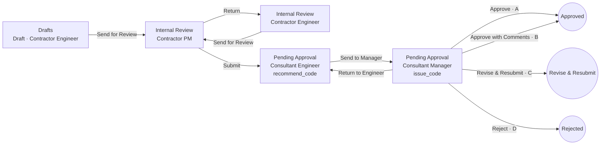

# Workflow engine design

How Work Items move through Workflows. Terms follow [GLOSSARY.md](../GLOSSARY.md); tables follow [data-model.md](data-model.md); every read and write obeys [visibility.md](visibility.md). The engine is built in-house on PostgreSQL ([ADR 0008](adr/0008-in-house-workflow-engine-on-postgres.md)).

The engine has two halves:
- **Definition time:** the visual builder, validation and publishing.
- **Run time:** one command, `take_transition`, plus a few supporting commands (§5), all executed as single database transactions.

## Contents

Don't read this doc whole: find your heading with `grep -n '^#' docs/workflow-engine.md`, then Read from that line with offset and limit. `scripts/doc-index.test.ts` keeps this list in step with the headings.

- **1. Definition model**: read when you change what a Workflow Version holds: Steps, Stages, Transitions, Outcomes.
  - **Example: Rabaed Default "Material Approval Request (MAR)"**: read when you need a worked Workflow, or touch the MAR's.
  - **Rabaed Default documents**: read when you edit or import the Rabaed Default JSON documents in `apps/admin`.
  - **Definition format**: read when you change `WorkflowDefinition`, the JSON the builder, api and Rabaed Admin share.
  - **Publish-time validation**: read when a Workflow Version won't publish, or you add a publish rule.
  - **Ownership and binding (ADR 0016)**: read when you work on who owns a Workflow (Rabaed, Project, Library) and how a Type binds one.
  - **Authoring (WF-4)**: read when you add or change a command that writes Workflow definitions.
  - **Company defaults (RP-517)**: read when you work on a Company's default Form, Workflow or Screen per Type.
  - **The Library of Workflows (RP-442, WF-19)**: read when you work on a Company's Library of Workflows.
- **2. Run-time state**: read when you need the columns a Work Item's Workflow position lives in.
- **3. Who holds a Step (actor resolution)**: read when you change who gets a Step: the Participant, the Step Pool, the holder.
- **4. Conditions (routing)**: read when you write or evaluate a condition on a Transition.
  - **As built (RP-430, WF-7): Restrict and Validate at run time**: read when you touch `evaluateCondition` or `app.condition_holds`.
- **5. Commands**: read when you add a Workflow command; it gives the rules every command follows (one transaction, locks, idempotency).
  - **5.1 `take_transition(item, transition, action_form_answers, confirmed)`**: read when you change what taking a Transition checks or writes.
  - **5.2 Pick up and Return to pool (`app.pick_up_step` / `app.return_to_pool_step` in the code)**: read when you work on pooled Steps.
  - **5.3 `recommend_code(item, code, note)`**: read when you work on a Recommended Code inside one Participant.
  - **5.3a The Owner's review: a Recommended Code to the Owner (ADR 0022)**: read when you work on the Owner confirming a Consultant's Code.
  - **5.4 `create_revision(closed_item)`**: read when you work on Revisions of a closed item.
  - **5.5 `replace_rejected(closed_item)` for Code D**: read when you work on replacing a rejected item.
  - **5.6 Admin commands (Rabaed Admin only, `admin_action` + a shared event with a reason)**: read when you add a Rabaed Admin command on a Work Item.
  - **5.7 Screens and replies (settled 2026-10-10, ADR 0019; built in RP-516)**: read when you work on Screens or a Participant's reply in an Action Form.
  - **5.7 The List's row commands: Delete, Duplicate, Download (as built, RP-409)**: read when you change the List row's ⋯ menu.
- **6. Outcome hooks**: read when you change what an outcome leads to (Revision, replacement, Comment).
- **7. Signing and the Documental Record**: read when you touch signing a Transition or the Documental Record.
- **8. Document Numbers**: read when you work on how and when a Document Number is given.
  - **Settled 2026-10-05 (Document numbering)**: read when you need the numbering decisions: who sets the Numbering Pattern, when a change applies.
  - **As built (RP-312 to RP-317, RP-311 review)**: read when you touch the numbering functions in the database.
- **9. People and companies leaving**: read when a Member or a Participant leaves: Handover, Vacancy.
- **10. Step Age and "Need My Action"**: read when you work on Step Age dots or the Need My Action list.
- **11. Builder (React Flow) contract**: read when you work on the visual Workflow builder.
- **Settled (2026-09-26)**: read when you hit an edge case settled early (a Consultant withdrawn, and others).
- **12. Adding a Rabaed Default Type: the checklist**: read when you add a Rabaed Default Work Item Type.

---

## 1. Definition model

A Workflow version is a directed graph.

- **Steps** are the points of the graph. Each has:
  - a `stage_key`, which decides its Kanban column;
  - an **actor rule**: who may hold it (§3);
  - an `outcome_mode`: `none`, `recommend_code`, `issue_code`, `inspection_result` or `confirm_code` (the Owner's review, §5.3a; ADR 0022);
  - whether the raiser's Form is edited there (`edits_form`, ADR 0019; RP-514), by the Member holding it, before the first Submit (form-engine.md §4). Left out (null), the default: a Step of the Draft Step's role held with the Draft Step's Function Permission (the Draft, the Contractor Engineer Step), never the internal reviewer's;
  - on the Draft Step, **Drafts visible to** (`drafts_visible_to`, ADR 0019; RP-514): `company` (the default) or `author` (visibility.md V1);
  - on a raiser's Step a `send_back` leads to, **After a Send Back** (`after_send_back`, ADR 0021; as built, RP-580): `comment` (the raiser only replies with a comment and Submits again) or `edit_form` (its Form reopens until the next Submit). Every Version saved or published since RP-580 has it on those Steps: left out, a save sets `comment` (`prepareDraft`'s `withAfterSendBackDefault`, `workflow-checks.ts`) and so does every publish (`app.publish_workflow_draft`), a copy published without a save included (a duplicate, the Library's, a Company's defaults in a new Project). Null, only on a Version published before (they never change, RP-424), reads as `edit_form`, as ADR 0014 built it. The builder shows it in the Step panel of a raiser's Step a Send Back leads to ("Comment only" / "Edit the Form").

  There is no per-Step or per-Transition signing choice: every Transition is confirmed and recorded (§7, ADR 0017). The old `workflow_step.is_signing` column was dropped (RP-85, `20270616000000_drop_is_signing.sql`); the definition format (WF-2) and the builder never had it.
- **Transitions** are edges. Each has:
  - a `label` (i18n);
  - a `kind`: `send` (within the Participant), `submit` (to another Participant), `return` (back within the Participant), `send_back` (back to the Participant that Submitted it, with no outcome; ADR 0014), `close` or `cancel`;
  - an optional `condition` (§4);
  - an optional `outcome` it sets: a closing outcome of the Work Item Type's outcome set ("Outcomes" below; the Rabaed Defaults' `A`, `B`, `C`, `D`, `passed`, `passed_with_comments`, `failed`, `approved`, `rejected`, `closed`);
  - an `action_form`: the pop-up schema, or the **Screen** it shows, whose Version the Workflow Version pins (§5.7, ADR 0019; RP-516);
  - `notifications`.
- **Start:** every Workflow has exactly one **Draft** Step (Stage category `draft`) where items are created.
- **End:** terminal Steps sit in Stages of category `closed_positive`, `closed_negative` or `cancelled`. Reaching one closes the item.

### Example: Rabaed Default "Material Approval Request (MAR)"

Settled 2026-10-10 (ADR 0020). As built (RP-437): Version 3 of the Rabaed Default, the document [`apps/admin/workflows/submittal-2-2.json`](../apps/admin/workflows/submittal-2-2.json) (the MAR's `MAR.json` until RP-596 renamed it; the eight submittal Workflows are listed under "Rabaed Default documents"), with the MAR Form Version 5 ([`apps/admin/forms/MAR.json`](../apps/admin/forms/MAR.json)) and the Rabaed Default Screens it names ([`apps/admin/screens`](../apps/admin/screens)); "Rabaed Default documents" below says how they are published.



- **Internal Review is a Stage holding two Steps,** Contractor Engineer and Contractor PM. **A Return never goes back to the Draft Step** or the Drafts Stage: the PM's Return goes to the Contractor Engineer Step, and the engineer sends it for review again. The Drafts Stage holds only items never sent, so a Draft never has a Document Number (§8) or a Step Age (§10). The first Return goes to the item's author (§3.3). Items on MAR Workflow Version 2 keep its route, whose Return goes back to the Draft Step.
- **Who edits the Form:** the Member holding the Draft Step or the Contractor Engineer Step, before the Submit (form-engine.md §4, ADR 0019). At the Contractor Engineer Step the holder may also add, replace and remove Documents: they freeze at the Submit (§5.1).
- **Cancel** stays as built: from the raiser's own Steps, until the first Submit (§5.1 "Cancel"). A Returned item is not a Draft: it keeps its number and is never discarded (§5.4).
- As built (RP-515): the engine runs this route on any Workflow (the seam suites' test Workflow has it with `engineerStep`, `packages/db/test-support`). Publishing refuses a `return` into a Step in a `draft` Stage (ADR 0020; as built, RP-437: `return_to_draft`, check 2); MAR Versions 1 and 2, published before, keep their Return to the Draft.
- As built (RP-437), the Steps and Transitions by key: `draft` (Contractor, `create`) ─`send_for_review`→ `internal_review` ("Contractor PM", `review`) ─`return` (a reason, internal)→ `contractor_engineer` (Stage Internal Review, `create`, `editsForm: true`) ─`send_for_review_again`→ `internal_review` ─`submit` (Screen `cover_note`)→ `consultant_engineer` (Pending Approval, Consultant `review`, Recommends a Code) ─`send_to_manager` (Screen `consultant_review`: Sample checked, Matches specification, Verification note, all internal)→ `consultant_manager` (Pending Approval, `approve`, issues the Code) ─`return_to_engineer` (a reason)→ `consultant_engineer`; from `consultant_manager`, `approve_a` (Screen `code_a`) and `approve_b` (`code_b`, with the `items_to_create` table, at least one row) → `approved`, `revise_c` (`code_c`) → `revise_resubmit`, `reject_d` (`code_d`) → `rejected` (Stage Rejected, closed negative, added to the Submittals' Rabaed Default Stages); `cancel`, `cancel_engineer`, `cancel_review` from the raiser's three Steps → `cancelled`. Each Code Screen asks the final verification (the same three fields, shared) and Remarks: optional with A only, required with B, C and D (product owner, 2026-10-11). The Consultant Engineer Step's pool is the Consultant's Engineers only (`actor.positions: ["engineer"]`, RP-511 decision 1), never its Manager, so a Consultant with one Engineer has it held at once (ADR 0018); the Manager's Step needs `approve`.

The MAR has no Send Back: the Consultant sends work back to the Contractor only with Code C, and the Contractor resubmits it as a Revision (§5.4). Send Back is for Workflows such as the Site Report's "Return for Comment" (ADR 0014).

### Rabaed Default documents

As built (RP-437, WF-14): the Rabaed Default Workflows, Forms and Screens are JSON documents in `apps/admin`, not migrations: `workflows/<Type>.json` (the definition format below), `forms/<Type>.json` (`{"sections": [...]}`, form-engine.md §1) and `screens/<key>.json` (`key`, `name`, `schema`, `internalFields`). One seed step, `pnpm defaults:publish --engineer <email> --reason <why>` (`publishRabaedDefaults`, `apps/admin/src/rabaed-defaults.ts`), publishes, in this order, every Screen (`publishRabaedScreen`: `screenProblems`, then the next published Version of the Rabaed Default Screen with that key), every Form (`publishFormVersion`, as `pnpm form:publish`) and every Workflow (`writeRabaedWorkflow`, as `pnpm workflow:publish`, with every publish check and an `admin_action` row), each only when it differs from its latest published Version (and a Workflow also when a Screen it names has a newer Version than it pins), so it can run again. A Type's earlier Workflow Version that still has items on it is kept as a `history` document of `rabaedDefaultTypes` (the WIR's Version 1, `workflows/WIR-1.json`, RP-170) and published as its Version only while the Type's Workflow has no Version of that number or later, so a database seeded before Version 2 keeps its own Version 1 and a fresh one gets the same two: items on Version 1 finish on it (no in-flight move names the WIR). The demo seed runs it first (`apps/api/src/demo/seed.ts`), so every seeded or tested database has them; a new environment runs it once after the migrations. The Types they need are data in `20270118000000_rabaed_default_types.sql` (`mar-v3.test.ts` checks it names the Types `rabaedDefaultTypes` does). Last, it moves the open items still on a Version retired with ADR 0019 (`apps/admin/src/in-flight.ts`, which a migration can't do, as the Versions they move to are published after the migrations): an open Comment on the Comment Workflow and Form Version 1 (whose Resolution section nobody may save any more) to the latest of both, Steps by key; an open MAR on the MAR Form Version 4 and Workflow Version 2 to the MAR Workflow Version 3, keeping its Form, the Consultant's review to the Consultant Engineer Step, whose reply records the verification. A holder who may not hold the new Step gives it back to its pool. Run again, it moves nothing.

| Type | Module | Workflow | Form | Outcomes |
|---|---|---|---|---|
| MAR, Material Approval Request | Submittals | `submittal-2-2.json` (2→2), Version 3 | `MAR.json`, Version 6 | Review Codes |
| SAR, Supplier Approval Request | Submittals | `submittal-2-2.json` (2→2) | `SAR.json` (RP-591) | Review Codes |
| DAR, Document Approval Request | Submittals | `submittal-1-1-owner.json` (1→1 → Owner review) | `DAR.json` (RP-591) | Review Codes |
| WIR, Work Inspection Request | Inspections | `WIR.json`, Version 2 (RP-170): Draft → Contractor PM (Return to Contractor Engineer) → Submit (Cover Note) → Consultant Engineer (Recommended Result, Internal Note) → Send to Manager (Return to Engineer) → Consultant Manager → Passed, Passed with Comments (its `items_to_create` rows become Comments) or Failed (re-inspection by Revision). Version 1 (`WIR-1.json`: one Consultant inspection Step) stays published for the items on it | `WIR.json` | Inspection Results |
| CMT, Comment | Snag List | `CMT.json`, Version 2 (Version 1 migrated), its Resolve showing the Screen `comment_resolution` | `CMT.json`, Version 2: no Resolution section (Version 1 migrated) | None |

#### The eight submittal Workflows

Settled 2026-10-15 (grilling of RP-26; ADR 0022); as built, RP-596 (`20270407000000_default_workflow_keys.sql`). The submittal Types (MAR, SAR, DAR) each have eight Rabaed Default Workflows: the number of reviewers on each side, 1 (the Project Manager alone) or 2 (the Engineer, then the Project Manager), each with and without the Owner's final review. There is no picker at Project creation: all eight are listed, read by every Member, in Rabaed Admin → Workflows and in Project → Settings → Workflows ("Rabaed Default Workflows"), where a Project Admin uses one for the Type (the binding command, as for a Project's own) or duplicates it to edit; Rabaed Engineers edit them in the builder as any Rabaed Default.

| Document (`apps/admin/workflows`) | Name (English / Arabic) | Steps |
|---|---|---|
| `submittal-1-1.json` | 1→1 Contractor PM → Consultant PM / «1→1 مدير المقاول ← مدير الاستشاري» | Draft, Contractor PM, Consultant Manager issues the Code |
| `submittal-1-2.json` | 1→2 Contractor PM → Consultant Engineer → Consultant PM | adds the Consultant Engineer, who Recommends to the Manager (Screen `consultant_review`) |
| `submittal-2-1.json` | 2→1 Contractor Engineer → Contractor PM → Consultant PM | adds the Contractor Engineer Step the PM Returns to |
| `submittal-2-2.json` | 2→2 Contractor Engineer → Contractor PM → Consultant Engineer → Consultant PM | MAR Version 3 |
| `submittal-1-1-owner.json` … `submittal-2-2-owner.json` | the same, each ending "→ Owner review" / «… ← مراجعة المالك» | the Consultant PM Recommends A to D (Submits into `owner_review`, Screens `code_a` to `code_d`); the Owner's Step confirms (`confirm_a` to `confirm_d`, one "Confirm" offered) or Sends Back (`owner_send_back`, a reason, to the Consultant PM): §5.3a |

All eight use the Codes A to D with their Screens (`cover_note` on the Contractor PM's Submit, `consultant_review` where a Consultant Engineer Step exists, `code_a` to `code_d`) and the same Cancel Transitions from the raiser's Steps; the 1-reviewer Contractor side has no Return, since a Return stays inside Internal Review and there is no Engineer Step to go to.

- **Which one a Type runs.** The Type's own Rabaed Default (`work_item_type.workflow_definition_id`) is the one new items start on while a Project binds none: MAR and SAR 2→2, DAR 1→1 → Owner review. The other seven of each Type are Rabaed Defaults of their own (`workflow_definition` of `owner_kind` `rabaed` with `work_item_type_id` the Type and `default_key` ("1-1", "2-2-owner", …) naming it within the Type), which only a binding puts a Project on. `defaults:publish` creates them the first time and publishes each document's Versions into the row its `default_key` names (`submittalWorkflows` in `apps/admin/src/rabaed-defaults.ts`); the Workflow's name follows that list. Binding is `app.bind_workflow`, unchanged: any Rabaed Default made for the Type with a published Version.
- **Existing Projects keep their bindings.** A Project that bound its own Workflow to a Type, or another Rabaed Default, keeps it. Republishing a Type's Rabaed Default changes every Project that binds no copy of its own for that Type: it runs the new Version from the next item it raises, with no step of its Project Admin's (items already raised keep theirs, §2). So the DAR's Rabaed Default is now 1→1 → Owner review (Contractor PM → Consultant PM → the Owner's review) on every such Project, existing ones included, and its next DAR starts on it (accepted by the product owner, spec RP-598 review). A Project created later runs what the table says.
- **RP-566's check** (publishing a Rabaed Default Version is refused while an Active Project running it lacks an outcome or Stage it uses) counts, for a Rabaed Default the Type does not run, only the Projects that bind it (`projectsLackingOutcomesAndStages`): none falls back to it.
- **Rabaed Admin** lists one row per Rabaed Default Workflow (`GET /v1/workflows`: `workflowId`, `workflowName`, `isTypeDefault`); the read, check, save, publish and duplicate routes take `?workflow=<id>` to act on one of a Type's other Rabaed Defaults (404 for another Type's), and a duplicate's source may be named by `fromWorkflowId`. Project → Settings → Workflows reads `rabaedDefaults` per Type (`WorkflowSettingsType`), all that have a published Version.

The Non-Conformance Report (NCR) is not a Rabaed Default yet: it gets its own Workflow and Form (RP-553, to decide with the product owner). The Inspections Module's Rabaed Default Stages: Draft, Internal Review, Pending Inspection, Passed, Failed, Cancelled; its Function Permissions give the Contractor's engineer `create`, its PM `review` and `submit`, and the Consultant's engineer and manager `review` and `approve`. The Rabaed Default Inspection Results changed with the WIR: Passed with Comments creates Comments (`create_items` CMT) and Failed offers a Revision (`app.default_outcomes`, `defaultOutcomeSets`), so a Failed inspection's chain counts in the Dashboard's Revision line (named "Failed" on an Inspection Results card, "Code C" on a Review Codes one) as a Code C chain does.

The Issued Code is the `outcome` of the Transition taken from the `issue_code` Step. The "Approve / B / C / D" buttons are four Transitions, each with its own Action Form. For example, B requires at least one comment row, and each row becomes a Comment Work Item.

### Definition format

As built (RP-425): one JSON document per Workflow Version, `WorkflowDefinition` in `packages/domain` (`workflow-definition.ts`), used by the builder (live), the api (publish) and Rabaed Admin (import):

- `steps`: `key`, `name` (English and Arabic), `stage` (the Stage key), `actor` (`role`, or `raiser: true` for the raiser whatever its role (RP-622, §3.1), the Function Permission `permission`, optional `positions`, which narrow the Step Pool to the Members holding one of them, as built in the RP-437 review: `app.step_pool`; null on a terminal Step; stored in `workflow_step.actor_rule` as `{base_role, …}` or `{raiser: true, …}`), `outcomeMode` (`none`, `recommend_code`, `issue_outcome`: the Issued Code or the Inspection Result, by the Work Item Type's `outcome_kind`; `confirm_code`: the Owner's review, which issues the Code Recommended to it, §5.3a), and optionally `editsForm` (true or false; left out, the default, `stepEditsForm`) and, on the Draft Step, `draftsVisibleTo` (`company`, `author`). As built (RP-514): stored in `workflow_step.edits_form` and `workflow_step.drafts_visible_to`, null when left out; a row carries each only when set.
- `transitions`: `key`, `label`, `kind`, `from`, `to`, `outcome`, `permission`, `actionForm`, and optionally:
  - `screen`: the Screen it shows, by key, with `actionForm` null (RP-516, §5.7); stored in `workflow_transition.screen_key`, a row carrying `screen_key` only when set. A published Version's row also holds the pinned Version (`screen_version_id`) and its schema copied into `action_form`; the definition reads the Screen alone, so a copy of the Version pins again when it is published;
  - `rules.restrict`: a condition; Positions; not the same person as held a Step (`step`) or took a Transition (`transition`); has been through a Step (`step`, one of the acting Participant's own) or a shared fact (`fact`: `sent_back`, `revision`); all Comments or Subtasks closed;
  - `rules.validate`: a condition with its message; Form complete; a Document (`has_document`, optionally in a named Document field);
  - `actions`: offer "Assign to" (the actor picks among their own Participant's Members; nothing is stored), set a field to a value or to the moment taken (`{ "now": true }`, never the text "now"), copy a field;
  - `notifications`: the holder or Step Pool, the raiser, watchers, a Position of the acting Participant.

  WF-7, WF-8 and WF-9 give them meaning at run time. As built (RP-430, WF-7): `rules` is stored in `workflow_transition.rules` and applied by `take_transition` (§4, §5.1). As built (RP-431, WF-8): `actions` is stored in `workflow_transition.actions` and applied by `take_transition` (§3.3, §5.1 "Actions").
- `layout`: Step positions on the builder's canvas, by Step key.

Stages are not in the definition: a Step names its Stage by key, and the Stages (with their categories) come from the Project and Module the Workflow runs in (the checks' `stages`).

**Stages** (as built, RP-428, WF-5): per Project and Module, seeded from the Rabaed Defaults; the Project Admin renames, adds, reorders and deletes them, each with a category (`draft`, `in_progress` (Open), `closed_positive`, `closed_negative`, `cancelled`) that never changes once added; a Stage is deleted only when no Step of any Workflow Version of the Project uses it (data-model.md `stage`). Kanban columns, List Stage chips, Dashboard buckets and "is the item closed" read the Project's Stages and their categories, never fixed keys. Publishing checks a Workflow against the Stage set of its owner: the Project's for a Project's Workflow; the Rabaed Defaults' for a Rabaed Default or a Library Workflow (seam-1 `workflow-definition.test.ts` picks the set the same way). Copying a Workflow into a Project maps its Stages by key and is refused when the Project's Module lacks one: `stageCopyProblems` (`packages/domain` `stage.ts`), one `stage_missing` problem per Stage with an English and Arabic message naming it and a Step in it. The copy command (`POST /v1/workflows/:id/duplicate`, `duplicateWorkflow` in the api) runs it on the copy into a Project, against that Project's Stages of the Workflow's Type's Module, in the transaction that copies: refused `stage_missing` (422) with `problems`, and nothing is copied. A copy into a Company Library has no Project Stages to check.

**Outcomes** (as built, RP-429, WF-6; glossary Outcome; data-model.md `outcome`): each Work Item Type has its own ordered outcome set: a code, an English and Arabic name, closing or not, positive or negative, and follow-up actions: create items from the closing Transition's Action Form rows, of a named Type (`create_items`, read by WF-11), offer the raiser a Revision (`offer_revision`, §5.4) or a replacement (`offer_replacement`, §5.5, WF-12). The Rabaed Defaults: Review Codes A, B (create Comments, Type `CMT`), C (offer a Revision), D (offer a replacement); Inspection Results Passed, Passed with Comments, Failed; Approval Approved, Rejected; None: Closed (`defaultOutcomeSets` in `@rabaed/domain` `outcome.ts`, `app.default_outcomes`). A Type starts with the set of its `outcome_kind`; every Project runs its own copy of each Rabaed Default Type's set, seeded as its Stages are. A Project Admin adds outcomes to the Project's copy and changes their names, follow-up actions and order (each audited in `setup_event`); a Rabaed Default set changes only in Rabaed Admin, and every such edit reaches only the Projects created afterwards (decided 2026-10-11; "Rabaed Admin -> Workflows" below). An outcome's code, closing and polarity change only while it is unused (decided 2026-10-09): no closing Transition of a published Workflow Version the Project's items can run names it (`app.outcome_in_use`, read from definitions only so the answer never depends on hidden items); once used they stay, refused `outcome_in_use` (409, with an English and Arabic message). Everyone who reads the Type reads its outcomes; nothing else widens. The Dashboard, the Kanban badges, the List's outcome filter and the Code C line read an outcome's place in its Type's set (closing, polarity, follow-up actions), never fixed codes: a card's bars are the Type's closing outcomes when it has two or more (those offering a Revision first, then the positive, then the negative; `dashboardBarOutcomes`), else Approved and Rejected by Stage; the Approved % counts the positive bars; the Code C line counts chains that had an outcome offering a Revision, "approved on revision" when the latest got a positive outcome, "rejected after C" a negative one offering no Revision (`chainBucket`, `codeCState`). An outcome's Dashboard bar and badge carry its English and Arabic name (`outcomeLabel`: "Approved (A)").

**Positions only.** No Workflow names a person, whoever owns it: a Rabaed Default is copied into other Companies' Projects, and every Project Workflow is read project-wide (ADR 0016). The format enforces it: an actor rule, an action and a notification have no field that holds a Member, and the one way left (setting a Member field to a value) is refused at publish (`names_person`).

`parseWorkflowDefinition` refuses unknown keys at any depth. `definitionFromRows` / `definitionToRows` convert a Version's rows (`workflow_step`, `workflow_transition` with Steps by key, `workflow_version.layout`) without loss (there is no signing flag: ADR 0017, dropped by RP-85); `rules` (RP-430), `actions` (RP-431) and `notifications` (RP-432) are columns, null when a Transition has none; a row carries each only when the definition has it.

### Publish-time validation

A draft Workflow version can't be published unless all of these hold. `workflowPublishProblems(definition, context)` in `packages/domain` (`workflow-checks.ts`, RP-425) runs every one of them, given the Type's `outcome_kind`, the Module's Stages and the Type's latest published Form; each problem has a stable code, the Step or Transition it concerns, its severity (`error`, or `warning`) and an English and Arabic message for the builder. The authoring commands (WF-4, RP-427) run it before every publish; Versions published as data by migration skipped it, so seam-1 `workflow-definition.test.ts` runs it on every published Version, and the rows' round trip with it.

1. Exactly one Draft start Step. Every Step is reachable from it, and every non-terminal Step has an outgoing Transition and an actor rule. `workflow-checks.ts` (with key uniqueness and Transitions naming existing Steps).
2. Every `stage_key` exists in the Module's Stage set, and terminal Steps sit in closed or cancelled Stages: nothing leaves a Step in a closed or cancelled Stage. A `return` never goes into a Step in a `draft` Stage, which holds only items never sent (ADR 0020; as built, RP-437: `return_to_draft`; a `send_back` may). `workflow-checks.ts`.
3. The Work Item Type's outcome set matches: every Transition into a terminal Step is a close (or a Cancel) and sets a closing outcome of the Type's set, and no other Transition sets one; when the set offers a choice (two or more closing outcomes), some Step issues the outcome and every such close leaves from a Step that issues it. As built (RP-429): the checks' context gives the set (`outcomes`): the Project's copy for a Project's own Workflow, the Rabaed Default set for a Rabaed Default or Library one (seam-1 `workflow-definition.test.ts` picks it the same way). `definitionToRows` keeps the outcome kind only to name a row's `outcome_mode` word. At run time trigger `work_item_outcome_in_set` refuses any item outcome that isn't a closing outcome of its Type's set on its Project (or `cancelled`). As built (RP-434): a close setting an outcome whose follow-up actions create items (`create_items`, Code B) needs its Action Form's `items_to_create` table with a text column (`items_table_missing`, naming the Type), never a field its Screen keeps internal (`items_table_internal`, RP-525: the items are shared); whether a row is required is the Workflow's choice. `workflow-checks.ts`.
4. A `return` goes only to an earlier Step held by the **same** Participant role. A `submit` always crosses to a different role. A `send_back` goes from a Step of the role the item was Submitted to, back to a Step of the role that Submitted it, which the Workflow chooses; it sets no outcome. `workflowKindProblems` (`workflow-publish.ts`, RP-334).
5. ~~Every `submit` Transition and every Transition from an `issue_code` Step is signing.~~ Dropped by ADR 0017: every Transition is confirmed and recorded.
6. Conditions reference only fields that exist in the Form (checked against the Form's latest published version). Conditions read the Form and item attributes (`workflowRuleAttrs`: `trade`, `location`, `work_item_type`, `revision_no`); a Validate also reads the Transition's Action Form answers. A Restrict reads Action Form answers (WF-7) only where it picks among Transitions sharing a label and source Step, once the pop-up is filled, and then only fields every one of their Action Forms asks; a Restrict that hides a button is read before any pop-up. Actions write only fields the acting Participant fills at that Step (WF-8): the Transition's Action Form and the Form Sections changed at its source Step (`sectionSteps`); a copy reads only from those, never another Participant's answers (`field_not_filled_at_step`), and on a move inside one Participant (`send`, `return`) never from its Action Form into the Form (`copy_internal_answer`: those answers are Internal Communication, V5, such as a Recommended Code, and the Form is read by every Participant once the item leaves), and never from a field its Screen keeps internal into a shared field or the Form (`copy_internal_answer`, RP-525); "now" goes only into a date or time field. The Steps and Transitions a rule names exist, "has been through" a Step names one of the acting Participant's own, and a Document rule names a Document field (`attachments`, `photos`). `workflow-checks.ts`.
7. Action Forms are valid Form schemas. `workflowActionFormProblems` (`action-form.ts`, RP-300). A Transition showing a Screen (§5.7) is checked with the Screen's latest published Version the Workflow's owner uses (the checks' `screens`), by every check that reads an Action Form (check 3's table of items, check 6); a Screen with none is `screen_not_found`, and a Transition naming a Screen and holding an Action Form of its own `screen_with_action_form` (RP-516).
8. No cycle is possible without a `return` or a `send_back`. A loop across Participants always goes through a `send_back`, never through Submit alone. `workflowKindProblems` (`workflow-publish.ts`, RP-334).

And, from spec RP-423 (`workflow-checks.ts`):

- No Workflow names a person: Positions only. The format enforces it (see "Definition format"); an action setting a Member field to a value is `names_person`.
- A Cancel leaves only the raiser's own Steps (the Draft Step's role), goes to a Step in a cancelled Stage, and sets no outcome. At run time it is offered only until the first Submit, and never on a Revision (§5.1 "Cancel", §5.4).
- Among Transitions sharing a label and source Step, conditions that can overlap or leave a gap are a **warning** (§4): `condition_overlap`, `condition_gap`, found by trying the answers on each condition's edges.

And, from ADR 0022 (as built, RP-593; `ownerReviewProblems` and check 3 in `workflow-checks.ts`), the Owner's review (§5.3a):

- **A confirming Step is reached only with a Recommended Code:** every Transition into a `confirm_code` Step is a `submit` carrying a closing outcome of the Type's set, from a `recommend_code` Step (`confirm_without_recommended_code`). Check 3 lets that Submit set an outcome though it doesn't close the item, and asks Code B's `items_to_create` table of it, since the Comments are made from its rows.
- **Every Code Recommended can be confirmed:** for each outcome a Transition into a confirming Step carries, the Step has a close setting it (`confirm_close_missing`). A confirming Step issues the outcome for check 3, and its closes need no table of items. Its closes may share one label ("Confirm"): the engine picks the one of the Recommended Code, so no routing warning is given for them.
- **The Owner's Send Back goes to the Step that Recommends the Code** (a `recommend_code` Step with a Transition into the confirming Step), the other party of the exchange (`confirm_send_back_not_to_recommender`). The api pre-fills no Action Form from a move of the review (`ownArrivalAnswers` reads only moves taken by the viewer's own Participant), since its events are internal to both sides.

And, from ADR 0019 (as built, RP-514; `formEditingProblems` in `workflow-checks.ts`):

- **Nobody edits the raiser's Form at or after a Submit.** A Step that edits the Form (`stepEditsForm`) and is reachable from a `submit`'s target Step without a `send_back` is refused (`form_edited_after_submit`): another Participant's Step, or a raiser's Step a `send` crosses back to. An item Sent Back to its raiser is edited at the raiser's Steps that edit the Form, by their holder, until the next Submit (ADR 0014), only when the Step the Send Back led to says **After a Send Back: Edit the Form** (ADR 0021, as built RP-580): then the Step the Send Back leads to, and the Draft after a Return from it. At "Comment only" nothing of the Form changes until the next Submit, wherever the raiser moves the item inside its Participant. At run time `app.can_save_answers` keeps to it, through `app.after_send_back_setting` (form-engine.md §4).
- **"Drafts visible to"** is set on the Draft Step only (`drafts_visible_to_not_on_draft`).
- **"Edit the Form" after a Send Back** is set only on a raiser's Step (the Draft Step's role) a `send_back` leads to (`edit_form_not_after_send_back`, ADR 0021; RP-580). "Comment only" elsewhere changes nothing and passes.

As built (RP-334): checks 4 and 8 are `workflowKindProblems`, which `workflowPublishProblems` runs. A Step's role is its actor rule's `base_role`, and a Step held by the raiser is of its own holder, "the raiser" (RP-622, `actorHolder`), as for every check comparing Steps' holders (a Send, a Cancel, "Edits the raiser's Form", "has been through", a Form Section's `editable_at`; the database's `app.actor_holder`): the Snag's Draft (the raiser) Submits to Open (the Contractor), which Submits to Verify (the raiser), which Sends it Back; a `send_back` is valid from a Step of role A to a Step of role B when some `submit` goes from a Step of B to a Step of A. The database also refuses a `send_back` with an outcome (`workflow_transition_send_back_no_outcome`), and `take_transition` raises on a `return` that would cross Participants. The seam suites' test Workflow with a Send Back is `addTestWorkflow` (`packages/db/test-support`).

Published versions never change. As built (RP-424): triggers `workflow_version_published_frozen`, `workflow_step_published_frozen` and `workflow_transition_published_frozen` refuse any UPDATE or DELETE of a published `workflow_version`, and any INSERT, UPDATE or DELETE of the `workflow_step` / `workflow_transition` rows of one (moved in or out included), even for the table owner (error 42501, as `form_version`'s guard); a draft stays editable and can be published. Seam-2 `workflow-version-frozen.test.ts`. Publishing v2 leaves v1 items untouched. Items on v1 show a notice ("Workflow updated to v2"), and anyone can view v2.

### Ownership and binding (ADR 0016)

A Workflow definition belongs to Rabaed (a **Rabaed Default**), to a Project (its own copy) or to a Company's **Library** (`workflow_definition.owner_kind` `rabaed`, `project` or `company`, with `project_id` or `company_id`). A copy keeps no link to the Workflow it was copied from.

A Project chooses the Workflow of each Work Item Type with a **binding** (`workflow_binding`): (Project, Type) → Workflow, and optionally exceptions (Project, Type, raising Participant) → Workflow, such as "Contractor X's DARs". At most one of each. A binding names one of the Project's own Workflows or a Rabaed Default with a published Version, never another Project's or a Library's (copied into the Project first).

A new item starts on the latest published Version of: the raiser's Participant's exception, else the Project's binding, else the Type's Rabaed Default; and keeps it (§2). Binding another Workflow, or publishing a new Version, reaches only items created afterwards.

Every Project Member reads the Project's Workflows whole, with every Company's Steps; a Library only its Company (visibility.md V20, V18). The item read gives its Workflow's name and Version number (`workflow` in the item detail).

As built (RP-426): `app.new_item_workflow_version(project, type, participant)` resolves the Version, for `app.create_work_item` and for the api's new-item Form (which Form Sections are editable at that Workflow's Draft). The trigger `workflow_binding_checked` refuses a binding outside these rules (error 23514). Bindings are written by WF-4's commands (RP-427, "Authoring" below). A Revision starts on its chain's own Workflow, not the binding's (`app.revision_draft_step`, §5.4). `app.is_draft_step` reads a Step's Stage without the Type whose default its Workflow is (a Project's own Workflow is no Type's default); a Stage key of category `draft` is a Draft in each Module that has it, in the Stage set the Workflow is published against (RP-428: its Project's for a Project's own Workflow, the Rabaed Defaults' for any other). It is the one definition of a Draft Step: `app.create_work_item` starts a new item at the Step it names, and the api's Form-at-a-Step reads the same rule (RP-448 review). The item read takes the Workflow's name and Version from `app.work_item_workflow` (security definer, for whoever sees the item), so it never hides an item from a viewer who can't read the Workflow's rows.

### Authoring (WF-4)

As built (RP-427, `20261226000000_workflow_authoring.sql`): the commands, each one transaction, each audited. The app role writes no definition table directly (seam 2 `workflow-authoring-rls.test.ts`).

- **Who may:** a Project's own Workflows and its bindings, its Project Admins; a Library Workflow, its Company's Authorized Person (no Position permission for it yet); a Rabaed Default, Rabaed Engineers in Rabaed Admin (with a reason, in `admin_action`: `save_workflow_draft`, `publish_workflow`) and the `pnpm workflow:publish --type <code> --definition <file.json> --reason <why> --engineer <email>` CLI (the migrator, as `form:publish`, writing the same `admin_action` row as Rabaed Admin: the active Engineer `--engineer` names, since the CLI signs nobody in). Anyone else gets `not_found`, the plain 404 (visibility.md scenario RP-427-1). A Member's command writes one `setup_event` row (who, when, what), the one record of setup changes (data-model.md), read by nobody through the app role.
- **A Workflow is for one Work Item Type:** `workflow_definition.work_item_type_id` (backfilled from the Types and bindings), copied with it; `app.workflow_type` is the one rule for reading it (its own, else the Type whose Rabaed Default it is, else the first binding's), for the commands and the publish checks alike. Its publish checks run in that Type's context: its `outcome_kind` and outcome set (RP-429: the Project's copy for a Project's own Workflow, else the Rabaed Default set), the Stages of its Module (the Project's own when it has them, else the Rabaed Defaults'), its latest published Form, the Option Lists (`readWorkflowCheckContext`, `packages/db/src/workflow-authoring.ts`). Every save, check and publish, in the api and Rabaed Admin, runs one sequence on a document (`prepareDraft`: parse, publish checks); a Transition's rules, actions and notifications (WF-7 to WF-9) are saved, read and copied with it (`app.store_workflow_draft`, `app.workflow_version_rows`).
- **Duplicate** (`app.duplicate_workflow(source, project, name, now)`, `POST /v1/workflows/:id/duplicate {projectId, name}`): copies the latest published Version of a Workflow the Member reads (a Rabaed Default, a Workflow of a Project they are on, their Library's) as draft Version 1 of a new Workflow of the Project (`projectId`) or of their Company's Library (`projectId: null`). Copy to Library and copy from Library into a Project are this command. Nothing records the original (ADR 0016). Refusals: `not_found`; `project_closed` (409); `invalid_name` (422, a name that isn't English and Arabic).
- **Read** (`GET /v1/workflows/:id`, `WorkflowRead`): the published Versions and the latest one's definition, for whoever reads the Workflow (V18, V20); its draft, with the name it publishes under, only for its authors (`app.workflow_draft`). A Workflow with no published Version yet is read by its authors only: anyone else gets the plain 404 (row-level security on `workflow_definition`, scenario RP-427-5).
- **Save draft** (`app.save_workflow_draft`, `PUT /v1/workflows/:id/draft {name?, definition}`): the definition document, parsed by `parseWorkflowDefinition` (refused `invalid_definition`, 422, with each issue's path), written as the draft Version's rows (`definitionToRows`; a new draft Version after the latest when there is none). A Transition's `rules`, `actions` and `notifications` are saved in their columns (WF-7, WF-8, WF-9). A new `name` waits with the draft (`workflow_version.draft_name`) and becomes the Workflow's name when it is published: until then Members and items read the published name (V20, scenario RP-427-5). Refusals besides: `not_found`; `project_closed` (409); `invalid_name` (422).
- **Validate** (`POST /v1/workflows/:id/validate {definition?}`): `{ issues, problems }` for the given document, or the saved draft; saves nothing.
- **Publish** (`app.publish_workflow`, `POST /v1/workflows/:id/publish`): the api reads the draft through `app.workflow_draft`, which locks the definition, runs `workflowPublishProblems` on it and calls the command in the same transaction, so no save comes between. Any error refuses it (`workflow_problems`, 422, with every problem); warnings are returned with the new `versionNo`. The Workflow takes the draft's name. Nothing to publish is `no_draft` (409); `not_found`; `project_closed` (409).
- **Bind / unbind** (`app.bind_workflow`, `app.unbind_workflow`, `PUT` / `DELETE /v1/projects/:id/workflow-bindings`): a Project Admin binds a Type the Project uses, for every raiser or for one raising Participant, to the Project's own Workflow or a Rabaed Default (another Project's, a Library's and a made-up one are all `not_found`); `workflow_not_published` (409) and `workflow_not_for_type` (422) otherwise, and `project_closed` (409) on a closed Project, for both. Unbinding goes back to the Project's binding, else the Rabaed Default. Both reach new items only.
- **An exception's Workflow names no Participant** (visibility.md V20): binding it as an exception, publishing it while it is one (under its draft's name), and saving a draft renaming it while it is one are refused `workflow_name_names_participant` (422) when the name (English or Arabic) holds a Participant's Company legal name or its Participant Code as a whole word (`app.names_participant`).
- Rabaed Admin's and the CLI's functions, granted to `rabaed_admin` only and refusing any Workflow but a Rabaed Default (`not_found`): `app.write_workflow_draft`, `app.mark_workflow_published`. The commands above and they share the uncallable cores `app.store_workflow_draft` and `app.publish_workflow_draft`; a Version's rows are shaped once, by `app.workflow_version_rows` (security invoker). Since RP-525's review their per-column parts are helpers, so a new Step or Transition column changes only those: `app.workflow_version_step_rows` and `app.workflow_version_transition_rows` (a Version's rows, security invoker, both roles), `app.workflow_rows_fit` (a draft's rows checked, `invalid_definition` otherwise) and `app.insert_workflow_rows` (a draft's rows stored), neither granted. Rabaed Admin's routes: `POST /v1/workflows/:typeCode/validate`, `/draft` and `/publish` (`{definition, reason}`).
- **Rabaed Admin -> Workflows** (as built, RP-443, WF-20; `20270205000000_admin_workflows.sql`, `apps/admin/web`): `/workflows` in Rabaed Admin lists the Rabaed Default per Work Item Type with its published Versions and whether a draft waits (`GET /v1/workflows`), and opens one in the builder from `@rabaed/ui` (`GET /v1/workflows/:typeCode`: the builder read plus the Type's Module and its outcome set in full). The builder keeps its edits in the page; **Save draft** (`POST .../draft`), the builder's **Publish** (`POST .../publish`, the page's current definition) and **Copy in as draft** from another Type (`POST .../duplicate {fromTypeCode}`, its draft else its latest Version, `duplicate_workflow`) each carry the reason typed at the top and are logged in `admin_action` (V9); Validate (`POST .../validate`) asks for none. The checks and writes are WF-4's (`writeRabaedDefaultWorkflow`), so the CLI and the page agree; the CLI stays for files. The Rabaed Default outcome set (`POST /v1/workflows/:typeCode/outcomes`, `.../outcomes/:code`, `.../outcomes/order`) and the Module's Rabaed Default Stage set (`POST /v1/stages/:moduleKey`, `.../:key`, `.../order`) are edited here too: add, rename or change names and follow-up actions, reorder; code, closing, polarity, Stage key and category stay once added, and nothing is deleted. Every edit, a new outcome or Stage included, reaches only the Projects created afterwards (decided 2026-10-11, RP-528 review; `20270207000000_default_sets_reach_new_projects.sql` dropped the triggers that copied an added one into every Project), so the sets Projects hold never change under them. Each edit takes its set's advisory lock (`outcomes:rabaed:<type>`, `stages:rabaed:<module>`) before the check it depends on, and a reorder must name every member exactly once; an existing code or key is refused `already_exists` (409), a bad order `invalid_order` (422). So an existing Project may lack an outcome or Stage added since it was created, and an item there could not close with that outcome (`work_item_outcome_in_set`) or would sit in a Stage its set does not list. **Publishing a Rabaed Default Version is refused while an Active Project running that Rabaed Default lacks an outcome or Stage it uses** (decided 2026-10-14, RP-566; `writeRabaedDefaultWorkflow`, so the page, the `workflow:publish` CLI and `defaults:publish` alike): the outcomes are those its Transitions set, the Stages those its Steps sit in (`definitionOutcomesAndStages` in `@rabaed/domain`); a Project runs the Rabaed Default when it uses the Rabaed Type (no Type of its own of that code) and either binds no other Workflow to it Project-wide or binds a raising Participant to the Rabaed Default (`app.new_item_workflow_version` reads the raiser's own binding first; an exception for another Workflow leaves the other raisers on the Project-wide choice); it lacks an outcome when its copy of the Type's set has no closing outcome of that code, a Stage when its Module's Stage set has no Stage of that key; a Closed Project raises nothing and is not counted (`projectsLackingOutcomesAndStages` in `@rabaed/db`, read as Rabaed Admin and the migrator read, across every Company). The check locks what it read until the publish commits: the Rabaed Default's `workflow_definition` row for update (the binding commands lock it too) and each counted Project's outcome-set and Stage-set advisory keys, shared (`app.lock_project_sets_shared`; `app.delete_stage` and an outcome's code change take them exclusively). The refusal (422 `projects_lack_entries` with `projects`, `outcomes`, `stages`; the page says it in English and Arabic) names how many Projects and which outcomes and Stages, never which Projects or Companies, and is logged in `admin_action` as `refuse_workflow_publish` with the reason, the count and the entries (V9, scenario RP-566-1). Each such Project's Project Admin adds them to the Project's sets (RP-441's Settings pages), then the Version publishes; the alternative of keeping such Projects on an older Version was not taken. The other way onto a Rabaed Default is a Project Admin's: binding the Type, or one raising Participant, to it (`app.bind_workflow`), or taking away the binding that kept them off it (`app.unbind_workflow`; an exception falls back to the Project-wide binding, else the Rabaed Default). Each is refused `default_lacks_entries` (409) while the Project lacks an outcome or Stage the Rabaed Default's latest Version uses; the answer names them (`outcomes`, `stages`, the Project's own sets only, from `app.binding_lacks_entries`, which answers the Project's Project Admins alone), and Settings → Workflows says so in English and Arabic. The page is built by `vite build` into `apps/admin/dist` and served from `/assets` (the admin image builds it; `pnpm dev` builds it first); the Content-Security-Policy gained `font-src 'self'`. `workflowBuilderLabels` in `@rabaed/ui` builds the builder's words from the app's messages for both this page and the Project settings page.

---

### Company defaults (RP-517)

Settled 2026-10-10 (spec RP-511 decision 8, ADR 0019). As built (`20270202000000_company_defaults.sql`): a Company marks Library items as its **defaults**, one per Work Item Type and kind (`company_default`: kind `form`, `workflow` or `screen`). `PUT /v1/company-defaults {kind, workItemTypeId, itemId}` (`app.set_company_default`) and `DELETE /v1/company-defaults?kind=&workItemTypeId=` (`app.clear_company_default`) are for the Company's Authorized Person only; `GET /v1/company-defaults` lists them for any of its Members. Anyone else, another Company's item, a Rabaed Default and a made-up id are `not_found` (V18); an item with no published Version is `not_published` (409); a Workflow (or a Form with a Type of its own) made for another Type is `not_for_type` (422). Each change is a `setup_event` (`default_set`, `default_cleared`; a Project created from the defaults writes `defaults_applied`).

`app.create_project` copies the creating Company's defaults into the new Project in its own transaction (`app.seed_project_from_company_defaults`), Type by Type: a default Form as the Project's own Form (its latest published Version as Version 1, `work_item_type_id` set), which new items of the Type on the Project then use (RP-554, form-engine.md §7 "Which Form a new item gets"); a default Screen as the Project's Screen of that key (unless it has one); a default Workflow as the Project's own Workflow, its latest published Version published again (so it pins the Project's Screens), and **bound as the Type's default binding**. A Library Screen a copied Workflow names that the Project does not have yet is copied too, so the copy pins what the Library's did. Where the Company has no default for a Type nothing is copied and the chain of §1 "Ownership and binding" is unchanged: exception, binding, the Type's Rabaed Default. The copies are independent (ADR 0016): later changes to the Library, or clearing the default, never reach a Project already created. A Company **joining** a Project gets nothing copied (ADR 0016): it runs the Project's copies, and a raising exception (V15) is only ever set up on purpose, with the binding command. One `defaults_applied` event is written on the Project. The Library screen that marks defaults is My Company → Library → Workflows (RP-442, "The Library of Workflows" below); Forms cannot yet be put in a Library through the api (the Form builder and Libraries), so only the migrator writes them for tests.

---

### The Library of Workflows (RP-442, WF-19)

As built, with no new table or migration: a Company's Library holds its Workflows as `workflow_definition` rows of `owner_kind` `company` (§1 "Ownership and binding"), authored with WF-4's commands above, which already copy into and out of a Library.

- **List** (`GET /v1/library/workflows`, `LibraryWorkflows`): the Member's Company's Library Workflows, each with its name, Work Item Type, published Version numbers, when its latest Version was published (else copied in) and whether it is the Company's default for its Type (§ "Company defaults"). Row-level security keeps it to the Member's own Company (V18), and a copy with no published Version yet to its Authorized Person.
- **Save to my Company's Library** (`POST /v1/workflows/:id/save-to-library {name}`, `SavedToLibrary`): the Company's Authorized Person copies a Workflow they read (a Project's, a Rabaed Default, their Library's) into the Library. It is **Duplicate** with `projectId: null`, then published at once as the same Version's content, in one transaction, so it can be used on a Project straight away; when the Library's publish checks refuse it (the original uses a Stage only its Project has) the copy stays a draft and `published` is false with the `problems`. Nothing records the original (ADR 0016). Anyone who is not the Authorized Person, a Workflow the Member does not read and a made-up id are `not_found`; `invalid_name` (422) for a name that is not English and Arabic. The self-contained React action is `SaveToLibraryAction` (`apps/web/src/components/save-to-library-action.tsx`); Project → Settings → Workflows (RP-441) shows it in each row, to the Authorized Person only.
- **Use on a Project**: Duplicate (`POST /v1/workflows/:id/duplicate {projectId, name}`) with a Library Workflow as the source, by a Project Admin of the target Project: a draft of the Project's own, independent of the Library, refused `stage_missing` (422, naming each Stage) when the Project's Module lacks one the Workflow uses. The Library page offers it for the Projects the Member is Project Admin of (`UseOnProjectDialog`), and Project → Settings → Workflows' **Use a Library Workflow** (RP-441) for the Project in hand: one path for both (`copyIntoProject`, `apps/web/src/lib/copy-into-project.ts`; decided 2026-10-11). Neither publishes nor binds the copy: it is left a draft, which the Project Admin reviews in the builder, then publishes and binds ("Use for <Type>" among the Project's own Workflows).
- **Edit**: the Authorized Person opens a Library Workflow in the builder (`/library/workflows/:id`, the same builder as a Project's); each publish is a new Version of the Library copy, and Projects that copied it earlier are unchanged. Any other Member of the Company opens a read-only map (`GET /v1/workflows/:id/map`, `WorkflowMapRead`: the published Workflow with its Stages and Positions, for whoever reads it, V18, V20).
- **Where**: the sidebar's My Company group has **Library** for every Member (`/library`, Workflows tab; Forms join as another tab later). The Library page also shows the Company's default Workflow per Type and lets the Authorized Person mark or clear it with the Company-defaults commands.

## 2. Run-time state

The state lives on `work_item`:
- `current_step_id`, `current_stage_key`, `step_entered_at` (for Step Age);
- `participant_entered_at`, `participant_entered_step_id`: when, and at which Step, it reached the holding Participant (§10);
- `outcome`, `closed_at`.

The current holder is the single open `step_assignment` row.

History is the append-only `work_item_event` chain. Every command appends exactly one or more events with `prev_hash → hash`.

---

## 3. Who holds a Step (actor resolution)

When an item enters a Step, the engine resolves the holder in three stages.

**3.1 Participant.** The actor rule names a base or Project Role, for example "Consultant", or **the raiser** (as built, RP-622).
- If the rule names the raiser, the Participant is the raiser, whatever its role: checked first, a Send Back into the Step included. Its Step Pool still holds the rule's Function Permission (§3.2). A Draft Step held by the raiser is started by any Participant whose raising Member's Positions hold that permission (`create`) for the Type (`app.create_work_item`). The Snag's Version 2 holds Draft and Verify by the raiser: raised by a Contractor, Open is of the raiser's own role, so the raiser holds every Step and works and closes its own Snag; raised by the Consultant, the Contractor resolves it and the Consultant verifies it.
- If the role is the raiser's own role, the Participant is the raiser.
- If the role is the acting Participant's own (a move inside it, such as a Snag's Open ⇄ In Progress ⇄ On Hold), the Participant is the acting one (as built, RP-90, `app.next_step_holder`): never another Participant of its role that covers the item too (V3).
- Otherwise the candidates are active Participants in that role whose Visibility covers **all** the item's dimension values (Trade, Location…):
  - **1 candidate:** chosen.
  - **More than 1:** the person taking the Submit picks one in the Action Form. Project Settings also shows a **Visibility Overlap** warning, since this usually means misconfiguration.
  - **A Send Back** goes back to the Participant that held its target Step before (it Submitted the item from there), never to another of its role (V3; as built, RP-434, `app.next_step_holder`): a Comment Returned to Open reaches the Contractor that resolved it. With no earlier holder, the rule above applies.
  - **The Owner's review** (ADR 0022; as built, RP-593, `app.next_step_holder`): a confirming Step (`confirm_code`) whose actor rule names the Owner is held by an Owner Representative covering the item where the Project has one, else by the Owner covering it; the rule above then applies to those candidates. The Workflow names the Owner; the Project's Participants decide who acts for it.
  - **0 candidates:** a Visibility Gap. The Transition isn't offered, and taking it is refused with the same answer as for more than one candidate or an empty Step Pool (§3.2): `next_step_unavailable`, shown as "This can't be handed over yet: the next step has nobody to take it. Ask a Project Admin." The answer never says which case it is, nor names another Participant, Trade or Location (visibility.md, "Refusals of a Transition"; V14, V16). Separately, Project Admins get a Visibility Gap warning, computed from Participant grants only (V16).

**3.2 Step Pool.** The pool is the active Project Members of that Participant who:
- hold a Position with the rule's required permission (e.g. `review`, `approve`) for this Work Item Type, and
- have Visibility covering the item.

**3.3 Default assignee.** The first rule that yields a pool member wins:
1. The person who held this Step before, when coming back by `return` or `send_back`.
   **Then the item's author, for a Return** (settled 2026-10-10, ADR 0020): a `return` into a Step nobody has held yet (the Contractor Engineer Step, the first time) goes to the Member who sent the item from its Draft Step, if they are still in the Transition's pool; otherwise on to the rules below (the pool, or its only Member). With two engineers, the correction never lands with the one who didn't write it. As built (RP-515, `20270115000000_return_in_internal_review.sql`): `app.transition_next_holder`, after rule 1, reads the holder of the item's done Draft Step assignment (`app.is_draft_step`) when no assignment of the target Step exists, within `app.transition_step_pool` (one query with rule 1 since RP-525's review).
2. A person the previous actor picked in the Action Form, if the Transition offers "Assign to". As built (RP-431, WF-8): only a Member of the actor's own Participant, from the next Step's Step Pool (Positions, Visibility), so only when that Participant holds the next Step; never another Company's Members (`app.assignees_offered`). The pick is `take_transition`'s `p_assign_to`; one it couldn't have offered is refused `assignee_not_offered`, whoever it names.
3. The Participant's **default holder** for this Step, set in Project Settings by that Participant (e.g. "Contractor PM: Ali"). **Designed, parked** (settled 2026-10-10, ADR 0018): not built until a Project needs two or more people in one pool to default to one of them; rule 4 covers the common case.
4. **The pool's only Member** (settled 2026-10-10, ADR 0018; UAT RP-467, RP-468): when the Step Pool for the Transition (after "not the same person", §4) has exactly one Member, they hold it at once, with no Pick up. It is judged when the item arrives: a Member joining the pool later doesn't take it away. The holding Participant's history records it as an internal event ("Assigned to Ali Sonour, the only one who can take this Step"); "Step reached" goes to that Member and Need My Action counts it as theirs; "Return to pool" isn't offered while the pool has one Member. The same at every Step of every Participant.
   As built (RP-513): every pooled assignment the engine makes (`app.transition_effects`, after rules 1 and 2, which make a held one; Code B's Comments in `app.transition_follow_up_items`) goes through `app.hold_pool_of_one`, which counts `app.assignment_pool` (the assignment's `app.step_pool` without the Members its Transition's "not the same person" names, pooled or held alike) and, with exactly one, holds it: status `picked_up`, `picked_up_at` its arrival time (so `picked_up` means "held by an assignee", as after "Assign to"), and a `work_item_event` of type `assigned`, `internal` to the holding Participant, payload `{"reason": "only_member"}`, its actor the holder (never the Member whose Transition brought it, who may be of another Company). `app.return_to_pool_step` refuses `pool_of_one` (409) while `app.assignment_pool` has fewer than two Members, and `app.work_item_actions` doesn't offer it then.
5. Otherwise the item stays **pooled**. Everyone in the pool sees it under "Need My Action", and one of them **picks it up** (§5.2).

**3.4 Who the holder's own Participant sees** (settled 2026-10-10, ADR 0018). The item's "With" line names the holder for the holding Participant's own Members: "Ali Sonour · TMC Constructions". While it is pooled, it says so and names the pool, up to three names then "+n": "TMC Constructions · not picked up yet: Ali Sonour, Khalid Bakr"; the List and Kanban show a short "Not picked up" chip ("لم تُستلَم"). Every other Participant sees the holding Company's name only (V14). As built (RP-513): the item read's `heldBy.pool` (`{names}`, every name, from `app.work_item_pool`: only while the open assignment is pooled and the viewer's own Participant holds it; null otherwise and for every other Company), which the page orders in the viewer's language, showing three then "+n" (RP-511 review); the List and Kanban read the holder through `app.work_item_holder`, a person only within the viewer's own Participant (visibility.md scenario RP-513-1).

---

## 4. Conditions (routing)

A condition is a small JSON rule over three sources: the item's Form data, the current Action Form answers, and item attributes (Trade, Location, Work Item Type). Example:

```json
{ "all": [ { "field": "cost_impact", "op": ">", "value": 500000 },
           { "attr": "trade", "op": "in", "value": ["EL", "ME"] } ] }
```

- Operators: `= != > >= < <= in not_in empty not_empty`, plus `all`, `any` and `not`. There is no code and no scripting.
- When several Transitions share a label and source Step, exactly one must match at run time. Publish validation warns when conditions can overlap or leave a gap. If none matches at run time, the action is blocked with a clear message.

### As built (RP-430, WF-7): Restrict and Validate at run time

- **One rule, two layers.** `evaluateCondition` (`@rabaed/domain` `condition.ts`) and `app.condition_holds(rule, fields, action_form_answers, attrs)` are the same rule, run over the same cases (`condition-cases.json`; unit and seam-2 tests). A `field` reads the Action Form answer when the Action Form has that key, else the Form's; an `attr` reads `trade` and `location` (their codes), `work_item_type` (its code) and `revision_no` (`app.work_item_rule_attrs`).
- **What a rule reads is what the acting Member may read**, so a refusal never differs by hidden data: the answers through `app.work_item_answers` (ADR 0012); "not the same person" and "has been through" only the item's events shared with every Participant or internal to the acting one (V5); "has been through" a Step only a Step the acting Participant held (`step_assignment`), never another Participant's internal route, even where its shared Submit left that Step (V14); "all Comments closed" only Comments the Member sees (`app.sees_work_item`), naming none; "a Document" only Documents the Member sees (`app.item_row_seen`). Visibility scenarios RP-430-1 to RP-430-3.
- **Restrict** (`app.transition_conditions_hold`, `app.transition_restrictions_hold`): a condition; Positions (the acting Member holds one of them); not the Member who left a Step or took a Transition (their own events of the item); has been through a Step, or a shared fact (`sent_back`: a Send Back event; `revision`: `revision_no > 0`); all Comments closed (open items linked `raised_from` to it). Subtasks don't exist yet (no `work_item.parent_id`): "all Subtasks closed" holds until they do. A Transition whose Restrict doesn't hold isn't offered (`app.takeable_transitions`), and taking it is refused `transition_not_available`, exactly like a key that isn't there.
- **Not the same person removes that Member from the Step Pool for the Transition** (RP-449 review): the Members it names (`app.not_same_person_members`, read as the Restrict reads them) neither take it nor become its next holder. The next Step's pool for it is `app.transition_step_pool` (the Step Pool without them): `app.next_step_holder` asks for someone in it, so when nobody is left the Transition isn't offered and is refused with the usual uniform answer (`next_step_unavailable`, or `no_step_pool` at the raiser's own Steps, §3.2); "Assign to" (`app.assignees_offered`) offers only it; coming back by a Return or a Send Back goes to the previous holder only when they are in it, else to the pool. The pooled assignment it makes stays without them until picked up: `app.step_pool` reads the Transition that made a pooled assignment (its event, at the assignment's time) and leaves its named Members out, so they can't pick it up, aren't offered the Pick up and aren't told it waits.
- **One button per label.** Transitions sharing a label and source Step are offered once (the first by sort, whose other Restrict rules hold); taking any of their keys takes the one whose conditions hold with the Form, the attributes and the Action Form answers (`app.transition_routed`). None or several: `no_route` ("This can't go ahead: its answers match no route, or more than one."). A Transition with no label to share is offered only when its conditions hold before any pop-up.
- **Validate** (`app.transition_validation_failed`): a condition with its message, at least one Document (on the item, or in the named field). Taking it is refused `validation_failed` (422) with the rule's message in English and Arabic (`validationMessage` in `@rabaed/domain`); the database answers `validation_failed:<n>`, the rule's place in `validate`, and the API gives its message. **The Form complete** is the Form engine's completeness (`validateAnswers`, with conditional required, tables, checklists and files), so the API checks it, over the whole Form as the Member reads it, before calling `take_transition`, as it checks the sections a Step leaves; the database doesn't. Why not in SQL: completeness is the Form engine's one definition (TypeScript `validateAnswers`: conditional required, tables, checklists, file counts, Option Lists); a second copy in SQL would be a second definition of the same rule that could drift, against CODING_STANDARDS (one definition per layer, both tested over the same cases), and nothing in it needs the database's locks. The database still holds the API to it: `take_transition` takes the hash of the answers the API checked (`p_checked_data_sha256`) and refuses `form_not_checked` when the locked item's answers differ, so no answers the API did not find complete move on. Every Submit of the raiser's is checked so, whoever takes it (RP-525): the PM, who may not save at Internal Review, gets the hash from `app.answers_sha256` as the Step's holder, and the API checks the sections of the Step being left before it.
- **`take_transition` is short** (RP-449 review, CODING_STANDARDS: a function redefined again gets its copied block extracted first): its checks in order, then `app.transition_next_holder` (the next holder: the Participant, the previous holder coming back, the "Assign to" pick), the Recommended Code check, the actions step, and `app.transition_effects` (everything it writes). `app.takeable_transitions`, `app.transition_assignees` and `app.transition_recommendable_outcomes` read the item the acting Member holds through `app.held_work_item`; "a Cancel only until Submitted" is `app.cancel_allowed`, used where it is offered and where it is taken. A later ticket redefines the short body or a helper, never a copy of the whole.
- **The rules step** is `app.transition_rules(item, transition, answers)`: route, Restrict, Validate, returning the Transition to take and the refusal. `take_transition` calls it once the Transition is found and goes on with the routed one; a later redefinition (WF-8) keeps the call. The API asks `app.transition_route` for the routed Transition first, to check its Action Form and "Form complete".

---

## 5. Commands

Every command runs in **one transaction**:
- it locks the item row (`SELECT … FOR UPDATE`);
- it takes an **idempotency key**, so a double-click can't apply twice; a Transition locks the Member's key before the api checks anything, so the second of two requests sent at once waits for the first to commit and replays it (RP-600);
- it writes side effects (notifications, PDF jobs, emails) to an **outbox** table in the same transaction, and workers deliver them afterwards.

### 5.1 `take_transition(item, transition, action_form_answers, confirmed)`

Checks, in order. Any failure aborts with nothing written.

1. The item is open, the Project is Active, and the caller is an active Project Member who can see the item (visibility layers 2–4).
2. The caller holds the current assignment (picked up, or default-assigned).
3. The Transition starts from the current Step on the item's **pinned** Workflow version, and its condition matches. As built (RP-430): its rules (§4, "Restrict and Validate at run time"): the route among Transitions sharing its label (`no_route`), its Restrict (`transition_not_available`) and its Validate (`validation_failed`).
4. The caller holds the permission the Transition needs.
5. The Action Form answers validate. With Code B, there is at least one comment.
6. **Confirmed** (ADR 0017): every Transition carries `confirmed = true` from its confirmation pop-up. As built (RP-436): the api's `takeTransitionRequest.confirmed`; without it, an item the caller sees is refused `not_confirmed` (422), a hidden one is the plain 404, and nothing is written. A Member also needs a saved Signature (`member_signature`), and their Company a Stamp (`company.stamp_file_id`), before taking any Transition (ADR 0023); as built for the Signature (RP-85, `20270615000000_member_signature.sql`): `app.take_transition` refuses a holder with no active `member_signature` row `no_signature` (409), after `not_holder` and before the Transition's own checks, with nothing written; the api refuses it first, before the Action Form's and the Form's answers are checked, for a Transition the caller may take (so a Draft whose Form isn't complete still gets `no_signature`); a hidden item is the plain 404 first. The item read's `actions.signatureRequired` is true while the caller has Transitions to take and no Signature, so the web app shows the pop-up instead of the Action Form; the Kanban's move asks `GET /v1/me/signature` when it opens. The Stamp's check comes with RP-617 and is not enforced yet. Both are checked when the Member opens the Transition, before its Action Form, so no answers are lost: without a Signature, a pop-up sends them to Profile → Add Signature and back; without a Stamp, it says the Company has none and its owner or Authorized Person must add it. Rabaed notifies nobody. The button keeps the Transition's own label: there is no separate "Sign" step or checkbox.
7. **On `submit`:**
   - all Form-required fields are complete;
   - for a Revision of a drawing submittal, every carried Markup has a reply.
8. Actor resolution for the target Step succeeds (§3).

Effects, in order:

1. **First exit from Draft:**
   - the Document Number is assigned (§8), and `numbered_at` (the Creation Date) set with it.

   **Documents freeze at the Submit** (settled 2026-10-10, ADR 0020), not at the first exit from Draft: until the first Submit the holder of a raiser's Step that edits the Form (the Draft, the Contractor Engineer Step after a Return) adds, replaces and removes them. Nobody outside the raiser's Participant has seen them before (V1). The content hash of a Send for Review still covers them as they are then (§7). As built (RP-515, `20270115000000_return_in_internal_review.sql`): the trigger `work_item_freezes_documents_at_submit` (`app.freeze_documents_at_submit`) sets `frozen_at` on every confirmed Document not removed when the item, once Submitted, crosses to another Participant (a Submit: the first, or the next after a Send Back, so Documents added after a Send Back freeze too), or closes (a Cancel included: an item closed without a Submit freezes its Documents too, kept as built by the product owner, 2026-10-11, so a cancelled item's Documents stay as they were); it replaced `work_item_freezes_documents`, which froze them leaving the Draft Step. `app.can_change_draft_documents` (and so `app.can_change_documents` and every Document command) is `app.can_save_answers` at a Step the raiser's Participant holds: the holder, at a Step that edits the Form, before the first Submit or back after a Send Back; nobody else, the PM holding Internal Review included (`not_editable`). A frozen Document is still refused `document_frozen`.
2. The event is appended. It records:
   - type `transition` (or `recommend_code` / `issue_code`);
   - the Action Form payload;
   - `audience`: `shared` if the Transition is `submit` or `send_back`, closes the item, or comes from an `issue_code` Step; otherwise `internal` to the actor's Participant;
   - who took it (`actor_member_id`, `actor_participant_id`) and when (`created_at`);
   - `signature_id`, the Member's Signature in force (`app.active_signature_id`), on the Transition's own event (`transition` or `issue_code`; both of the Owner's review's), never on its `recommend_code`, `internal_note` or `internal_answers` events. As built (RP-85): set by `app.transition_effects`; a later Signature never changes it, since replacing one ends its row and adds another. Not granted to the app role, and not in the event's hash (`app.work_item_event_hash` is unchanged, so earlier events keep verifying);
   - a `content_sha256` of the item's exact content as the Transition leaves it (§7);
   - the hash chain.

   An Internal Note written in the Action Form is its own `internal_note` event, appended just before the Transition's, carrying the Transition's id. It is always `internal` to the actor's Participant, even with a Submit or a Code (visibility.md V5). So are the answers to the fields its Screen marks internal (§5.7): an `internal_answers` event, before the others; the Transition's payload keeps the shared answers only.
3. The current assignment is closed (`done`).
4. The item moves: `current_step_id`, `current_stage_key` and `step_entered_at` are set. If it leaves the acting Participant (handed to another, or closed), `participant_entered_at` and `participant_entered_step_id` are set too. The event is `shared` when the item leaves the acting Participant (a Submit or a close always does); a move inside one Participant is `internal`, even from a Step that issues Codes.
5. **If the new Step is non-terminal:** a new assignment is created (§3), and `work_item_access` is granted to the holder's Participant (`handling`). On the first `submit`, oversight access is granted to Owner and Owner Representative Participants whose Visibility covers the item, and `submitted_at` (the Submission Date) is set when the raiser's Participant takes it; a later Submit, after a Send Back, leaves it. While a Sent Back item is at its raiser's Steps, everyone with access still sees it, as it was at the Send Back (visibility.md V1, V19; RP-309). Every move to another Participant, and every close, adds one to `work_item.arrivals`, which marks what the next holder adds as its own until the item leaves it.
   A `send_back` needs no complete Form. (Until RP-437 one out of a Step of a Participant other than the raiser first put the Form Sections other Participants filled back as they arrived, ADR 0013; there are none any more, ADR 0019.)
6. **If the new Step is terminal:**
   - `outcome` and `closed_at` are set;
   - outcome hooks run (§6);
   - a Documental Record job is written to the outbox (§7);
   - the Package status is recomputed;
   - the parent is re-checked (a parent can't close while Subtasks are open, so that check is also a precondition when the parent itself closes);
   - **follow-up items** (as built, RP-434, WF-11): when the outcome's follow-up actions create items (`create_items`, Code B's Comments), `app.transition_follow_up_items` makes one item of that Type per row of the Action Form's `items_to_create` table, in the same transaction, after the effects above (§6).
7. Notifications for the Transition go to the outbox. Recipients are re-checked against visibility at send time.
   - **Step reached** (RP-195): a trigger on the new open `step_assignment`; delivered to its holder or Step Pool, never the actor.
   - **Watched items** (RP-355): a trigger on `work_item_event` (a Transition, a Code or Inspection Result, a new Revision, a cancel; never `answers_changed`, Documents, Pick ups, Recommended Codes or Internal Notes) writes a row when someone other than the actor watches the chain. `app.deliver_notification` delivers it to the chain's watchers who still see the item (`app.work_item_watchers`) and may read the event (V5: an internal move reaches only its own Participant), except the actor and the Members the event made it wait on (they get "Step reached").
   - **Sent Back** (RP-356): a trigger on a `send_back` Transition's event writes a row; it is delivered to the active Project Members of the Participant it was sent back to (the Participant of the Step it gave back) who still see the item, never the actor, routed by their "Sent Back" settings. For them it is the one notification of that move: no "Step reached" for that Step and no watched-item notification of it. Nothing for a closed Project.
   - **Routing** (RP-355): every recipient's notification passes the routing rule (`app.notification_route`, the same as `@rabaed/domain`'s `routeNotification`) with their settings, Project mute and email pause: in-app (always yes, but for a muted Project and the weekly report; RP-432) and email none/immediate/digest, stored on the notification for the email jobs. A notification for neither is not written. Need My Action never passes through it. The weekly Step Age report is an email only: its route has no bell and, while its email is on, `immediate` (sent on its schedule).
   - **Immediate email** (RP-357): a notification routed `immediate` writes an `email` outbox row; the worker sends it in the recipient's preferred language (else their locale), with one template per kind (`notificationEmailTemplate` in `@rabaed/mailer`), only if `app.take_notification_email` finds it may still go (see data-model.md, notification). A failed send is retried and dead-lettered like any outbox row.
   - **Daily digest** (RP-358): a notification routed `digest` waits. The worker's scheduled job `daily_digest` (07:00 Asia/Riyadh, Sunday to Thursday: `dailyDigestSchedule` in `@rabaed/domain`; a run missed while the worker was down is made up within 12 hours, never the next day) writes one `digest` outbox row per Member with notifications waiting, and the worker sends each Member one email, grouped by Project, then item, in their language (template `daily-digest`). Each entry passes the immediate email's send-time checks; one that fails is dropped. Friday's and Saturday's wait for Sunday's; an empty digest is not sent.
   - **Closed Project** (RP-360, visibility.md scenario 15): a Project that is no longer active goes quiet. `app.deliver_notification` delivers nothing of it (events still in the outbox when it closed reach nobody), no digest is queued for what waits on it, and immediate emails, digest entries and weekly reports check it again at send time. Notifications already delivered stay in the bell.

**Actions** (as built, RP-431, WF-8). After the rules step and every check above, before any effect, in the same transaction:

- **"Assign to"** (`offer_assign_to`): the pop-up offers the next Step's Step Pool when the acting Participant holds that Step (`app.assignees_offered`; the API reads it through `app.transition_assignees` as `WorkItemActions.transitions[].assignTo`, with names, the viewer's own Company only), and nobody otherwise. The picked Member holds the new assignment, picked up (§3.3 rule 2, after the holder coming back by a Return or a Send Back), so it is in their Need My Action. Any other pick: `assignee_not_offered` (422), nothing written.
- **Set and copy** (`app.transition_actions`, the actions step, kept apart so later redefinitions call it unchanged): a write goes into the Action Form answers when the Action Form has that key, else into the Form; only into what the acting Participant fills at this Step (its Action Form's fields, and the Form Sections it may change now, `app.editable_section_keys`; never a calculated or Built-in Field). A copy reads only from those fields, the Form as the actor reads it (`app.work_item_answers`), so never another Participant's answers, and on a `send` or `return` never an Action Form answer into the Form (V5). "Now" (`app.moment_answer`) is the moment taken: a `date` or `time` in Riyadh, a `datetime` in UTC. Anything else, whatever the reason, is refused `action_not_allowed` (409) with nothing written; publishing refuses each case first (§1, check 6). Actions run in order, a copy reading what an earlier one wrote.
- Form writes are saved as Save draft saves them, through the one helper both call (`app.write_work_item_answers`): the answers as they arrived kept for everyone else (V19), field times, and once the item has left Draft an `answers_changed` event internal to the actor's Participant, just before the Transition's event, whose content hash covers them. Action Form writes are in the Transition event's payload.

**Cancel** (as built, RP-433, WF-10). A `cancel` Transition (publishing keeps it to the raiser's own Steps, into a Step in a cancelled Stage, with no outcome) is offered (`app.takeable_transitions`) and taken only until the item is first Submitted (`submitted_at`): after that it isn't there, even back at the raiser's Steps after a Send Back, and taking it is refused `transition_not_available` (one rule for both, `app.cancel_allowed`). **Cancel is discard for a Revision** (decided 2026-10-09): a Revision (`revision_no > 0`) is never offered a Cancel and can't take one, from its Draft or the raiser's other Steps; while it is a Draft its raiser discards it instead (§5.4), and the next Revision reuses its number, so a Revision chain never ends by Cancel. It needs no complete Form, closes the item with outcome `cancelled` (allowed outside every outcome set), and is recorded like any Transition: a `transition` event, `shared` (nobody outside the raiser's Participant sees an item before its first Submit). A Cancel issues no Document Number: a Draft cancelled keeps "No number yet"; one cancelled from Internal Review keeps the number it got leaving Draft. Open Subtasks are cancelled with it (§6) once Subtasks exist (no `work_item.parent_id` yet); Comments are raised only by a Code, so never before Submit. The Rabaed Default Stages of Submittals include **Cancelled** (category `cancelled`), copied into every Project. Seam 1 and 2: `cancel-recommended-code.test.ts`, `cancel-recommended-code-rls.test.ts` (the test Workflow's `withCancel`).

### 5.2 Pick up and Return to pool (`app.pick_up_step` / `app.return_to_pool_step` in the code)

**Pick up** is the word for taking a pooled Step (settled 2026-10-10, ADR 0018): "Claim" is the payment request of the Financial module (GLOSSARY.md). The buttons are "Pick up" and "Return to pool" ("استلام", "إعادة إلى المجموعة"). As built (RP-512): `POST /v1/work-items/:id/pick-up` and `/return-to-pool`; the assignment status is `picked_up` and its time `picked_up_at`; events written before the rename keep their types `claimed` and `released`, shown with the new words, because `work_item_event` is append-only.

- Pick up takes a pooled assignment. It uses a conditional update, so only one Member wins.
- Return to pool gives it back to the pool, offered and taken only while the pool has more than one Member (§3.3 rule 4; RP-513: refused `pool_of_one` otherwise).
- Both append internal events.
- A Pick up withdraws the other pool Members' unread "Step reached" notification for that Step (RP-355, scenario 70: `app.withdraw_step_reached`, a trigger). A Return to pool doesn't bring it back.

### 5.3 `recommend_code(item, code, note)`

- Only on a `recommend_code` Step, usually as part of that Step's forward Transition Action Form.
- It is stored as an internal event, and `recommended_code` is updated.
- It is never visible outside the Participant.
- **As built (RP-433, WF-10; `20270103000000_cancel_recommended_code.sql`, `take_transition` in `20270105100000_cancel_take_transition.sql`):** part of `take_transition`, as `p_recommended_code` (the api's `recommendedCode`); its note is the Internal Note written with it. Offered only on a `send` from a Step whose outcome mode is `recommend_code`, whose next Step the same Participant holds, and only the Type's closing outcomes on the item's Project, in order (`app.recommendable_outcomes`; for the api `app.transition_recommendable_outcomes`, as `WorkItemActions.transitions[].recommendCode`, with each outcome's name). Any other is refused `recommended_code_not_offered` (422), one answer whatever the reason, with nothing written. It is optional. It is its own `recommend_code` event (`payload.recommended_code`), always `internal` to the recommender's Participant, just before the Internal Note and the Transition; there is no `recommended_code` column, since every Participant that sees the item reads its row. So the history (`app.work_item_history`'s `recommended_code`, the api's `recommendedCode`), the Activity Feed and their numbering read it through the same RLS as any internal event, and no notification carries it (the watched-event trigger ignores it). Visibility scenario RP-433-1.

### 5.3a The Owner's review: a Recommended Code to the Owner (ADR 0022)

Settled 2026-10-15 (grilling of RP-26); as built, RP-593 (`20270409000000_owner_review.sql`). A Workflow may end with the Owner's review (the DAR's 1→1→1): the Consultant PM's Code is a Recommended Code to the Owner, who confirms it, issuing it, or Sends the item Back.

- **Definition.** The Consultant PM's Step Recommends a Code (`recommend_code`); its Recommendations are Submits into the Owner's Step, one per Code, each carrying its Code as the Transition's `outcome` (with its own Screen: Code B's holds the `items_to_create` table). The Owner's Step confirms a Code (`confirm_code`): its closes, one per Code (they may share the label "Confirm"), each set the outcome it issues, and a `send_back` returns the item to the Consultant PM (comment only, ADR 0014, ADR 0021). The publish checks are in §1 ("And, from ADR 0022"). The test Workflow is `addOwnerReviewWorkflow` (`packages/db/test-support`); the Rabaed Defaults that carry it are the four "→ Owner review" Workflows of §1 "The eight submittal Workflows" (RP-596; the DAR runs 1→1 → Owner review).
- **The Code to confirm** is the `outcome` of the Transition that last brought the item to the confirming Step (`app.code_to_confirm`). Only the close setting it is offered (`app.takeable_transitions`) and taken (`app.take_transition`, refused `transition_not_available` otherwise); Transitions sharing its label route to it (`app.transition_routed`), so "Confirm" always issues the Recommended Code: the Owner picks no Code of its own (`app.confirm_allowed`).
- **Confirm** issues the Code as an issued Code: the item closes with it, a shared `issue_code` event, and its result runs as for any issued Code (§6): B creates its Comments, C offers a Revision, D a replacement. Code B's Comments are made from the Recommendation's shared answers (its `items_to_create` rows), raised by the Consultant and its Member who recommended it, the reviewer of record (`app.transition_follow_up_items`, given that Member).
- **A Send Back clears nothing:** the Consultant PM holds the item again (the Member who held it, §3.3) and may recommend another Code; the next Recommendation is the one confirmed.
- **Who holds it:** the Owner's Participant, or an Owner Representative covering the item where the Project has one (§3.1). The Rabaed Default Positions give each a Project Manager with Approve in the Submittals.
- **Visibility** (V5; visibility.md scenarios RP-593-1 to RP-593-3): the Recommended Code (`recommend_code` event), the Recommendation's Submit and the Owner's Send Back are written once internal to the Consultant and once internal to the Participant holding the review (data-model.md `work_item_event`), so every other Participant (the Contractor, the Owner when an Owner Representative holds the review) reads none of them in the history, the Activity Feed, notifications or a count, and sees the item "With Owner review" («مع مراجعة المالك»), never the holding Company's name: in the List, the Kanban (one lane of that name), search, the item, its Workflow map and the weekly Step Age report (`app.with_owner_review`; V14, scenario RP-598-1). The Consultant that recommended and the Participant holding the review read the holder as on any other Step. It learns the Code only when it is issued; one sent back never reaches it. The Consultant's Remarks with its Recommendation stay with the two as well; the Contractor reads the Owner's Confirm and the Comments.

### 5.4 `create_revision(closed_item)`

- **Allowed when:** the item is the **latest** Revision of its chain, its outcome offers a Revision in its Type's set (RP-429: `app.outcome_offers`; in the Rabaed Defaults Code C, and since RP-437 an Inspection Result's Failed, the re-inspection; RP-311 review, `20261107000300_revision_code_c_only.sql`), no other Revision of the chain is open, and the caller may raise the item: an active Member of the raiser's Participant whom the Workflow's Draft Step actor rule allows (for the MAR, the Contractor's engineers). When the Workflow engine gains "assign to", the Workflow may name one person instead (settled 2026-10-05).
- **Creates** a new item:
  - `revision_of_id` = the closed item, `root_id` kept, `revision_no + 1`;
  - Form data copied, except Form Sections filled by other Participants, which start empty (form-engine.md §4); Documents copied as new unfrozen rows;
  - pinned to the **latest published** Form and Workflow versions, with a notice if they changed;
  - starts at Draft, showing "No number yet" like any new item;
  - gets the base Document Number with the revision suffix when it first leaves Draft (§8);
  - Drawing Markups carried over as open items needing replies (with drawing submittals, later).
- **Discard:** a Revision still in Draft can be discarded by the raiser's Participant. Nothing about it ever left that Participant, so the next Revision reuses its `revision_no`. Discard is how a Revision is given up: it is never offered a Cancel (decided 2026-10-09; `app.cancel_allowed`, §5.1 "Cancel"), so a chain never ends by Cancel. **Any Draft (RP-409, owner decision 2026-10-10):** the List's Delete discards a Draft, an original too, while it has no Document Number, for a Member who may edit it (the rule for saving its answers, `app.can_save_answers`) (`app.can_discard_draft`, `app.discard_draft`, `POST /v1/work-items/:id/discard-draft`, `actions.discardDraft`): closed as `cancelled`, marked `discarded_at`, its access rows removed, the row kept for audit with when it was started; an issued item is never discarded.
- The closed item stays closed and gains a `related` Link to the new one.
- **The item page shows the chain:** a drop-down lists every Revision of the chain the viewer may see (V1 applies to each Revision on its own), and choosing one shows that Revision's answers, Documents and history. Reviewers decide on the latest Revision they received.
- **As built (RP-316, `20261105000000_create_revision.sql`):**
  - `work_item.revision_no`, `revision_of_id`, `root_id` (an original's own id, set on insert) and `discarded_at`; one `revision_no` per chain among the rows not discarded. The app role reads `revision_no` only, never the chain's ids (an Owner Representative whose Visibility widened may see Rev 1 but not the original, V2).
  - `app.can_create_revision(item)` is the rule above, with the Draft Step of the **latest** published Version of the Workflow the item runs (role and permission; `app.revision_draft_step`, RP-427). `app.create_revision(item, idempotency_key, now)` locks the chain's original row, so two requests never open two Revisions, and answers `created`, `applied` (the same key again: the same Revision), `not_found` (hidden), `project_closed`, `idempotency_key_reused`, or `revision_not_allowed` for every other reason alike: nobody outside the raiser learns whether a Draft Revision is open. The api is `POST /v1/work-items/:id/revisions` (409 `revision_not_allowed`).
  - The answers come from `app.fill_revision` (form-engine.md §4), only for fields the Revision's Form Version still has with the same type; `WorkItemDetail.versionsChanged` says when the Form or Workflow Version differs from the revised item's, and the page shows a notice. Documents are copied as new, confirmed, unfrozen rows keeping their original upload times (`document_copy` records the source, never granted; RP-393), and the api copies their files in the same transaction, since a storage key names its item.
  - **Discard** (`app.discard_revision`, `POST /v1/work-items/:id/discard`): only while the Revision has no Document Number (it never left Draft), by an active Member of the raiser's Participant. It closes as `cancelled`, is marked `discarded_at`, its assignment is done and its `work_item_access` rows go, so nobody, the raiser included, sees it again. Outcomes `discarded`, `not_found`, `project_closed`, `not_discardable` (409). A Revision Returned to Draft after it was numbered can't be discarded: its number was issued. (Settled 2026-10-10, ADR 0020: a Return stays in Internal Review, so on such a Workflow a numbered Revision is never back in Draft; at the Contractor Engineer Step it isn't a Draft and `app.can_discard_revision` refuses it, as any numbered one.)
  - The `related` Link from the revised item is added at the Revision's **first Submit**, not at creation: the closed item's Links are read by everyone who sees it, and a Draft Revision must not reach them (V1, scenario 51).
  - `WorkItemDetail` has `revisionNo`, `versionsChanged`, `droppedFields` (form-engine.md §7, `app.revision_dropped_fields`), and `actions.createRevision` / `actions.discardRevision`.
  - Database functions: `app.revision_draft_step(item)` (the Draft Step of the latest published Version of the Workflow the item runs, RP-427: a chain stays on its own Workflow whatever the Project binds later; it replaced `app.latest_draft_step(type)`, the Type's Rabaed Default's, dropped in the same migration), `app.can_create_revision(item)`, `app.can_discard_revision(item)`, `app.revision_versions_changed(item)`, `app.revision_dropped_fields(item)`, `app.form_field_type(form_version, key)`, `app.create_revision(item, key, now)`, `app.fill_revision(revision, closed_item, now)` (only `app.create_revision` calls it), `app.revision_document_copies(item)` (the storage keys the api copies), `app.discard_revision(item, now)`, `app.revision_chain(item)` and `app.set_work_item_root()` (the trigger setting an original's `root_id`).
  - Error codes: `revision_not_allowed` (409, every reason alike), `not_discardable` (409), `project_closed` (409), `idempotency_key_reused` (409); a hidden or made-up item is the plain 404.
  - **Links follow the drop-down** (RP-311 review, settled with the user): a reader who sees one item of the chain but not another never reads the other through the Links, Linked from or a link answer, not even by number and Subject (form-engine.md §2.8a, visibility.md scenario 62).
- **The drop-down as built (RP-318, `20261106000000_revision_chain.sql`):** `app.revision_chain(item)` (security definer, the app role's only way to the chain) returns the Revisions of the item's chain the acting Member sees, `app.sees_work_item` checked on each, the original first, each with its id, Document Number (null until it first leaves Draft) and `revision_no`; never a discarded one, and nothing for an item the caller can't see. The api is `GET /v1/work-items/:id/revisions` (`RevisionChain`), a hidden item the plain 404. The item page shows `RevisionPicker` beside the Document Number only when the viewer sees more than one Revision. Each Document Number is shown whole, as issued, its " Rev n" included (stored in English), left to right in both languages, like every Document Number; a Draft Revision reads "Revision n: no number yet".

### 5.5 `replace_rejected(closed_item)` for Code D

This creates a **new** item with a new Document Number and a `replaces` Link to the rejected one. Rejected items never get Revisions.

- **Allowed when** (`app.can_create_replacement`): the item is closed with an outcome whose follow-up actions in its Type's set include `offer_replacement` (Code D in the Rabaed Defaults; never a fixed code, RP-429 `app.outcome_offers`), and the caller may raise the item, as for a Revision: an active Member of the raiser's Participant whom the Workflow's Draft Step actor rule allows. At most one replacement stands per item: another is refused while one exists that is neither discarded nor Cancelled.
- **Creates** a new Work Item (`app.create_replacement`, RP-435): not a Revision (`revision_no` 0, no `revision_of_id`, its own chain), with the source's Subject; the answers copied as for a Revision, except Form Sections filled by other Participants, which start empty (`app.fill_revision`, which now asks that the source's outcome offers a Revision or a replacement); Documents copied as new unfrozen rows; pinned to the latest published Form version and to the latest published Version of the Workflow a new item of its Type raised by its raiser runs (`app.new_item_workflow_version`, RP-426: the raiser's exception, else the Project's binding, else the Rabaed Default; not the source's), at its Draft Step; at Draft, "No number yet", and a new Document Number from the counter when it first leaves Draft (§8), no " Rev". It is visible like any new Draft: to the raiser's Participant only (V1).
- **The Link** runs from the replacement to the rejected item (`kind = replaces`) and is made at creation, so `app.take_transition` isn't involved. It is read under the replacement's row-level security: nobody else reads it while the replacement is a Draft; the replacement lists the rejected item under its Links (E1), and the rejected item lists the replacement in Linked from (E3) once it has been Submitted. It isn't a free Link: Links can't remove it.
- **The api** is `POST /v1/work-items/:id/replacements` (`{idempotencyKey}`, 201 `{id}`; 409 `replacement_not_allowed` for every refusal alike, 422 `idempotency_key_reused`, 404 for a hidden item); the same key again answers with the same replacement. `WorkItemDetail.actions.createReplacement` says when the item page offers its Create replacement card, beside the Create Revision card (`actions.createRevision`, the outcome's `offer_revision`); both read the outcome's follow-up actions. A replacement Draft is discarded like any new Draft, by the Workflow's own Cancel Transition when it has one.

### 5.6 Admin commands (Rabaed Admin only, `admin_action` + a shared event with a reason)

- `admin_reassign(item, member)`: moves the open assignment to another pool member.
- `admin_reset_step(item)`: re-creates the current Step's assignment and clears a stuck Pick up. The Step, Stage and outcome don't change.

There is no admin path to `take_transition`, `recommend_code`, `issue_code`, or changing the Workflow version.

### 5.7 Screens and replies (settled 2026-10-10, ADR 0019; built in RP-516)

- **The reply.** The Form belongs to the raiser (form-engine.md §4). Every other Participant answers in the Action Form of the Transition it takes, its reply, never in the Form. Its answers are in that Transition's event, with the event's audience (§5.1 effect 2): a move inside the Participant (the Consultant Engineer's "Send to Manager") is internal to it, a Code is shared.
- **Screens.** A Transition's Action Form comes from a **Screen**: a named, reusable, versioned Action Form schema (fields and checklists, which are required), validated by the Form engine as an inline `action_form` is (`screenProblems`, `@rabaed/domain` `screen.ts`), each answer field **shared** or **internal** to the acting Participant. Screens are kept per Project (Project → Settings → Screens, RP-441), edited by its Project Admins, copied from the Rabaed Default Screens, and kept in a Company's Library like Workflows (ADR 0016). A Transition names the Screen it shows by key, and a published Workflow Version pins the Screen Versions it uses, so editing a Screen never changes a running item. Who reads a Screen follows the Workflows that use it: every Member of the Project (visibility.md V20); a Library's by its Company only (V18).
- **Internal fields.** A field the Screen marks internal stays with the acting Participant even when its Transition is shared: the Consultant Manager's Code reply shares its Remarks with the Contractor and oversight, never its verification note (V5, scenario RP-516-1).
- **Pre-filled answers.** The Consultant Manager's Code Screen holds the final verification, pre-filled from the Engineer's reply, which the Manager may correct. The pre-fill reads only the acting Participant's own events (V5), as a copy action does (§5.1 "Actions"). As built (RP-437): `WorkItemActions.transitions[].prefill`, for the Member holding the item: the answers of the last move they read, when it is `internal` (a move inside their own Participant: a reply such as Send to Manager), its shared and its `internal_answers` event's together, kept to the field keys the Transition's Action Form asks (`ownArrivalAnswers`, `apps/api/src/work-items/work-items.ts`). An item that arrived from another Participant (a Submit, shared) pre-fills nothing. The pop-up starts from them; what is sent is what the Member confirms.
- **Cover Note.** The Contractor's Submit Screen has a shared, optional **Cover Note** ("ملاحظة الإحالة") next to the Internal Note, in the Submit's event and read by everyone who sees the item from the Submit on. It is not Remarks (the Consultant's shared text with a Code) and not an Internal Note. As built (RP-437): the Rabaed Default Screen `cover_note`, one optional shared field `cover_note`, which the MAR's, SAR's, DAR's and WIR's `submit` shows; the Internal Note stays the pop-up's own fixed element. Its answer is in the Submit's event (`answers.cover_note` in the history), with the Contractor's Company only (V14).
- **History.** As built (RP-437): each history event with `answers` carries the Action Form they were given in (`answersForm`, its Transition's as the Workflow Version pinned it, read like the Workflow, V20), and the item page lists them labelled: the Cover Note with a Submit, the final verification with a Code, and the viewer's own Company's internal reply.

As built (RP-516, `20270116000000_screens.sql`):

- **Tables.** `screen` (`owner_kind` `rabaed`, `project` or `company`, a `key` unique per owner, an English and Arabic `name`) and `screen_version` (`version_no`, `status` draft or published, `schema`, `internal_fields`: the keys of the internal answer fields; at most one draft). A published Version never changes or goes away, even for the tables' owner (`screen_version_published_frozen`, error 42501). Row-level security as visibility.md V20 says; the app role writes neither table.
- **Commands** (each audited in `setup_event`, kind `screen`, types `screen_created`, `screen_draft_saved`, `screen_published`): `app.create_screen` (`POST /v1/projects/:id/screens {key, name, schema, internalFields}`: a Project Admin of an active Project; draft Version 1; refused `key_taken` (409) for a key the Project's Screens have, `invalid_screen` (422, with `problems`) for a schema that isn't a Form schema), `app.save_screen_draft` (`PUT /v1/screens/:id/draft {schema, internalFields}`: the next Version), `app.publish_screen` (`POST /v1/screens/:id/publish`: the api runs `screenProblems` on the draft `app.screen_draft` has locked, in the transaction that publishes; any problem refuses it `screen_problems` (422) with every problem: the Action Form checks, and `unknown_internal_field` for an internal key that isn't one of its answer fields). Reads: `GET /v1/projects/:id/screens` (the Project's and the Rabaed Default Screens, each with its latest published Version number) and `GET /v1/screens/:id` (`ScreenRead`: published Versions and the latest's content; the draft for its authors only). Anyone who may not author a Screen gets `not_found` for every command, as for a made-up id. Library Screens have no commands yet (RP-517); Rabaed Default Screens are published from their documents by `pnpm defaults:publish` (RP-437, §1 "Rabaed Default documents").
- **Pinning.** The definition's `screen` is `workflow_transition.screen_key`. `app.workflow_screens(definition)` is the one rule for which Screen a key means: the latest published Version of the Workflow owner's Screen with that key (the Project's for a Project's Workflow, the Company's for a Library one), else the Rabaed Default's. The publish checks read it (`readWorkflowCheckContext`'s `screens`, each with its schema and internal fields), and `app.publish_workflow_draft` pins it before marking the Version published: `screen_version_id`, and the Version's schema copied into `action_form`, which the Version's freezing (RP-424) then keeps. Everything that reads a Transition's Action Form at run time (the actions offered, the api's answer check, `app.action_form_fits`, rules and actions) reads that copy, unchanged. **The fallback to the Rabaed Default is live** (product owner, 2026-10-11): a key the owner has no Screen for means the Rabaed Default Screen's latest published Version when the Workflow Version is published, so a new Rabaed Default Version reaches the next publish of every Workflow using it. The fallback stays: RP-517 copies a Company's own default Screens into its Projects, never the Rabaed Default Screens, so a key neither the Project nor its Company has a Screen for still reads the Rabaed Default one. Rabaed Admin and the `workflow:publish` CLI read the Screens too (`rabaed_admin` bypasses row-level security; seam 1 `apps/admin/test/workflows.test.ts`).
- **Run time.** `app.take_transition` (rebuilt from `20270110000000_pick_up_rename.sql`) splits the answers after the actions step: those of the pinned Version's internal fields (`app.transition_internal_fields`) go in an `internal_answers` event, `internal` to the acting Participant and carrying the Transition's id, before the Recommended Code, the Internal Note and the Transition's own event; the Transition's payload keeps the rest. Follow-up items (Code B's Comments) read the shared answers only (RP-525: they are shared with the raiser, V5).
- **Internal answers stay internal** (RP-525, `20270117000000_raisers_form_review_fixes.sql`, scenario RP-525-1). Publishing refuses a copy of an internal answer into a shared field or the Form (`copy_internal_answer`) and an internal `items_to_create` table (`items_table_internal`); `app.take_transition` refuses such a copy at run time too (`action_not_allowed`), and creates no follow-up item from an internal table, for a Workflow Version published before these checks.
- **Reads take no lock.** `GET /v1/screens/:id` reads the draft through `app.screen_draft_read` (stable, its authors only); `app.screen_draft` locks the Screen and reads through it, for a publish only. `app.work_item_history` returns each event's `answers` (a Transition's or Code's payload less `document_number` and `outcome`; an `internal_answers` event's own), through the same row-level security as every event, and the api's history gives them as `answers`. The web history labels an `internal_answers` event "Internal reply · <Transition>", and lists the answers of every event under it, labelled from `answersForm` (RP-437).
- **Checklists.** An Action Form takes a checklist whose items ask no photos (a photo is a Document; `not_in_action_form` otherwise), for Screens and inline Action Forms alike.

---

### 5.7 The List's row commands: Delete, Duplicate, Download (as built, RP-409)

The List's row ⋯ menu (owner decisions 2026-10-10; `20270117000400_list_row_commands.sql`; data-model.md §5 "The List's row commands"; visibility.md Exports row, scenarios RP-409-1 to RP-409-3):

- **Delete** (`POST /v1/work-items/:id/discard-draft`, `app.discard_draft`): discards any Draft that never left Draft, an original too, for a Member who may edit it now (`app.can_discard_draft`, the rule for saving its answers). It closes `cancelled`, is marked `discarded_at`, its assignment done and its access rows removed: nobody sees it again. A discarded original frees nothing (it had no number). `WorkItemSummary.actions.discardDraft` says when the menu offers it.
- **Duplicate** (`POST /v1/work-items/:id/duplicate`, `{idempotencyKey}`, 201 `{id}`): a new Draft of the latest published Form of the item's Type, with the Subject, the answers last written by the caller's own Participant (`app.own_written_fields`) for fields its Draft Step can edit with the same type, and the Documents and photos that Participant uploaded (`app.copy_duplicate_documents`; the api copies the files in the same transaction, at most `duplicateMaxFileBytes` in all). It records only its source (`app.record_duplicate`), with no time and no event; the same key again answers with the same Draft while it stands.
- **Download** (`GET /v1/work-items/:id/shared`, `getSharedWorkItem`): the item as it last arrived, the same for every viewer (`app.work_item_shared_*`); nothing before the first Submit.
- Error codes: `duplicate_not_allowed` (409, every reason alike: anyone but a Member of the raiser's Participant, or a Type with no published Form), `duplicate_files_too_large` (409: its files come to more than a Duplicate copies; nothing is created), `not_discardable` (409), `project_closed` (409); a hidden or made-up item, and a Download before the first Submit, the plain 404.

## 6. Outcome hooks

As built (RP-429): what an outcome leads to is its follow-up actions in its Type's set (§1 "Outcomes"), never its code; the table gives the Rabaed Defaults. `app.work_item_outcome_actions(item)` gives a closed item's to whoever sees it: WF-11 builds B's Comments from `create_items`, D's replacement reads `offer_replacement` (§5.5, as built, RP-435: `app.can_create_replacement`), and Create Revision reads `offer_revision` (`app.can_create_revision`).

| Outcome | Effect |
|---|---|
| A | Approved. If the item is a supplier submittal, an Approved Supplier List entry is added (below, RP-594). If it's a drawing submittal, its Drawing Revision becomes current and the previous one is superseded. |
| B | As for A, plus one **Comment** Work Item per comment row (and per open Markup, with drawing submittals). Each is `raised_from`-linked, assigned per the Comment type's Workflow. "All comments closed" is tracked on the source item. |
| C | Closed with a "Create Revision" action available to the raiser. |
| D | Closed with a "Create replacement" action (`offer_replacement`, §5.5). |
| passed / passed_with_comments | Like A / B, for Inspections. |
| failed | Like C: re-inspection by Revision. |
| cancelled | Closed. Open Subtasks are cancelled too (once Subtasks exist; RP-433: a Cancel is taken only before the first Submit, so no Comment exists yet). Only an original is cancelled: a Revision is discarded instead (§5.4). |

**Code B's Comments as built (RP-434, WF-11; `20270107000000_code_b_comments.sql`).**

- **The Comment Type** `CMT` (Snag List, outcome kind `none`: Closed) has a Form (the comment, an optional reference to a field or Document of the reviewed item, the Classification; Version 1 also had a Resolution section filled by the Contractor at Open, retired with RP-437) and the **Rabaed Default Comment Workflow**: Draft (Consultant) ─Raise (submit)→ Open (Contractor) ─Resolve (submit; the resolution note is required: since Version 2, RP-437, the Contractor's reply, the Screen `comment_resolution`, shared)→ Resolved (Consultant) ─Close→ Closed (`closed`), or ─Return to Open (Send Back, with a reason)→ Open. Version 1 is migrated as data; Version 2 is the document `apps/admin/workflows/CMT.json` (with Form Version 2, `apps/admin/forms/CMT.json`), published by `pnpm defaults:publish` (RP-437; seam 1 keeps the latest Version and the document equal). The Snag List's Rabaed Default Stages are Draft, Open, Resolved and Closed (In Progress and On Hold, which the Comment doesn't use, joined after Open with the Snag, RP-90); its Function Permissions give the Contractor's Positions `submit` (resolve) and the Consultant's `create` and `close` (since RP-90 the Contractor's also `create` and `close`, and both sides' `attach`; a Comment's Steps name the Consultant, so a Contractor still can't close one). Photos on a resolution wait for files outside Draft (Documents change in Draft only).
- **The Snag Type as built (RP-90, SNAG-1; spec RP-619; `20270429000000_snag_type.sql`).** `SNG` (Snag List, outcome kind `none`: Closed), raised by the Consultant, on the documents `apps/admin/forms/SNG.json`, `apps/admin/workflows/SNG.json` and the Resolve Screen `apps/admin/screens/snag_resolution.json`, Version 1 of each published by `pnpm defaults:publish` (seam 1 `snags.test.ts` keeps the latest Versions and the documents equal). The Form: the Subject (the item's title), a Description (required) and the "before" Photos in the raiser's Draft, the Classification. The **Rabaed Default Snag Workflow**: Draft (Consultant, `create`) ─Raise (submit)→ Open (Contractor, `submit`); inside the Contractor, Open ─Start work (send)→ In Progress ─Put on hold (send)→ On Hold, Open ─Put on hold (send)→ On Hold, and back by `return`: In Progress → Open, On Hold → In Progress (Resume work), On Hold → Open; from each of the three, Resolve (submit; the resolution note required, the Contractor's reply in the Screen `snag_resolution`, shared) → Verify (Consultant, `close`; the Stage Resolved), whose holder is the raiser (§3.1: its own role); Verify ─Close→ Closed (`closed`), or ─Return to Open (Send Back, a reason required)→ Open, back to the Contractor that held it (`app.next_step_holder`). The moves inside the Contractor are its internal events (V5), so every other Company sees the Snag Open, its Step Age counted from when it reached the Contractor (§10, V14); a `send` leaves the item in the Contractor's Step Pool (§3.3: a person picks it up, or the pool's only Member holds it), a `return` goes back to who held that Step. Open's holder is resolved by §3.1: one covering Contractor holds it; with two or more (a Visibility Overlap) the Raise is not offered and refused `next_step_unavailable`, since no Action Form picks a Participant yet (RP-658). Once raised, every move stays with that Contractor, even when another Contractor comes to cover the Snag too: a Step of the acting Participant's own role stays with it (§3.1, `20270429000100_own_role_steps_stay.sql`). Not as the spec first wrote it: the resolution note is the Resolve Screen's, not a Form section `editable_at` the Contractor's Steps, because a Form section of another Participant's Step is refused at publish (`other_participant_section`, ADR 0019); the "after" photos wait for RP-623. Seam 2: `packages/db/test/snag-rls.test.ts`; visibility scenarios RP-90-1 to RP-90-3.
- **The rows** (`app.transition_follow_up_items`, called by `app.take_transition` once the item is closed): for an outcome with `create_items` of Type X, each row of the Action Form's `items_to_create` table becomes an item of X: raised by the acting Participant (the reviewer); on the Workflow a new item of X raised by it starts (`app.new_item_workflow_version`); already Raised, at the Step its Draft's single Submit leads to, pooled for the reviewed item's raiser (routed there, never by §3.1, so never another Contractor; V3); with the reviewed item's Trade, Location and Scopes; its answers the row's cells under the keys X's Form has; its Subject the row's first text cell (at most 200 characters); a Document Number from the counter (§8); `submitted_at` set (it has left its raiser, V1); `raised_from`-linked to the reviewed item; and access for every Participant the reviewed item has, with its reason (the reviewer `raised`, the reviewed item's raiser `handling`, oversight as it was). Its history starts with the Raise, a `transition` event `shared`, by the reviewer. A Type that can't take them (missing, no single Submit out of its Draft, a Draft the reviewer's role doesn't hold, a first Step not of the reviewed item's raiser's role) raises an error and nothing is written: a Code B never drops its Comments silently.
- **A SAR's supplier as built (RP-594, spec RP-598; `20270409000100_sar_adds_supplier.sql`).** An outcome hook beside Code B's Comments: `app.take_transition` calls `app.sar_adds_supplier` once the item is closed, in the same transaction, for any Transition that closes it (a Code issued at the Step or confirmed by the Owner's review, §5.3a). It acts only for a Work Item Type with `adds_approved_supplier` (the Rabaed Default SAR) and an outcome of Code A or B; C and D add nothing, and a Revision closed later at A or B adds its supplier then. It inserts one `approved_supplier` row: `source` `submittal`, `source_work_item_id` the SAR, no `added_by_member_id`; the name is the Form keys `supplier_name_en` and `supplier_name_ar` (RP-591), one standing for the other if only one is given; the Trade is the item's Trade; the Scope is the item's Scope when it has exactly one of that Trade's, and with several or none the whole Trade. **Names are compared as RP-592 does** (`app.approved_supplier_listed`): the English name or the Arabic name equal to a supplier the Trade already lists as approved, ignoring letter case and the spaces around it; then nothing is added (a withdrawn one doesn't count, as with an Admin's add). The check and the insert hold the same per-Trade lock as `app.add_approved_supplier`. Visibility: V10.
- **Counts:** `WorkItemDetail.raisedItems` `[{type, open, closed}]` from `app.work_item_raised_item_counts(item)` (security definer, RP-624): the items raised from it that the viewer sees, never a discarded one, open and closed, per Work Item Type (its Code B's Comments, the Snags raised from it); a Type with none is absent. `app.work_item_comment_counts(item)` stays for the "all Comments closed" rule (§4), which reads Comments only. The item page shows one line per Type that has any: "Comments: n open / m closed", "Snags: n open / m closed".

---

## 7. Signing and the Documental Record

Every Transition a Member takes is signed ([ADR 0017](adr/0017-the-documental-record-names-everyone-who-acted.md), amending ADR 0003): there is no per-Transition signing choice in the Workflow.

- **At every Transition:** the Member confirms it in its pop-up (§5.1 check 6), and its event in the append-only `work_item_event` trail records who took it, from which Participant, when, `signature_id` (the exact Signature version in force, RP-85) and a `content_sha256`, and joins the hash chain.
- **The content hash** (as built, RP-436: `app.work_item_content_sha256`, called only by `app.take_transition`) is the SHA-256 of the item's Subject, its Form answers and its outcome as the Transition leaves them (a Send Back's sections already put back), and every confirmed, unremoved Document it holds then, each by id, field, file name, type, size and storage key. Documents are never changed in place, so any answer, Document or outcome that changes changes the hash. Each Document also carries its file fingerprint (as built, RP-618: `document.file_sha256`, the SHA-256 of its bytes taken when the api confirms the upload, hex, or null for a Document confirmed before RP-618; copies carry their source's), so a file swapped in storage no longer matches. Events written before keep the older formula (no `file_sha256`): the event stores its hash, and the chain (`app.work_item_chain_intact`) is over the stored hashes, so it holds over the whole history.
- **Who reads the hash** (settled 2026-10-08, RP-448 review): the hash is over the exact content (ADR 0017), and some of that a reader of the event may not see: references stripped from another Company's answers (ADR 0012), and what V19 keeps with the Participant holding the item. Hashing only what every reader sees would make the record's hash depend on its reader, so the hash stays exact and nobody reads it through the app role instead: `work_item_event.content_sha256`, `prev_hash` and `hash` are not granted to it (CODING_STANDARDS, Side channels; visibility.md, Documental Record row). The closure job and `app.work_item_chain_intact` read them as the owner. Seam 2: `sent-back-rows-rls.test.ts` checks the hash at a resubmit against one worked out from the inputs (`consultant-section-rls.test.ts`, which checked it at a Send Back out of the Consultant's own section, retired with those sections, RP-437) (`expectedContentSha256`, `packages/db/test-support`).
- **At closure,** a background job in the worker (ADR 0023, settled 2026-10-16):
  1. writes the item's **Record Data**: one XML file holding exactly what the record prints (form-engine.md §6): the fields, every Transition on the path to the outcome with the Member's name, Position and Company, its time, content hash and shared Action Form answers, each acting Company's logo and Stamp and each Member's Signature as they were, the outcome, and every shared Document's name and fingerprint. Returns and the work around them, Internal Notes, Recommended Codes, Chat and in-progress answers stay out (visibility.md V7);
  2. renders the one Rabaed layout from the Record Data only, with headless Chromium, in the Project's record language;
  3. appends the shared PDF and image Documents as pages, attaches other files (DWG, Excel…) inside the PDF up to 100 MB in all, and lists the rest with their fingerprints;
  4. converts it to PDF/A-3 with the Record Data attached inside;
  5. checks it: it opens, validates as PDF/A-3, shows every signer's Signature and counts its pages;
  6. seals it with PAdES B-LT, signed by the KMS-held key under Rabaed's own certificate, with an RFC 3161 timestamp from a free public service, and a QR and Verification Code to the public verification page; then checks the seal;
  7. stores the PDF and the Record Data at the record's one location (`documental_record`), and writes a "record ready" event for the notification engine, which tells everyone who sees the item, by its own settings.
- A failed check publishes nothing and alerts in Rabaed Admin. A job failure never rolls back the closure: the job retries and shows in the Job Monitor, and the item shows no record until one passes.
- **Re-produce:** when the PDF maker had a bug, a Rabaed Engineer re-produces a record in Rabaed Admin from the same Record Data, at the same location, name and URL, with a new seal date. The item and its Transitions are never reopened; the replaced PDF is kept in admin-only history and its verification page says it was replaced.
- **Working Copy:** an item that isn't closed is exported on request through the same renderer from the shared read (`GET /v1/work-items/:id/shared`), unsealed, with the Project's watermark text and no Verification Code (visibility.md, Working Copy row).

---

## 8. Document Numbers

- The number is assigned inside `take_transition` at the first exit from Draft:
  1. resolve the Project's **Numbering Pattern** for the Type (the Type's Custom pattern, else the Project pattern, else the Rabaed Default), as in effect at that moment;
  2. build the counter key from the segments the sequence counts separately for;
  3. increment `numbering_counter` in the same transaction.
- A rollback releases nothing, because nothing was committed, so there are no gaps.
- **Duplicate numbers** (RP-311 review, settled with the user: skip at issue; `20261107000200_skip_used_numbers.sql`): two counters can build the same number (the Rabaed Default issued `TWR-MAR-01-0001`; a pattern with the same segments that stops counting by the Participant starts the counter `TWR-MAR`, whose 1 is `TWR-MAR-01-0001` again). `app.issue_document_number` takes the counter's next value until the number is one the Project hasn't used, under an advisory lock on (Project, number), so a pattern change never refuses a Transition. Each counter stays gap-free except for the values it skips, which it never issues. `work_item_document_number_key` (unique `project_id, document_number`) stays and serves the check.
- **Revisions** reuse the base number of their chain with the revision suffix ` Rev n`, assigned when the Revision first leaves Draft. The first submission has no suffix. As built (RP-316): `app.take_transition` gives an item with `revision_no > 0` its chain original's `document_number || ' Rev ' || revision_no`, and no counter moves. The suffix is stored in the number, in English, and shown whole, left to right, in both languages.

### Settled 2026-10-05 (Document numbering)

- **Who sets the pattern:** the Project Admin in Project Settings, and Rabaed Engineers from Rabaed Admin (logged in `admin_action` with a reason). Every Project Member sees it read-only, with a live example. A change applies only to items numbered after it; issued numbers never change.
- **Segments:** up to 6 of Project code, Work Item Type code, Trade code, Participant Code, Location level, fixed text; separator `-` or `/`; sequence of 3–7 digits.
- **What the sequence counts by:** the setter ticks the segments. Without the Participant Code among them, every Company shares one counter, and each can tell from the gaps how many items the others numbered: saving such a pattern needs the setter to accept that warning (visibility.md, Document Numbers). The Rabaed Default pattern includes the Participant Code and counts by it.
- **Participant Code:** 2–6 letters or digits per Participant on the Project, set by the Project Admin; until set, the Participant's position (`01`). Fixed once a number uses it: a number printing the position fixes it too, so no code can be set after (RP-508, `20270120000000_order_fixes_code.sql`).
- **Location segment:** the code of the item's Location at the chosen level; an item whose Location sits above that level prints its own Location's code.
- **Starting numbers:** a Project Admin or Rabaed Engineer may set a counter's starting number before it issues its first number (for Projects moving from a paper register). Locked after that. Counter values are seen only by Project Admins and Rabaed Engineers.
- **A starting number fixes the Participant Code** (RP-311 review, settled with the user; `20261107000100_starting_number_fixes_code.sql`): setting the starting number of a counter whose key holds a Participant's printed value (the pattern counts by the Participant) fixes that Participant's code, as a number using it does, from either path. Under its position (no code yet), no code can be set after. Otherwise the next number would fall under another key and the counter set up ahead would never be used.

### As built (RP-312 to RP-317, RP-311 review)

Database functions (`app.*`):

| Function | What it does |
|---|---|
| `is_numbering_pattern(segments, seq_scope)` | Whether a pattern is well formed: 1–6 known segments, `seq_scope` distinct positions among them. The table's check. |
| `counts_by_participant(segments, seq_scope)` | Whether the sequence counts by the Participant Code; without it the shared-counter warning must be accepted. `countsByParticipant` in `@rabaed/domain` is its copy. |
| `document_numbering(segments, separator, seq_scope, attributes)` | The pure builder: counter key and prefix. `sequenced_document_number(prefix, separator, digits, seq)` adds the zero-padded sequence (never cut). `documentNumbering` / `sequencedNumber` in `@rabaed/domain` are their copies; both run the cases in `packages/domain/src/numbering-cases.json`. |
| `numbering_pattern_in_effect(project, type, at)` | The Type's Custom pattern, else the Project's, else the Rabaed Default. A Type whose newest row `follows_project` uses the Project's again (RP-412 rebuild). |
| `numbering_pattern_versions(project, at)` | Every version of a Project's patterns (the Project's and each Type's, numbered from 1), for its Project Members: the pattern, when it took effect, and who saved it, the Company named only where the reader may know it (their own, or every Company for a Project Admin; not the Host Company as such; V15) and the person only within the reader's own Company (V14); a Rabaed Engineer's save says so. visibility.md RP-412-1, RP-412-3. |
| `issue_document_number(item, at)` | Called only by `take_transition` at the first exit from Draft: the pattern in effect, fixing the Participant Code when the pattern has the Participant segment, with or without a code (the position is fixed while there is none, RP-508), the counter's next unused number. |
| `apply_numbering_pattern(...)` / `set_numbering_pattern(...)` | Save a pattern (Rabaed Admin / the Project Admin, who is checked first). A Type's save without segments writes a `follows_project` row: the Type uses the Project pattern again from then (RP-412 rebuild). Outcomes `saved`, `not_found`, `project_closed`, `type_not_found`, `invalid_pattern`, `shared_counter_not_accepted`. |
| `assign_participant_code(participant, code)` / `set_participant_code(participant, code)` | Set a Participant Code (Rabaed Admin / the Project Admin; a Member who sees the Participant but isn't one gets 42501, so 403). Outcomes `set`, `not_found`, `project_closed`, `invalid_code`, `duplicate_code`, `code_in_use`. |
| `numbering_counter_for(...)` / `numbering_counter(...)` | The counter some values fall under, with its prefix, last value and whether it issued. Outcomes `found`, `not_found`, `type_not_found`, `participant_required`, `trade_required`, `location_required`, `value_not_found`. |
| `start_numbering_counter(...)` / `set_numbering_counter_start(...)` | Set a counter's starting number while it has issued nothing, fixing the Participant Code its key holds. Outcomes `set`, the refusals above, `project_closed`, `counter_used`. |

The `apply_`, `assign_`, `_for` and `start_` functions hold the rules and check no caller: they are granted to `rabaed_admin` only; the app role reaches them through the Project Admin's functions.

Error codes, api (`/v1/projects/:id/numbering`, `/numbering/counters…`, `/v1/participants/:id/code`): `invalid_pattern` 422 (the request schema refuses most shapes first, 400), `shared_counter_not_accepted` 422, `type_not_found` 422, `invalid_code` 422, `duplicate_code` 409, `code_in_use` 409, `participant_required` / `trade_required` / `location_required` / `value_not_found` 422, `counter_used` 409, `project_closed` 409; anyone but a Project Admin, and a made-up Project, the plain 404 (scenario 55). Rabaed Admin answers `not_found` with 404 and every other refusal with 409, and calls a malformed Participant Code `invalid_participant_code` (its `invalid_code` is the sign-in code's).

---

## 9. People and companies leaving

- **A Member leaves a Step Pool: Handover, never a Vacancy** (settled 2026-10-10, ADR 0018). Deactivating a Member's account, removing them from a Project, or changing their Positions or Visibility so that they leave a Step Pool first lists every open Step they hold, their Drafts and Draft Revisions included (Project, Document Number or "No number yet", Subject, Step). Each needs a new holder from that Step's pool without them: the Authorized Person making the change picks one; exactly one candidate is filled in and shown to check; none refuses the change ("Nobody else can take <Step> on <Project>. Give someone the Position or Visibility first."). The change and the Handovers are saved together. Each Handover is an internal event of the holding Participant ("Handed over from Ali Sonour to Khalid Bakr: Ali Sonour deactivated"), and the new holder gets "Step reached". There is no member-level Vacancy: `assign_vacancy` was never built, and the "Vacancy in my Company" setting and RP-356's Vacancy notification are gone.
  As built (RP-108): the API makes each change inside `handedOver` (`apps/api/src/identity/handover.ts`), in the change's own transaction. Before it, `app.handover_pooled_before` notes the pooled Steps whose pool (`app.assignment_pool`) has the Member in it; then the change (`app.deactivate_member`, `app.remove_project_member`, `app.set_project_member_positions`, `app.set_member_visibility`, unchanged); then `app.handovers_needed` lists each Step the Member holds (`picked_up`, theirs) whose Step Pool (`app.step_pool`) no longer has them, with the candidates (`app.assignment_pool` without them), and each pooled Step from before whose pool is now empty, with none. One with none refuses the change, 409 `nobody_can_take` naming its Step and Project; a Step without a valid pick (the request's `handovers`, `{assignmentId, toMemberId}`; a single candidate must be sent too, as shown) refuses it 409 `handover_needed` listing every Step; either way nothing of the change is saved. Otherwise `app.hand_over_step` gives each its pick: the same assignment, `assignee_member_id` the new holder and `picked_up_at` now (so "not the same person" still reads the Transition that made it); the old holder's unread "Step reached" withdrawn; a `work_item_event` of type `assigned`, `internal` to the holding Participant, its actor the Authorized Person, payload `{"handover": {"from_member_id", "to_member_id", "because"}}` (`because`: `deactivated`, `removed`, `positions`, `visibility`), shown in the history from `app.work_item_history`'s `handover` column; and an outbox row, payload `handed_over_to`, that `app.deliver_notification` delivers as "Step reached" to the new holder only while it is still theirs. Every function is the Authorized Person's own Company's only: its Participants' Steps and its Members, never another Company's (visibility.md scenario RP-108-1; seam 1 `apps/api/test/handover.test.ts`, seam 2 `packages/db/test/handover-rls.test.ts`). A closed Project's items are left out: nothing moves there. The Handover dialog is on the Members screen (Deactivate), a Participant's Project Members (Remove, a Position ticked off), a Member's Visibility page and the Project's Visibility settings (a Participant's).
  Review fixes (RP-511, decided 2026-10-10 by the product owner): the list is ordered by Project, then the items the one making the change sees by Document Number and Subject, then the rest, never by when an item was made (hidden, visibility.md "Creation Date"). An item they don't see (`app.sees_work_item`: not on the Project, or narrower Visibility) is listed by its Step and Project only, "An item at <Step> on <Project>", with no Subject, Document Number or item id (`HandoverStep.item` null; scenario RP-108-2); the pick still works. Each Step names its holder (`holder`); the candidates are ordered in the viewer's language by the dialog (`sortedByName`), the database's order only steady. **A Project Admin narrowing a whole Participant's Visibility** (`app.set_participant_visibility`) hands over the Steps of the Members it takes out of a pool too (`handedOver` with no Member: `app.handover_participants(null, participant)` is that Participant when the Admin's own Company is its Company). Narrowing a Participant takes every one of its Members off an item at once, so in practice its Steps have nobody left and the change is refused 409 `nobody_can_take`. An Admin of another Company is refused 409 `other_company_handover` with only how many Steps and whose (`steps`, `company`, from `app.handovers_waiting`): "1 Step of K1 needs a new holder first. Ask K1 to hand them over.", never a Step, item or Member (V14; scenario RP-108-3). `app.hand_over_step` takes such a Project Admin for `visibility` as well as the Authorized Person. Later (not built): an official request from the other Company's Admin to the Participant's Company.
- **Participant withdrawn:** every open item it raised gets a `cancelled` event, outcome `cancelled`, and a Documental Record. Its open assignments on other companies' items become Participant-level Vacancies. They pass to the replacement Participant's pool once one covering the item is added.

---

## 10. Step Age and "Need My Action"

- **Step Age** = weeks since `step_entered_at`, shown as up to 4 dots, for the holding Participant's own Members. Every other Company counts it from `participant_entered_at` and sees the Step it arrived at, so internal moves never reset or reveal anything (visibility.md V14). `app.step_as_seen` is the one place that chooses.
- **A Draft shows no Step Age** (settled 2026-10-10, ADR 0020; settles RP-364): the time a Draft was started reaches nobody, its own author included. A Return stays in Internal Review (§1), so a Returned item's Step Age counts from the Return, as at any Step. As built (RP-515): `app.step_as_seen` gives no `entered_at` for an item at its Draft Step that was never numbered (it never left it), to every reader, so the List, the Kanban, the item detail, the `stepAgeMin` filter, the Step Age sort and cursor and the weekly report carry none (the api's reads also keep their own `document_number is null` guard, RP-393). An item Sent Back to its Draft Step after a Submit, or Returned there on an older Version, has its number and counts from that move. Scenario RP-515-1 (seam 1 `apps/api/test/return-in-internal-review.test.ts`, seam 2 `packages/db/test/work-item-rls.test.ts`).
- A weekly job builds each Participant's ageing report from the items it can see, through `app.step_as_seen` too.
- **"Need My Action"** = open assignments where the viewer is the assignee, or is in the pool and nobody has picked it up. It is a toggle on a Project's views (List, Kanban, later Plan, Floor and the Snag List), and each Project card shows its count. The viewer's own Drafts stay in view with the toggle on but are never counted (settled 2026-10-06).
- **Weekly Step Age report:** Sunday 07:00 Riyadh time, by email, to Members holding the Assign permission (their Participant's open items) and to the Owner's and Owner Representative's Members holding Assign (oversight items). It stops when the Project closes.
  As built (RP-359): the worker's scheduled job (`weeklyStepAgeReportSchedule`, RP-358's mechanism: a worker that was down makes it up within 12 hours, never a week late) queues one outbox row per active Project and Member holding `assign` there (any Module), and the outbox sends each one, checked again at send time: the Project still active, the Member still on it holding Assign, the "Weekly report" group's email not off, email not paused, the Project not muted. Its items are what the List shows the recipient with the open Stages filter and `stepAgeMin=1` (any Step Age): their visible open items with a Step Age, so never an un-numbered Draft (RP-393, scenario 76), the latest Revision of each chain they see, aged through `app.step_as_seen`. For an Owner or Owner Representative, whose only access is oversight, that is their oversight items. Grouped 4+, 3, 2 and 1 weeks; the email links to the List with that filter, and to the items 4 weeks or more (`stepAgeMin=4`). An empty report is not sent. Submittals only for now, as the List; a "Need My Action" link waits for that filter.

---

## 11. Builder (React Flow) contract

- The editor saves a **draft** `workflow_version` in these parts:
  - `layout jsonb`: Step positions on the canvas only;
  - `workflow_step` rows;
  - `workflow_transition` rows.
- Stages appear as horizontal swim-bands, and Steps are dropped into a band.
- The side panel edits the selected Step or Transition: actor rule and outcome mode (Steps; no signing option, ADR 0017); label, kind, condition, outcome, the Screen it shows (picked, never edited here: Screens are edited in Project → Settings → Screens, ADR 0019) and notifications (Transitions).
- "Validate" runs the §1 checks live, and "Publish" runs them again server-side.

As built (RP-438, WF-15): `WorkflowCanvas` in `@rabaed/ui`, on React Flow (`@xyflow/react`), draws a definition with the Project's Stages: a band per open Stage that holds a Step, side by side in the Stages' order (right to left in Arabic), then one Outcome band for the terminal Steps; Steps as cards (name, Participant role, Function Permission, Positions, outcome mode); Transitions as labelled arrows coloured by kind (a Return or Send Back dashed, under the Steps). Steps sit where `layout` puts them when it places every Step; otherwise (the Rabaed Defaults have no layout) each sits in its Stage's band, a later Step of the band beside the earlier one (`workflowMap`, `workflow-map.ts`). `mode="edit"` lets Steps be dragged and hands back the layout in left-to-right units, for WF-16. `WorkflowStepList` is the same map as a list, for keyboard and screen-reader users and phones.

As built (RP-439, WF-16): `WorkflowBuilder` in `@rabaed/ui`, at Project → Settings → Workflows → a Workflow (`/projects/:projectId/settings/workflows/:workflowId`, its authors only), following `settings-workflows.html` and `wf/wf.js`. It opens on `GET /v1/workflows/:id/builder` (the Workflow with its draft, its Work Item Type, the Stages and outcome set it is checked against, and the Positions; the plain 404 to anyone who doesn't author it). The bar has undo and redo (Ctrl+Z, Ctrl+Shift+Z), Auto-layout (RP-555), Test run (walk the Transitions from the Draft Step), Validate and Publish. The palette adds a Step, an outcome (a terminal Step in a closed Stage) or ready-made Steps, by click or by dragging into a Stage's band; the canvas draws a band for every open Stage, selects by click or Tab and Enter, moves a Step (into another Stage when dropped in its band), and connects two Steps by dragging from one's edge (or "Add a Transition to" in the side editor), the kind following the publish checks (Close into an outcome, Submit to another role, Return back within one, else Send). The side editor edits a Step (English and Arabic name, Stage, Participant role, Function Permission, Positions, outcome mode; "Drafts visible to" shown read-only on the Draft Step until RP-514) or a Transition (English and Arabic label, kind, outcome from the Type's set, offered on a Close only). **A Transition picks a Screen (ADR 0019):** until Screens are built (RP-516) the builder shows the Transition's current Action Form read-only and edits no fields; once they are, the picker writes the Screen reference. Every edit goes through `@rabaed/domain`'s `workflow-edit.ts` and is saved as the draft with WF-4's `PUT /v1/workflows/:id/draft` a moment after the last one, then checked with `POST …/validate`; the problems listed are the server's, and picking one selects its Step or Transition. Publish saves what is pending, re-checks on the server, lists what changed since the published Version (`definitionChanges`), names the Version it creates and says it applies to new items only, then calls `POST …/publish`. `WorkflowCompareDialog` shows two Versions side by side, added, removed and changed marked; its place is the Versions tab (RP-441).

As built (RP-440, WF-17): a Transition's side editor has two tabs, Settings and Notifications. **Settings** lists the Transition's rules under "Condition", as the design does: Restrict, Validate and Effects (the Actions of WF-8; "Action" is a glossary term to avoid for a Transition), one row each with edit and remove, "AND" between Restrict rules, and "Add rule". A Restrict rule that is one plain comparison is edited in its row (field, operator, value, remove); every other opens in the **Add rule** dialog, grouped as Jira groups them: Restrict (field value; who may take it, by Position; not the same person as held a Step or took a Transition; has been through a Step of the acting Participant's own role, or Sent Back, or is a Revision; all Comments or Subtasks closed), Validate (field filled in; field value; Form complete; at least one Document, in a named Documents field or anywhere), Effects (offer Assign to; set a field, to a value or to the moment it is taken; copy a field). Each editor writes the WF-2 JSON (`rules.restrict`, `rules.validate`, `actions`) through `workflow-rules-edit.ts` (`addRule`, `updateRule`, `removeRule`; an emptied list is left out, so a Transition without rules is stored as it was before); a Validate needs its message in both languages. **Conditions are built without JSON**: "field operator value" rows grouped as all of, any of or not, to any depth (`changeConditionKind`), the operators and the value input following the field's type (`operatorsFor`, `valueInputFor`). **Field pickers list only what publish accepts**: the builder read (`GET /v1/workflows/:id/builder`) gives `form` (the Type's latest published Form), and `transitionRuleFields` lists, by group, the answer fields `transitionFieldScope` allows, the one rule publish check 6 also reads: a Restrict the Form's fields, plus the Action Form fields every Transition sharing its label and source Step asks; a Validate the Form's and the Transition's own Action Form's; an Effect only the fields filled at the source Step (its Form Sections and the Action Form). A field the picker doesn't list stays in it, marked, when a rule already names it, so the rule can be changed. A comparison on an item attribute (`attr`), which the format allows but the pickers don't offer, is shown as stored and can be removed. The publish problems about a Transition's rules (check 6, the §4 warnings) show under its rules as well as in the list. **Notifications** shows who is told besides the next holder or Step Pool (always, so never stored): the raiser, watchers and a Position of the acting Participant (the role of the Transition's source Step), as chips (`setRecipient`, `notificationChoices`); and the channels: in-app always on, email "per each Member's settings", SMS "not set up yet". A Workflow never overrides a Member's own settings, and each recipient is checked against what they may see when the notification goes out (WF-9). Seam-1 test `workflow-builder-rules.test.ts`: every kind added, edited and removed, saved, validated and published through WF-4's API.

As built (RP-555, spec RP-528): the builder follows the owner's V2 reference (`Rabaed Workflow Builder V2`, 2026-10-12), with the owner's decisions; the same `WorkflowBuilder` serves Project Settings, the Library and Rabaed Admin. **Bar:** the name, the draft's badge with its autosave state ("Published vN" once published, until the next edit, with Publish resting), a Curved / Orthogonal arrow switch, undo and redo, Auto-layout (a column per step of the route in each Stage's band, the Steps of one column stacked, the Ends after, as the reference arranges them), Test run (tinted while on), Validate (a toast counting the errors to fix, then the first one selected and brought into view) and Publish. **Palette:** "Drag to add" (a Step, an End per closed Stage), Ready-made Steps, and the Canvas switches Snap to grid (20px) and Mini-map; below 1440px wide it is a column of icons, each named for screen readers and as its tooltip. The arrow style and the two switches are each viewer's own, kept in the browser (`localStorage`, never in the Workflow). A dashed overlay shows where a dragged palette item lands. **Canvas:** fitted to its Steps (padding 8%) on opening, on Fit and when it gets noticeably wider or narrower; the Stage bands drawn behind it; dots on every Step, half shown and full on hover (an End only receives); a connection dropped on a Step's dot or card adds a Transition, and one dropped on empty canvas adds a "New step" there (the source's Participant, Review) already connected, both named by their kind (Submit across Participants, Return back along the route, Send otherwise, Cancel into the Cancelled End, a Close after its End) with a toast; one dragged from an End says an End can't start a Transition. Shift-drag selects several, which Delete removes and a drag moves as one undo step. A Step or Transition with an error wears a red badge; a conditional Transition's label a filter icon, one whose Screen creates items a list icon (no kind icon, no signature icon: ADR 0017); labels into one End stack at its side; a selected label is filled in its arrow's tone, darkened only as far as white text needs for 4.5:1 (green 28%, amber 34%, red 9%; `edgeLook`'s fill). The bands stay where they stood while every Step is still in its own Stage's band, so a Step dropped near a boundary never moves them. Toasts sit at the bottom centre, clear of the side panel. The overview colours each Step by its Stage and each End by its own. **Step panel:** names (EN/AR), Stage, who holds it with the pool hint that names no one (visibility.md), Positions, Outcome (None / Recommends a code / Issues the outcome, the canvas chip's words), "Edits the raiser's Form" on the raiser's Steps and "Drafts visible to" on the Draft Step (owner's decision 3), "Transitions from this Step · N" (each selects its Transition and brings it into view) or, with none, how to add one, "Add a Transition to", Delete Step. **End panel:** its name, what an End does, "Incoming · N", Delete End. **Transition panel:** its route, labels, kind (six, Send Back included), "Outcome · Review Code" on a Type whose outcomes are letter codes (offered on a Close only), the rules (the compact row's value as wide as its field; the rules dialog for the rest), then the **Action Form**: the Screen picker (ADR 0019, owner's decision 1) and the chosen Screen's fields as read-only blocks (each with its kind and whether it is required; the table of items to create says what each row becomes, named from the outcome (`createsItems` on the builder read's outcomes: "one of the Snag List's Comments"); the Internal Note always last), a warning when the outcome creates items and the Screen has no table for them, **Preview pop-up** (the Screen drawn by the Form engine as the holder sees it, with the optional Recommended Code on a Transition from a Step that recommends a code, as the Transition dialog asks it; its required fields named in the footer; Confirm saves nothing; Rabaed Admin, without the Form engine's words, draws plain fields and tables) and **Edit in Screens**; then the Notifications inline (owner's decision 2) and Delete Transition. Nothing selected lists how to work the canvas and the draft's counts, plural-correct in both languages. **Validation** rows end without a full stop, with “ ” (« » in Arabic) for quotes; picking one selects and centres what it concerns. **Test run:** the bar (dark in both themes, over the overview) asks a sample answer for each Form field the draft's Restrict conditions read, an amount grouped with its currency and the Type's code before it ("MAR · Cost impact 620,000 SAR", a round value past the threshold); each move opens its pop-up in test mode, with Skip, and confirming says what it would create in the Snag List; nothing is saved or created (owner's decision 10). The current Step wears a pulsing ring; Steps and labels off the path recede by colour, keeping their text's contrast. **Publish:** what changed since the published Version, each changed line saying what (condition, Type, Screen, Notifications, …; owner's decision 5), the server's check with "Show first error", the required Change Note (stored in `workflow_change_note`, read by the Workflow's authors only; refused on an exception's Workflow when it names a Participant, V15) and how many items keep their Version, counted over the items the author sees (scenario RP-555-1). After publishing the builder stays (owner's decision 4); a Project's Workflow's toast links to its Versions page, whose history lists each Version newest first with its date ("11 Oct 2026"), its Change Note (isolated in its own direction) and the items the reader sees on it. **A blank Workflow** opens with one Draft Step, selected and saved, which the check reports has no way forward. Not built: an Inspection Result outcome mode label (needs the Type's outcome kind in the builder read), per-Transition recommendable codes (owner's decision 6), files in the pop-up (decision 7).

As built (RP-622): the Step panel's holder select offers **"The raiser"** ("المُنشئ") after the four roles, writing `{raiser: true, permission}`; a Step held by the raiser offers no Positions (the raiser may be of any role), and its card reads "The raiser · Close". The builder compares such a Step with the others as its own holder, as the publish checks do (§1 "Definition format"): a Submit from the raiser to a role crosses Participants, a Send from it to a role is refused, and a new Step dragged from it is held by the raiser too.

On the item page, "Workflow: <name> · Version n" opens "View workflow", a drawer with the Version the item is pinned to (`GET /v1/work-items/:id/workflow`, visibility.md "Workflow definitions and bindings"), as a map or a list. A Step held by the raiser is sent as held by the item's raiser's role (`withRaiserRole`, `app.work_item_raiser_role`: for whoever sees the item), so it folds and is named as that role's (RP-622). The viewer's own Participant's Steps are shown one by one and every other role's fold into one part; from a part only the Transitions into the viewer's own Steps are drawn. The position marks the viewer's own current Step, or another Participant's whole part as "With <Company>" (V14, scenario RP-438-1), or a closed item's terminal Step; the marked one carries Step Age as the viewer sees it.

---

## Settled (2026-09-26)

1. **Consultant withdrawn while holding a Contractor's item:** the item is not cancelled. The assignment becomes a Participant-level **Vacancy**. When a new Participant in that role covering the item's Visibility is added, the item goes to that Participant's Step Pool. Only items the withdrawn Participant *raised* are cancelled.
2. **No parallel review in v1.** Workflows are sequential. Parallel branches ("all must approve") are a v2 engine feature.
3. **Default holders are allowed.** Each Participant can set a default holder per Step in Project Settings (§3.3, rule 3).

---

## 12. Adding a Rabaed Default Type: the checklist

The MAR was once the only Rabaed Default Type; the Comment (RP-434) joined it and broke four tests that assumed one. Three now read the Types from the database (`apps/api/test/support/default-types.ts`: `defaultModules`, `typeCodes`), so a new Type or Module does not break them: `dashboard.test.ts` (the Snag List filter), `need-my-action.test.ts` and `projects.test.ts` (a Project's Module tabs). Use those helpers in a new test rather than writing the list. What a migration that adds a Type still has to do:

1. **Stages.** A Module has its own Stages: `insert into stage` in `20260929000000_work_items.sql` seeds the Submittals'; a Type in another Module needs its Module's Stages (the Comment's migration, `20270107000000_code_b_comments.sql`, shows one).
2. **Form.** A Type's Form is a `form_definition` with a published `form_version`; the MAR Form is seeded in `20261010000000_form_versions.sql`. A Type with no Form raises items with no answers.
3. **Workflow.** A published Version that passes the publish checks, and `work_item_type.workflow_definition_id` / `workflow_definition.work_item_type_id` pointing at each other.
4. **Numbering.** `app.issue_document_number` (`20261026100000_numbering_pattern.sql`) takes the Type's pattern, else the Project's, else the Rabaed Default, so a new Type needs no row; its number is `<project>-<type code>-<ordinal>-0001`, so its code is part of every Document Number.
5. **Position permissions.** `position_permission` rows per Module, or no Position can raise or act on it.
6. **Tests that cannot derive it.** `apps/api/test/work-item-board-moves.test.ts` builds its test Type on the seeded MAR (`where code = 'MAR'`) and expects the MAR's Transition keys and Stages (`approve_a`, `revise_c`, `pending_approval`); change it if the MAR's Workflow changes, not when a Type is added. Run the seam suites of `dashboard`, `need-my-action`, `projects`, `work-item-board-moves` and `demo-seed` before queueing.
7. **The documents.** A Type whose Workflow and Form are documents (the WIR, the Comment's later Versions, the Snag) gets a row in `rabaedDefaultTypes` (`apps/admin/src/rabaed-defaults.ts`), and any Screen its Workflow names a key in `rabaedDefaultScreens`, so `pnpm defaults:publish` and the demo seed publish them; its migration makes only the Type, an empty `form_definition` and a `workflow_definition` (`20270429000000_snag_type.sql` shows one). A Stage added to a Module that existing Projects use also goes into each Project's own set, at its place (the same migration puts In Progress and On Hold after each Project's Open).
